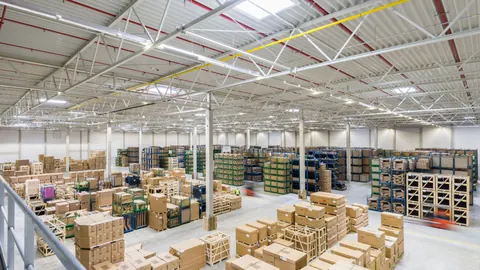
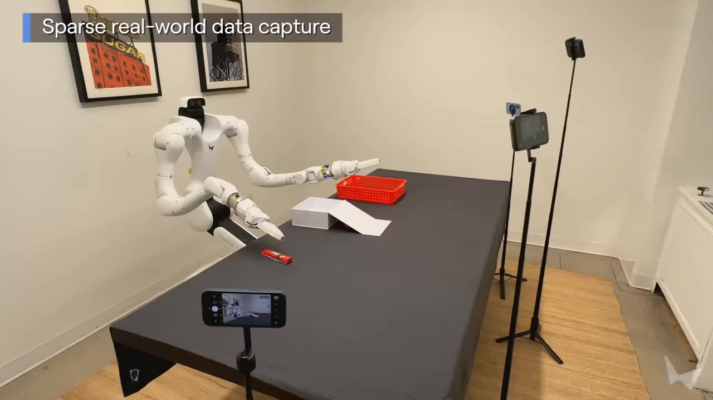

# Atlas：架构与创新点详解

> 本文内容整理自 World Labs 官方技术博客 [*Atlas: A World Model for Spatial Intelligence*](https://www.worldlabs.ai/blog/atlas)（2026-09-01 发布）。重点聚焦模型架构与创新点，内容仅围绕 Atlas 本身。截至本文撰写时 World Labs 尚未发布配套技术论文/模型权重，架构细节以官方博客披露为准。

---

## 目录

1. [模型概览](#1-模型概览)
2. [背景与定位](#2-背景与定位)
3. [核心架构：多模态自回归扩散 Transformer](#3-核心架构多模态自回归扩散-transformer)
4. [核心概念：空间上下文（Spatial Context）](#4-核心概念空间上下文spatial-context)
5. [四大能力](#5-四大能力)
6. [评测结果](#6-评测结果)
7. [模型缩放](#7-模型缩放)
8. [产品化与开放情况](#8-产品化与开放情况)
9. [已知局限](#9-已知局限)
10. [参考资料](#10-参考资料)

---

## 1. 模型概览

| 项目 | 内容 |
|---|---|
| 模型名称 | Atlas |
| 发布方 | [World Labs](https://www.worldlabs.ai/) |
| 发布时间 | 2026 年 9 月 1 日（官方博客） |
| 模型类型 | **全模态（Omni）世界模型**，面向空间智能（Spatial Intelligence） |
| 架构 | **多模态自回归扩散 Transformer**（multimodal autoregressive diffusion transformer） |
| 原生模态 | 文本、图像、**相机位姿**、**3D 深度图**（视频表示为图像序列） |
| 训练方式 | **从零预训练**（pretrained from scratch），大规模多模态语料 |
| 核心机制 | 所有输入统一进入**空间上下文（spatial context）**——每张图像锚定在 3D 空间位置上 |
| 四大能力 | 相机控制生成（1440p / 最长 1 分钟）、稀疏视角 3D 重建、时空模拟（Real-to-Sim）、图像/360 全景生成 |
| 开放情况 | **早期访问制**（early access，面向选定合作伙伴）；将驱动 Marble 后续版本 |
| 配套论文 | 暂无（博客声明"post produced by the World Labs team"，给出引用格式） |


*Atlas 官方博客主视觉（来源：[worldlabs.ai/blog/atlas](https://www.worldlabs.ai/blog/atlas)）*

官方摘要（原文引用）：

> "Today we are introducing Atlas, our next-generation world model. Atlas is an omni model that we pretrained from scratch to natively operate on text, images, video, and 3D. It is a **multimodal autoregressive diffusion transformer**: all inputs are combined into a **shared spatial context**. Atlas uses that context to generate what comes next, staying consistent in 3D with everything it has seen and imagining what lies beyond it. Atlas is built to scale: its performance improves with increased training compute, and we expect this trend to hold as we continue scaling."

---

## 2. 背景与定位

World Labs 是"空间智能"（Spatial Intelligence）方向的代表公司，此前的产品 Marble 已将"可交互的 3D 世界生成"推向消费级。Atlas 是其**下一代世界模型**，官方对世界模型的定义：

> "World models generate, reconstruct, and simulate any possible world. They understand how worlds appear, behave, and evolve — so that we can render imagined worlds for creative users, simulate the real world in high fidelity, and help robots plan actions."

Atlas 的定位是**通用（general purpose）世界模型**，一个模型覆盖三大类任务：

- **世界生成（Generation）**：从文本/图像生成新世界；
- **世界重建（Reconstruction）**：从稀疏真实观测重建真实世界；
- **世界模拟（Simulation）**：建模世界随时间的演化，服务机器人等下游应用。

---

## 3. 核心架构：多模态自回归扩散 Transformer

Atlas 的架构官方称之为 **multimodal autoregressive diffusion transformer**。博客明确表示这需要**同时跳出 LLM 与视频模型的标准架构**、为"未来世界模型的基础架构"重新设计：

> "These goals require us to **depart from standard architectures used by both LLMs and video models**, and design a new base architecture to serve as the foundation of future world models."

四个架构属性各自承担的职责（论文式拆解）：

### 3.1 Multimodal（多模态）

> "Atlas can natively process many different data types. At present it can operate on **text, images, camera poses, and 3D depth maps**; videos are represented as sequences of images. **Each image and depth map is conditioned on an explicit camera pose**, making spatial control a central component of the architecture."

关键点：**相机位姿是一等公民的输入类型**（native input type），每张图像/深度图都绑定显式相机位姿——空间控制被内建在架构层，而非靠文本提示词间接控制。

### 3.2 Autoregressive（自回归）

> "Atlas operates on sequences of elements, where each element is one of the multimodal data types above. Each output is generated one at a time, conditioned on earlier parts of the sequence. This flexible design naturally adapts to a wide variety of tasks: **each task is just a different kind of sequence, where inputs are followed by outputs**."

即：**任务 = 序列构造方式**。生成、重建、模拟等所有任务被统一成"输入元素 + 输出元素"的序列化形式，无需任务专属头或分支。

### 3.3 Diffusion（扩散）

> "Atlas is a **rectified flow** model that generates outputs by gradually denoising them. Diffusion models excel at modeling high-dimensional continuous data like images and video, and can naturally **trade off speed and quality by varying the number of denoising steps**."

扩散（整流流）负责高维连续数据（图像/视频/深度）的高保真生成，并可通过去噪步数灵活权衡速度与质量。

### 3.4 Transformer（Transformer）

> "The transformer architecture consists primarily of large matrix multiply operations and is well-adapted to modern hardware. It is a robust backbone for world modeling."

### 3.5 两条技术路线的红利兼收（创新点）

Atlas 是"现代 LLM 与现代视频模型"思想的结合体，**同时继承两类模型的工程红利**：

> "Like an LLM, it is an autoregressive transformer, so it can take advantage of innovations used to serve and accelerate LLMs including **KV-caching, cache-aware routing, disaggregated serving**, and more. Like a modern image or video model, it is a latent diffusion model and can make use of algorithms such as **diffusion distillation, classifier-free guidance, shifted noise schedules**, and advances in VAE design."

| 来源路线 | 继承的机制 |
|---|---|
| LLM 侧（自回归 Transformer） | KV-caching、cache-aware routing、disaggregated serving 等推理服务加速 |
| 视频/图像模型侧（latent diffusion） | 扩散蒸馏、classifier-free guidance、shifted noise schedules、VAE 设计进展 |

---

## 4. 核心概念：空间上下文（Spatial Context）

这是 Atlas 区别于 LLM 的**最核心创新**。官方类比：

> "Similar to an LLM, Atlas first encodes its inputs into a context, then generates outputs conditioned on the context. However, Atlas is unique because **each image is grounded at a 3D position in space; this forms a spatial context**."

- LLM 的上下文是一串 token 的语义上下文；Atlas 的上下文是**每个输入都被锚定在 3D 空间中的"空间上下文"**；
- 输出生成时必须与上下文中"已见过的一切"保持 3D 一致，并对"视野之外"进行合理想象（"staying consistent in 3D with everything it has seen and imagining what lies beyond it"）；
- **空间上下文管理（managing this spatial context）本身成为创作控制手段**：可以把两张互不相关的参考图放进上下文并摆到 3D 空间中的指定位置，Atlas 会生成一个在两者之间平滑过渡的世界——官方演示中模型自行"想象"出门口、走廊、壁龛等过渡空间（"it imagines doorways, hallways, nooks, and other transitions between otherwise unrelated image pairs"）；
- 长视频生成 = **相机运动 + 空间上下文管理**的组合：用户手工设计穿越场景的相机路径（"director's chair"——"you are staging the scene, not pulling the lever of a slot machine"），即可用少量参考图生成 **1 分钟 1440p** 连贯视频。


*相机控制生成：Atlas 从单张输入图+精确相机几何，生成任意角度的新视角（官方演示静帧，可交互版本见博客）。模型利用世界知识补全未见区域——例如生成机器人的背面、猜测泳池旁应有草坪。（来源：[博客 §Camera-Controlled Generation](https://www.worldlabs.ai/blog/atlas#camera-controlled-generation)）*

---

## 5. 四大能力

### 5.1 相机控制生成（Camera-Controlled Generation）

- 输入 **1–6 张参考图** + 手工设计的相机路径，逐帧生成新视角；
- **像素级相机控制（pixel-perfect camera control）**：使用精确相机几何作为原生输入，"going beyond coarse text-based instructions"——每个机位、每个运动都可控；
- 单张图即可生成完整场景：结合输入图内容与**广泛的世界知识**推断了未见视角（"it generates the back side of the robot, and it guesses that there should be a grassy lawn next to the pool"）；
- 输出上限：**最长 1 分钟、1440p 分辨率**；
- 覆盖宽泛的场景类型、视觉风格与相机运动。

### 5.2 空间重建（Spatial Reconstruction）

定位——用世界模型解决 3D 视觉的"老大难"问题：

> "We believe Atlas is a major step forward toward solving the problem of **novel view synthesis from sparse input images**, a decades-old fundamental problem in 3D computer vision."

核心机制与亮点：

- **可变输入视角数**：从 1 张到上百张（"Atlas can also make use of **over a hundred input images** in its spatial context"）；
- **"看得越多，想象越少"**："Passing more input images gives Atlas more context: **the more it sees, the less it imagines**"——2–3 张图通常就能给出忠实重建；
- 官方演示的"逐图累加"案例：单张地面照片 → 生成鸟瞰视角（花园部分准确、其余为想象）；加入第二张（小屋）→ 花园+小屋都准确、左侧房屋仍为想象；加入第三张（主屋）→ 整个场景准确呈现。第二个案例用 **2–25 张地面照片**重建斯坦福 Main Quad，并能生成高空航拍路径；
- **同场景多路径**：给定同一小组输入图，可生成任意多条相机轨迹（速度、长度、复杂度可变），"No matter how many times you change the camera path, the scene stays consistent"；
- **显式 3D 输出**：原生同时处理 2D 帧与 **3D 深度图**，因此能把世界输出为**点云**或 **3D Gaussian Splats**——单图输入时联合生成新视角+估计几何；真实视频输入时逐帧预测深度并融合成 3D 重建；无论哪种方式都会补全"没有任何相机拍到过的区域"（"Atlas fills in regions that no camera ever saw"）；
- 点云 → **3D Gaussian Splats**：点云只估计几何，Atlas 补全缺口后转为可在设备端高分辨率、高帧率渲染的完整 splat 场景——与 Marble 使用同一种表示，天然接入自家产品生态。


*显式 3D 输出：从单张输入图联合生成新视角与几何，转为 3D Gaussian Splats 场景（官方演示静帧）。（来源：[博客 §Explicit 3D Outputs](https://www.worldlabs.ai/blog/atlas#explicit-3d-outputs)）*



*点云 → 完整 splat 场景：Atlas 填补点云缺口并转为可设备端渲染的完整场景（官方演示静帧）。（来源：[博客 §Explicit 3D Outputs](https://www.worldlabs.ai/blog/atlas#explicit-3d-outputs)）*

### 5.3 时空模拟（Space-Time Simulation）

Atlas 作为**世界模拟器**："It understands both the spatial structure of the world and how the world evolves over time."

**（1）子弹时间视频重构图（Bullet-Time Reframing）**

> "Atlas turns a handful of ordinary cameras into a 'bullet time' multiview capture studio. With footage from **as few as three cameras**, Atlas can freeze time and reframe shots, letting you view events from impossible angles."

- 仅需 **3–5 个普通手机/运动相机**机位，即可冻结时间、从任意"不可能的角度"重构画面——无需专业摄影团队或专用采集设备（官方演示由工程师用"fits in a backpack"的三脚架+夹具拍摄）；
- 流程：先从 3–5 个视角重建场景，再自由重新取景（reframe）。

**（2）机器人 Real-to-Sim**

- **导航仿真**：手机视频取 **24 帧**即可重建大型环境（传统方式需要昂贵专业设备），然后模拟不同机器人在不同路径上导航，**由 Atlas 生成机体上相机视角的 RGB 与深度数据**——"The world and the robot's view of it come from the same model"（世界与机器人视角同源，天然一致）；
- **操作仿真（manipulation）**：从少量随手拍摄出发构建仿真，可复现**刚性、铰接（articulated）、可变形（deformable）物体**的物理交互；任务仿真化后可任意变换（物体、位置、机器人运动、光照、背景）——"The result is **diverse training data and testing environments for robotics at scale**"。



*Real-to-Sim：从少量真实录制重建环境并模拟机器人导航/操作，支持刚性、铰接与可变形物体的物理交互与可控变化（官方演示静帧）。（来源：[博客 §Robotics Simulation](https://www.worldlabs.ai/blog/atlas#robotics-simulation)）*

### 5.4 图像生成（Image Generation）

> "Though image generation is not its primary focus, Atlas is a capable image generator: it follows complex prompts, renders text, and generates a wide variety of visual styles. Atlas also generates **360 images** from text or image prompts."

图像生成不是主目标（"every image is a window to a possible world"），但作为统一模型的自带能力，支持复杂提示词、文字渲染、多风格，以及**文本/图像生成 360° 全景**。

---

## 6. 评测结果

官方强调 Atlas 是执行多任务的全模态模型，"no single benchmark that fully captures its generality"，因此只定量评测了两个关键任务。

### 6.1 相机控制生成（人评）

- 协议：单张输入图 + 1–3 段电影级相机运动（pan、truck、crane 等）组合成的目标相机路径；Atlas 用**原生相机输入格式**，其他模型（不支持相机原生输入）用标准电影术语的**文本描述**；第三方人类评分者判断谁更好地遵循相机路径；
- 结果（选择 Atlas 的投票占比，均大幅领先）：

| 对比基线 | Atlas 获偏好率 |
|---|---|
| MiniMax H3 | **75%** |
| Gemini Omni Flash | **81%** |
| Happy Horse 1.1 | **86%** |
| FLUX 3 | **93%** |
| Seedance 2.5 | **94%** |

> "These results confirm that **Atlas outperforms recent video models at camera-controlled generation**, and this advantage grows as camera trajectories become more complex."

### 6.2 稀疏视角 3D 重建

- 协议：输入一组图像+相机位姿，为每个输入像素预测对应 3D 点（pointmap）；指标为各数据集的 **mean absolute-relative pointmap error（AbsRel ×10⁻³，越低越好）**；所有基线结果均为官方**复现**以保证公平协议；
- 基线为 5 个近年专门的重建模型：Pi3X (posed)、π³、VGGT-Ω 1B、Depth Anything 3、MapAnything。

| Benchmark | **Atlas (Ours)** | Pi3X (posed) | π³ | VGGT-Ω 1B | Depth Anything 3 | MapAnything |
|---|---|---|---|---|---|---|
| **Average** | **25.3** | 28.7 | 34.7 | 36.4 | 39.3 | 47.7 |
| DTU | **8.6** | 11.1 | 16.2 | 9.7 | 11.9 | 18.2 |
| ETH3D | **9.3** | 18.7 | 25.4 | 11.4 | 23.8 | 34.8 |
| KITTI | **60.0** | 60.2 | 74.8 | 101.4 | 93.3 | 115.3 |
| NRGBD | **6.5** | 13.3 | 17.5 | 10.5 | 11.3 | 20.2 |
| 7-Scenes | **37.8** | 39.3 | 44.4 | 45.2 | 50.8 | 47.4 |
| T&T | 42.4 | 42.4 | 47.0 | **40.2** | 55.1 | 60.8 |
| ScanNet | **12.4** | 15.7 | 17.4 | 36.6 | 29.0 | 37.0 |

> "Despite its generality, **Atlas outperforms the best specialized open-source reconstruction models**."

要点：

- Atlas **在平均误差上以 25.3 领先全部 5 个专门重建模型**（最佳基线 Pi3X 为 28.7）；
- 7 个数据集中 6 个第一（DTU、ETH3D、KITTI、NRGBD、7-Scenes、ScanNet），仅 **T&T（Tanks and Temples）**上 VGGT-Ω 1B（40.2）略优于 Atlas（42.4，与 Pi3X 并列）；
- 值得强调的对比姿态：Atlas 是"顺带"做重建的全模态世界模型，却击败了只为重建训练的专门模型——凸显统一架构 + 空间上下文 + 世界知识的价值。

---

## 7. 模型缩放

> "Most progress in modern AI has been driven by scaling... We see strong evidence that Atlas will continue to improve with scale. We pretrained Atlas from scratch on a large diverse corpus of multimodal data. Over the course of development, we trained a **series of models of increasing size and training compute**, and found that **each new level of compute unlocked new model capabilities**."

- Atlas 从零预训练于大规模多样化多模态语料（未披露数据构成与规模）；
- 开发过程中训练了**一系列递增规模的模型**，每提高一档算力都解锁了新能力（类似 LLM 的涌现式叙事）；
- 官方明确押注缩放曲线将持续："We are confident that our future world models will follow this trend, dramatically improving their capabilities as we continue to scale."

---

## 8. 产品化与开放情况

- **早期访问（early access）**：Atlas 以邀请制向选定合作伙伴开放（官方提供 [early access 申请表单](https://form.typeform.com/to/zHFR4r3A)），定位"the go-to world model for generating, reconstructing, and simulating any world"；
- **Marble 集成**：Atlas 将驱动 Marble 的未来版本；其 splat 输出表示与 Marble 一致，可自然融入现有产品与渲染管线；
- **发布形式**：以官方博客发布（含完整引用格式 `@article{worldlabs2026atlas, ...}`），暂无论文、无开源权重、无 API 价格信息。

---

## 9. 已知局限

- **无技术论文**：架构只有博客级描述——未披露参数量、训练数据构成、推理成本、模型变体等细节；
- **模态范围带"at present"限定**：当前原生输入为文本、图像、相机位姿、3D 深度图（视频=图像序列），音频等模态未提及；
- **长视频生成依赖手工相机路径**：1 分钟 1440p 演示采用"hand-design a camera path"，可控性以人工设计成本换取；
- **重建与想象的边界**：输入稀疏时模型会"想象"未见区域（官方也坦承"sometimes you do not want imagination"），需要更多输入图压制幻觉；
- **早期访问制**：暂无公开可用渠道，第三方无法独立复现其基准结果。

---

## 10. 参考资料

- 官方博客：[*Atlas: A World Model for Spatial Intelligence*](https://www.worldlabs.ai/blog/atlas)（2026-09-01）
- 相关博客：[*Real-to-Sim-to-Real*](https://www.worldlabs.ai/blog/real-to-sim-to-real)（机器人 R2S2R 工作流）、[*The Next Frontier of AI Is Spatial Intelligence*](https://www.worldlabs.ai/)（Martin Casado 对谈 Fei-Fei Li 与 Yunzhu Li，涉及 SceniX 收购）
- 产品：[Marble](https://marble.worldlabs.ai/)（World Labs 的世界生成产品，Atlas 将驱动其后续版本）
- 引用格式：
  ```bibtex
  @article{worldlabs2026atlas,
    author = {World Labs Team},
    title = {Atlas: A World Model for Spatial Intelligence},
    journal = {World Labs Blog},
    year = {2026},
    note = {https://www.worldlabs.ai/blog/atlas},
  }
  ```

---

*本文档图片（`assets/` 下各文件）均取自 World Labs 官方博客演示（交互演示的静帧/缩略图），版权归 World Labs 所有。*
