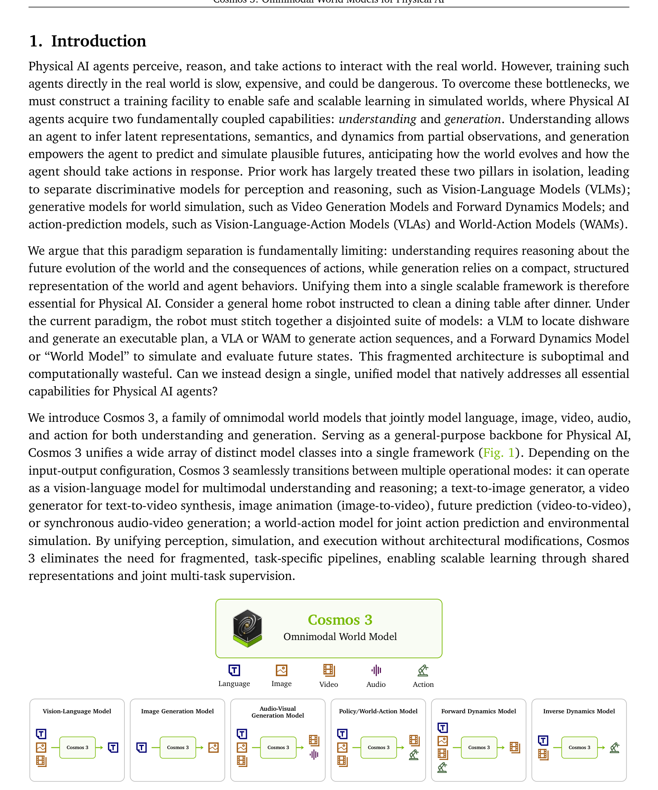
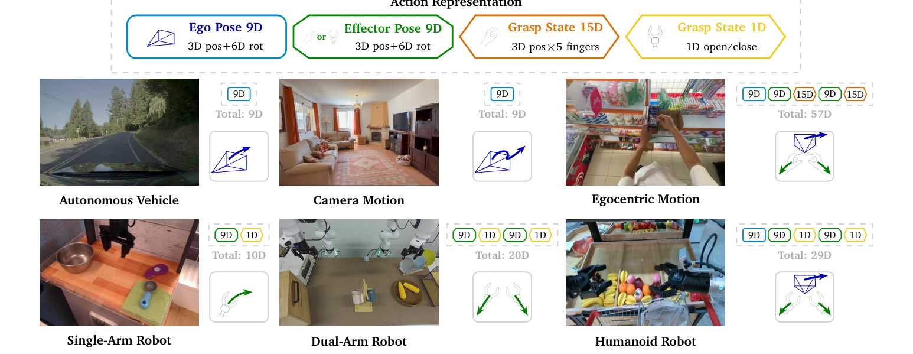
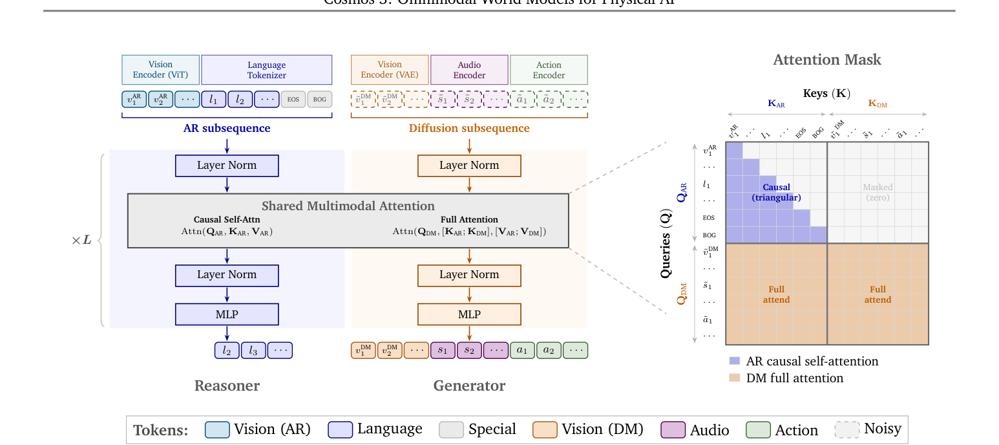
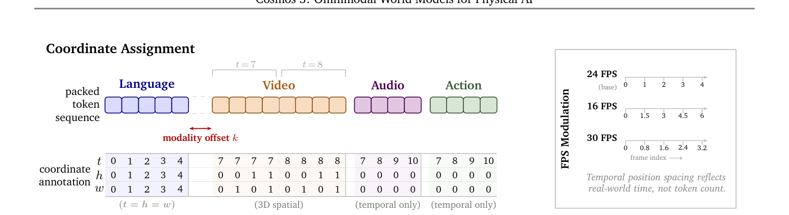

# Cosmos 3：架构与创新点详解

> 本文内容整理自 NVIDIA 官方技术论文 [*Cosmos 3: Omnimodal World Models for Physical AI*](https://arxiv.org/abs/2606.02800)（arXiv:2606.02800v4，2026-06-23）与 NVIDIA 官方发布博客 [*NVIDIA Launches Cosmos 3, the Open Frontier Foundation Model for Physical AI*](https://blogs.nvidia.cn/blog/nvidia-launches-cosmos-3-the-open-frontier-foundation-model-for-physical-ai/)（2026-06-01，GTC 台北）。重点聚焦模型架构与创新点，内容仅围绕 Cosmos 3 本身。

---

## 目录

1. [模型概览](#1-模型概览)
2. [背景与定位：面向 Physical AI 的全模态世界模型](#2-背景与定位面向-physical-ai-的全模态世界模型)
3. [模型家族与发布矩阵](#3-模型家族与发布矩阵)
4. [整体框架（Fig. 1）](#4-整体框架fig-1)
5. [架构核心](#5-架构核心)
6. [训练方法](#6-训练方法)
7. [数据方法论](#7-数据方法论)
8. [训练与服务基础设施](#8-训练与服务基础设施)
9. [评测结果](#9-评测结果)
10. [开放资源与 Cosmos Coalition](#10-开放资源与-cosmos-coalition)
11. [官方定位与已知局限](#11-官方定位与已知局限)
12. [参考资料](#12-参考资料)

---

## 1. 模型概览

| 项目 | 内容 |
|---|---|
| 模型名称 | Cosmos 3（论文全称：*Cosmos 3: Omnimodal World Models for Physical AI*） |
| 发布方 | NVIDIA（NVIDIA Cosmos Lab，296 位作者署名） |
| 发布时间 | 2026 年 6 月 1 日（GTC 台北）；论文 v4 更新于 2026-06-23 |
| 模型类型 | **全模态（Omnimodal）世界模型**：统一处理与生成语言、图像、视频、音频、动作五大模态 |
| 架构 | **Mixture-of-Transformers（MoT，混合 Transformer）**：推理 Transformer（Reasoner）+ 生成 Transformer（Generator）双塔 |
| 模型家族 | Cosmos3-Super（64B 总参数 / 32B 稠密骨干）、Cosmos3-Nano（16B / 8B）、Cosmos3-Edge（4B / 2B，待上线） |
| 生成机制 | 语言走 next-token prediction（自回归），其余模态走迭代去噪（rectified flow matching） |
| 开源协议 | Linux Foundation **OpenMDW-1.1** 许可证（代码、权重、数据集、评测基准全开放） |
| 关键链接 | [代码 github.com/nvidia/cosmos](https://github.com/nvidia/cosmos) · [权重集合 huggingface.co/collections/nvidia/cosmos3](https://huggingface.co/collections/nvidia/cosmos3) · [项目主页 research.nvidia.com/labs/cosmos-lab/cosmos3](https://research.nvidia.com/labs/cosmos-lab/cosmos3) |
| 榜单成绩（论文撰写时） | Artificial Analysis **文生图、图生视频开源权重双第一**；RoboArena **最佳策略模型** |

论文摘要（原文引用）：

> "We introduce Cosmos 3, a family of omnimodal world models designed to jointly process and generate language, image, video, audio, and action sequences within a unified mixture-of-transformers architecture. By supporting highly flexible input-output configurations, Cosmos 3 seamlessly unifies critical modalities for Physical AI—effectively subsuming vision-language models, video generators, world simulators, and world-action models into a single framework."

---

## 2. 背景与定位：面向 Physical AI 的全模态世界模型

Cosmos 3 要解决物理 AI 的核心难题（官方发布博客）：

> "Cosmos 3 解决了物理 AI 的一项核心难题：使机器人、智能汽车或视觉智能体能够在训练数据有限和仿真堆栈碎片化的情况下，在现实世界中进行泛化。"

其核心主张是**用单一架构取代"拼装式"系统**（结论章原文）：

> "Cosmos 3 unifies multimodal understanding and generation across language, image, video, audio, and action within a single architecture, **reducing the need to compose separate vision-language models, video generation models, world models, and action models**."

一篇模型即可承担三种角色（官方博客）：

1. 具备跨模态理解与推理的**视觉语言模型（VLM）**；
2. 模拟物理环境、预测未来世界状态的**世界模型 / 视频基础模型**；
3. 训练机器人执行任务的**世界动作模型（world action model）骨干**。

其中**动作（action）被视为与语言、视觉、音频并列的核心模态**——论文引言：

> "Beyond language, vision (image and video), and audio, Cosmos 3 treats action as a core modality, introducing a dedicated class of action tokens. These action tokens bridge the physical world with language-based reasoning and video-based world modeling, linking directly to physically grounded control signals for real-world interaction."

---

## 3. 模型家族与发布矩阵

论文 §2.5（Model Variants）的配置表（原表 Table 2）：

| Variant | LLM Layers | Hidden Dim | Attn Heads | KV Heads | Head Dim | FFN Dim |
|---|---|---|---|---|---|---|
| **Cosmos3-Edge** | 28 | 2,048 | 16 | 8 | 128 | 9,216 |
| **Cosmos3-Nano** | 36 | 4,096 | 32 | 8 | 128 | 12,288 |
| **Cosmos3-Super** | 64 | 5,120 | 64 | 8 | 128 | 25,600 |

规模与初始化来源（原文）：

> "Edge is a **4B-parameter model** built upon a dense **2B-parameter transformer**, Nano is a **16B-parameter model** built upon a dense **8B-parameter transformer**, and Super is a **64B-parameter model** built upon a dense **32B-parameter transformer**. All variants are initialized from pre-trained vision-language models."

- **Cosmos3-Super**：基于 Qwen3-VL 32B 架构（64 层），适合要求极高物理仿真精度与生成质量的后训练；
- **Cosmos3-Nano**：基于 Qwen3-VL 8B 架构（36 层），适合快速高质量视频生成与动作推理；
- **Cosmos3-Edge**：自研 2B 稠密 LLM（28 层，从零训练，去掉 QK 归一化、用 ReLU² FFN），面向实时边缘推理，发布时"即将上线"（论文附录 D 说明其两阶段课程训练）。

**后训练专用模型**（已发布）：
- `Cosmos3-Super-Text2Image`（文生图）
- `Cosmos3-Super-Image2Video`（图生视频）
- `Cosmos3-Nano-Policy-DROID`（机器人策略，DROID 数据集）

所有变体共享同一 MoT 双塔架构：每层携带独立的 Reasoner 与 Generator 两套参数。

---

## 4. 整体框架（Fig. 1）

*图 1（论文 Fig. 1）：Cosmos 3 作为物理 AI 的通用骨干。通过联合建模语言、图像、视频、音频与动作，单一模型统一了视觉语言模型、视频生成、世界模拟与世界动作模型的能力，支撑感知、推理、仿真与动作生成。（来源：[论文 §1](https://arxiv.org/abs/2606.02800)）*

处理流水线（论文 §2 开头）：

> "Cosmos 3 integrates modality-specific encoders to project different modalities into a unified representation space, which is then processed by a Mixture-of-Transformers (MoT) backbone. During inference, language tokens are generated via next-token prediction, while other modalities are generated through iterative denoising."

---

## 5. 架构核心

### 5.1 模态编码器（§2.1）

所有非语言模态在进入 MoT 骨干前，都会加上一个**可学习的模态专属 embedding**，使共享的 Transformer 参数与位置嵌入能够区分模态。

**图像与视频（双编码器，各司其职）：**
- **理解**：ViT 编码器（预训练视觉-语言对齐），patch 16×16，后接两层 MLP 合并 2×2 token；沿用 Qwen3-VL 的 DeepStack 视觉特征聚合，并在视频帧间穿插基于文本的时间戳；
- **生成**：采用 **Wan2.2-TI2V-5B 的视频 VAE 编码器**（时间压缩 4×，空间压缩 32×32，由 16×16 空间压缩 + 2×2 patch 合并实现），生成 VAE **冻结**，线性层将 latent 投影到 Transformer 隐维度。

**音频（§2.1.2）：** 采用 Lee et al. (2025b) 的音频 VAE 架构；48 kHz 立体声，hop size 1920 → **每秒 25 个音频 token**；冻结。

**动作（§2.1.3）：** 支持多种具身域（自动驾驶、相机运动、机器人、以自我为中心的人体运动），全部映射进**统一动作接口**：

- **统一动作表示（Fig. 3）**：动作是"引起世界状态变化的因果变量"——给定连续视频 token，动作 token $a_t$ 表示从前一状态 $v_{t-1}$ 到当前状态 $v_t$ 的转移。由三类共享几何组件构成：

| 组件 | 维度 | 含义 |
|---|---|---|
| Ego Pose（本体位姿） | 9D | 3D 位置 + 6D 旋转（Zhou et al. 的过参数化旋转表示） |
| Effector Pose（效应器位姿） | 9D | 3D 位置 + 6D 旋转 |
| Grasp State（抓取状态） | 1D~15D | 手部指尖位置或夹爪开合值 |

  相机/自动驾驶只有 ego pose；以自我为中心的数据用头显位姿差作 ego、腕部位姿差作 effector、指尖位置作 grasp；机器人用头相机位姿差 + 末端法兰位姿差 + 连续夹爪开合值。为避开 PID 参数等控制器细节，ego/effector 位姿用**相对变换伪动作** $\Delta T_t = T_{t-1}^{-1} T_t$；6D 旋转经 **SVD 转回 SO(3)**。
- **动作 token 化**：每个具身域使用**独立的领域感知输入/输出投影**（$z = W^{(k)}_{in} x + b^{(k)}_{in}$，$x = W^{(k)}_{out} z + b^{(k)}_{out}$），共享 MoT 骨干——在保留具身结构语义的同时统一进共享潜在动作空间。

*图 3（论文 Fig. 3）：统一动作表示。异构具身控制被映射为由共享几何组件（ego 位姿、effector 位姿、抓取状态）构成的紧凑动作向量；领域感知的输入/输出投影处理不同长度的动作向量，同时保留共享语义空间。（来源：[论文 §2.1.3](https://arxiv.org/abs/2606.02800)）*

### 5.2 Token 排列与生成模式（§2.2）——关键创新之一

输入 token 序列由**两个子序列**组成，这是理解 Cosmos 3 统一能力的钥匙：

> "The input token sequence consists of two subsequences: an **autoregressive (AR) subsequence** followed by a **diffusion (DM) subsequence**."

- **AR 子序列**：负责推理与理解，含语言 token 与 ViT 编码的图像/视频 token；**全部路由到 Reasoner 专用参数**；
- **DM 子序列**：跟在 AR 之后，含 VAE 编码的视频/图像 token，以及音频、动作 token；**路由到 Generator 专用参数**，但在每层通过联合注意力与 AR token 交互。

**统一排列规则**（适用于所有任务）：
1. AR token 放在 DM token 之前；
2. DM 子序列内，各模态的**干净条件 token 放在带噪 target token 之前**；
3. 条件与扩散子序列内部均按 **视觉 → 音频 → 动作** 排序。

**支持的生成模式**（§2.2.2）：语言（纯 VLM）、文生图、文生（视频+音频）、图生（视频+音频）、视频生（视频+音频）、动作条件视频（前向动力学）、视频→动作（逆动力学）、策略（联合动作+视频）、视频迁移（edge/blur/depth/segmentation/驾驶场景图控制）。

### 5.3 Mixture-of-Transformers（MoT）双塔架构（§2.3）——核心创新

*图 5（论文 Fig. 5）：Cosmos 3 的 Mixture-of-Transformers（MoT）架构。左：单条统一 token 序列包含自回归子序列（AR，离散语言 token 与可选的 ViT 视觉 token）与扩散子序列（DM，VAE 编码的连续 token）；中：每个 Transformer 解码层内有两套独立参数（Reasoner 塔 + Generator 塔），二者由预训练 VLM 权重共同初始化，仅在共享的多模态注意力处汇合；右：注意力掩码——AR 因果自注意力、DM 全双向注意力。（来源：[论文 §2.3](https://arxiv.org/abs/2606.02800)）*

**双塔层结构（§2.3.1）：**

> "Instead of processing all token types with the same parameters, the MoT design uses two pathways. Each pathway is a standard transformer layer with its own parameters, including layer normalization modules, attention projection matrices, and feed-forward networks. **The two pathways are both initialized from the weights of a pre-trained Vision-Language Model (VLM)**, allowing Cosmos 3 to inherit strong language and visual reasoning capabilities while learning to generate high-fidelity videos."

即：每个解码层内存在**Reasoner 塔（AR token）与 Generator 塔（DM token）两套独立参数**，双塔共享同一 Transformer block 骨架，初始权重均来自预训练 VLM——这既保留了语言/视觉推理能力，又为生成学习提供起点。

**双流联合注意力（§2.3.2）：**

- **AR 子序列注意力（因果）**：
$$O_{AR} = \operatorname{Attn}_{\text{causal}}\left(Q_{AR}, K_{AR}, V_{AR}\right)$$
  AR token 只能关注 AR 子序列内的前置 token，与 VLM 骨干的自回归性质完全一致，保留文本生成能力；
- **DM 子序列注意力（全双向）**：
$$O_{DM} = \operatorname{Attn}_{\text{full}}\left(Q_{DM}, [K_{AR}; K_{DM}], [V_{AR}; V_{DM}]\right)$$
  DM token 以 AR+DM 全部 token 为键值做双向注意力，可自由关注文本提示与所有条件/扩散 token，保持时间与空间一致性；**AR token 永不被 DM token 更新**，保证条件路径的因果完整性。

**训练阶段的权重传承**（§4 开头）——Reasoner 训练完成后，其权重直接用于初始化 Generator：

> "Because the Reasoner and Generator share the same transformer block architecture, the trained Reasoner weights are then used to initialize the Generator, transferring semantic and world knowledge into a model capable of synthesizing pixels, audio, and actions."

### 5.4 多模态位置编码：3D MRoPE + 绝对时间调制（§2.4）——关键创新之二

语言、视频、音频、动作以不同帧率/采样率同时生成时，token 必须对齐到**同一条绝对物理时间轴**。Cosmos 3 在 Qwen3-VL 的 3D 多模态 RoPE（MRoPE，$(t, h, w)$ 三维）基础上扩展：

**位置索引分配（§2.4.1）：**
- 语言 token：$t = h = w$（退化为 1D RoPE）；ViT 视觉 token：同帧共享 $t$，$h/w$ 随空间位置变化（与 Qwen3-VL 一致）；
- DM 扩散 token：视频 token 三轴均变（$t$ 随潜在帧索引推进，$h/w$ 平铺空间网格），图像视为单帧视频；音频与动作 token 仅携带时间坐标（$h = w = 0$）；每个视觉段内 $t/h/w$ 从零重置，作为**视频内绝对坐标**而非全局序列位置；
- **模态偏移 $k$**：分离文本与视觉的时间范围；
- **AR-DM 间隔（margin）**：实践发现扩散 token 直接接在最后一个 AR token 的时移处会导致首帧过饱和与棋盘伪影（Super 上尤甚），因此固定插入 **15000** 的时间间隔缓冲，为"文本→视觉"提供更清晰的过渡信号（受 Cao et al. (2025) 启发），无需架构改动或额外可学习嵌入。

**绝对时间调制 / FPS 调制（§2.4.2）：**

> "A single unit step along the temporal dimension may correspond to different physical time intervals across modalities or data sources."

定义**每秒时间步（TPS）**描述物理时间分辨率：视频 token 的 TPS = 帧率 ÷ 时间压缩因子（4）；音频 TPS = 48000/1920 ≈ 25；动作 TPS = 动作数据采样率。随后按各 token 的 TPS 相对基准值缩放时间增量——**时间位置间距反映真实世界时间，而非 token 数量**（24 FPS 为基准）。

*图 6（论文 Fig. 6）：3D MRoPE 下的坐标分配示意。左：含语言、视频（两帧、每帧 2×2 空间网格）、音频与动作的打包序列，每个 token 获得 $(t,h,w)$ 三元组——语言用 $t=h=w$，视频三轴都变，音频/动作仅时间坐标，模态偏移 $k$ 分隔文本与视觉时间范围。右：FPS 调制把帧索引映射为按物理时间缩放的位置，使 16/24/30 FPS 下相等的真实时长占据相等的位置区间。（来源：[论文 §2.4](https://arxiv.org/abs/2606.02800)）*

---

## 6. 训练方法（§4）

Cosmos 3 的训练分**两大阶段**：Reasoner 训练 → Generator 训练（渐进式多阶段课程）。

### 6.1 Reasoner 训练（§4.1）

- **预训练**：大规模图文、视频-文语料上的 next-token prediction；两轮训练，无放回采样；序列上限 16k token（单样本图像 ≤2048、视频 ≤8192 token）；**平方根归一化的逐 token 损失加权**平衡长短序列（作者称显著提升下游分数与训练稳定性）；AdamW，峰值 lr 5×10⁻⁵；与以往"冻结 VLM 只训投影层"的分阶段对齐不同，**从预训练一开始就全参数联合训练**；
- **SFT**：在精选的 Physical AI 混合语料（机器人、自动驾驶、智慧基础设施等）上微调，保留通用能力的同时做领域专精。

### 6.2 Generator 训练（§4.2）

**训练目标——跨模态整流流匹配（rectified flow matching）：**

> "The Cosmos 3 generator is optimized under a rectified flow matching objective across all modalities."

对任意模态的 target latent：$x_\sigma = \sigma \cdot \epsilon + (1-\sigma) \cdot x_0$，单一去噪器 $v_\theta(x_\sigma, \sigma, c)$ 用掩码 MSE 预测恒定速度 $v^* = \epsilon - x_0$（条件 token 从损失中门控掉）。创新点：
- **逐模态时间采样**：各模态（图像/视频/音频/动作）独立采样噪声水平 σ——图像、音频、动作用 logit-normal 分布，视频用 mode sampling（作者发现质量更好）；
- **整流流 shift 重参数化**：$\sigma = s \cdot \bar{t} / (1 + (s-1)\bar{t})$，$s \geq 1$ 把边缘分布偏向高噪声。

**预训练（§4.2.1）：多分辨率 + token 打包**
- 同时训练 **256p / 480p / 720p 三档分辨率、5 种宽高比、可变帧数**（256p 与 480p 最多 400 帧、720p 最多 300 帧），720p 流只取原生 ≥720p 素材；
- 批构成比例 **1:1:2:1**（纯图像 : 视频-256p : 视频-480p : 视频-720p）；
- 分辨率自适应 shift：$s=1$（256p）、$s=3$（480p）、$s=5$（720p）；
- **固定 74,000 token 预算的序列打包**，不同分辨率序列拼满每批，最大化 GPU 利用率（无 padding）。

**中期训练（Mid-Training，§4.2.2）——引入动作的关键阶段**

> "Mid-training bridges the gap between broad pre-training and downstream deployment."

两大目标：**领域专精**（图片 15.6M 样本池 + 视频 74.7M 精选片段，覆盖机器人、自动驾驶、人体活动、物理、仿真）与**多模态整合**（从图像/视频/音频生成扩展到动作与控制信号建模，新增动作与视频迁移两类监督）。

中期训练数据配比（论文 Table 6）：

| 训练流 | 模式 / 条件 | 占比 |
|---|---|---|
| Image | T2I | 10% |
| Video | T2V, I2V, V2V | 32% |
| Video + Audio | T2(V+Audio), I2(V+Audio), V2(V+Audio) | 8% |
| **Action** | 前向动力学、逆动力学、策略 | **25%** |
| General Transfer | edge、blur、depth、segmentation 控制 | 20% |
| Driving Transfer | 世界场景图控制 | 5% |

动作监督教会 Generator **双向的世界-动作因果接口**：

> "The model is trained not only to predict future video conditioned on actions, but also to infer actions from observed trajectories and to jointly generate actions and visual futures. This teaches the Generator a causal interface between controllable interventions and world evolution."

**后训练（§4.2.3–4.2.5）：**
- **T2I 后训练**：`Cosmos3-Super-Text2Image`，UniGenBench 全榜最佳（91.36）；
- **I2V 后训练**：`Cosmos3-Super-Image2Video`，10k 迭代、lr 1×10⁻⁵、约 50B token；
- **机器人策略后训练**（试点）：`Cosmos3-Nano-Policy-DROID`——从中期训练后的 Nano 恢复训练，新初始化动作编码器/解码 MLP/动作 embedding token，动作相关参数用 **5× 学习率倍率**加速适配；输入 = 当前本体感觉状态 + 三视角视觉（腕部 360×640 置于两个外部 180×320 视图之上，拼成 540×640 画布），预测未来 32 步绝对动作。

---

## 7. 数据方法论（§3）

### 7.1 Reasoner 数据（§3.1）

- 预训练：**19.7M 样本**（源自 Nemotron Nano 2 数据集的子集）+ **2.3M** 额外精选（增强数学、视频、空间 grounding、指令跟随）；
- 两阶段清洗管线：**语义去重**（对话级联合嵌入——图像/文本用 Qwen3-VL-Embedding-8B、视频用 PE-Core-G14-448 编码；K-means 聚类 + 簇内余弦相似度 >0.95 删除）+ **AI-judge 质量过滤**（Gemma-4-31B-it 作为"训练数据审计员"，从 Faithfulness/Completeness/Correctness 三个维度打 1–5 分，还产出证据式理由支持抽查）。

### 7.2 Generator 数据（§3.2）

- 图像与视频：从 **78 亿原始图像 + 30 亿原始视频**中处理得到 **7.67 亿图像 + 3.477 亿视频片段**；720p/480p 为主流分辨率，16:9 占 52.0%（图像）/97.3%（视频）；五步管线：采集预处理（TransNetV2 场景切分、cropdetect 去黑边、统一重编码）→ 嵌入去重（Qwen3-VL-Embedding-8B / Cosmos-Embed1，cuML KMeans 2 万簇）→ 语义分类与基础过滤（内部 VLM，47 个层次化类别）→ 标注 → 按分辨率/时长分片；
- 音频：预训练语料 1.389 亿条带可用音轨的片段；62.5M 条 <30s 的用 **Qwen3-Omni-Captioner** 生成合成音频描述；中期训练用显式选择策略构造更高精度的音画配对（区分叙事旁白/背景音乐与真实物理声）；
- 动作：**840 万 episode / 61.3K 小时**，覆盖四大物理 AI 支柱——以自我为中心运动 67.4%、自动驾驶 16.3%、机器人 8.7%、相机运动 7.5%；
- **合成数据（SDG-*）**：SDG-PhyxSim（物理交互场景）、SDG-RobotSim（具身机器人）、SDG-DriveSim（自动驾驶长尾场景）、SDG-SynHuman（数字人）、SDG-Warehouse（仓库作业），用于提升物理 AI 场景下的生成质量。

### 7.3 标注体系（附录 A）

自研 captioner 而非现成 VLM，保证输出结构可控、避免幻觉字段；注释组织为**带预定义语义字段的 JSON 对象**（图像：主体、布局、光照、美学、风格、空间构成；视频扩展时间信息：动作、状态变化、转场、相机运动、音频线索）。图像用**象限扫描标注**（四象限+中心分别描述）；视频有**专门的第二遍时序动态标注**。

---

## 8. 训练与服务基础设施（§5）

- **分布式训练**：HSDP（混合分片数据并行，组内分片参数/梯度/优化器状态）+ **Context Parallelism（Ulysses 方案）**——按 token 维切分序列，每注意力层两次 all-to-all 在序列轴与注意力头轴间切换；与序列打包、双流注意力天然兼容；最大 CP 度受 query head 数限制（Nano 32、Super 64）；
- **吞吐实测（GB200）**：Nano 用 1024 卡（507 iters/h，每卡每小时 4.56M 图像 token + 16.23M 视频 token）；Super 用 2048 卡（185 iters/h，每卡 1.66M 图像 + 5.91M 视频 token，520→673 TFLOPS，MFU 0.23→0.30）；
- **服务**：Reasoner 由 TensorRT-LLM 与 vLLM 支持（分页 KV cache、连续批处理）；Generator 由 **vLLM-Omni** 支持；另有纯 PyTorch 参考实现与 NIM 部署；
- 其余：联合数据加载器（look-ahead packing）、两路扁平注意力（单次变长 SDPA 调用）、选择性激活检查点、Wan2.2 tokenizer 的 Sharded AOT 编译、检查点管理。

---

## 9. 评测结果（§6）

论文在 50 余项基准上评估，覆盖理解、推理、图像/视频/音视频生成、迁移生成、前向/逆动力学与机器人策略：

**Reasoner（理解与推理，Table 10 节选）：**
| 基准 | Cosmos3-Super | Qwen3-VL 32B | Cosmos3-Nano | Qwen3-VL 8B | Cosmos3-Edge |
|---|---|---|---|---|---|
| RealWorldQA | 79.2 | 80.3 | 72.2 | 73.3 | 72.0 |
| CVBench | 88.0 | 86.8 | 86.5 | 84.9 | 87.8 |
| VideoPhy2 | **47.4** | 36.8 | **45.6** | 40.3 | 20.8 |
| MVPBench | **70.3** | 58.6 | **66.9** | 53.3 | 43.3 |
| CountBenchQA | 89.1 | 93.6 | 84.8 | 89.9 | 84.6 |

**生成（视频）：**
- **Cosmos-HUE**：T2V 89.3（最佳开源，仅次于闭源 Veo-3.1 91.3 与 Seedance-1.5-Pro 90.0）；I2V 89.6（与 Veo-3.1 89.7 仅差 0.1）；HWB 71.9，领先最强非 Cosmos 开源基线 Wan2.2-A14B（60.7）**11.2 分**，Nano 也以 66.9 位列开源第二——两者占据 HWB 开源前两名；
- **Artificial Analysis**（2026-05-28）：`Cosmos3-Super-Text2Image` 文生图榜**开源第一（含闭源总榜第 4）**；`Cosmos3-Super-Image2Video` 图生视频榜**开源第一**；`Cosmos3-Super-Text2Image` 在 UniGenBench 全榜最佳（91.36）；
- **策略**：`Cosmos3-Nano-Policy-DROID` 在 **RoboArena 与 MolmoSpaces 均位列第一**，并有真实机器人（Franka Panda）闭环评测。

---

## 10. 开放资源与 Cosmos Coalition

- **开源内容**（OpenMDW-1.1）：代码（cosmos / cosmos-framework）、开放权重（Super、Nano、T2I、I2V、Policy-DROID）、五个合成数据集（SDG-PhyxSim / RobotSim / DriveSim / SynHuman / Warehouse）、评测基准 **Cosmos-HUE**（Cosmos-HumanEval-v1）；
- **NVIDIA Cosmos Coalition**：NVIDIA 联合 Agile Robots、Black Forest Labs、Generalist、LTX、Runway、Skild AI 等成立的世界模型协作组织，成员可贡献模型/研究/评测，并使用 Cosmos 3 技术、训练工具与 DGX Cloud 基础设施规模化训练；
- **生态落地**：机器人领域（Agile Robots、斗山、LG、三星、Skild AI）、智能汽车（理想汽车）、视觉 AI 智能体（Centific、Fogsphere、Linker Vision、Milestone Systems、Yuan）；推理/云伙伴（Baseten、CoreWeave、Azure、Nebius、Deep Infra 等）。

---

## 11. 官方定位与已知局限

- **定位**：Cosmos 3 是"合成世界与现实世界之间的桥梁"，提供更好的合成数据、更好的专用模型起点、更好的物理 AI 闭环训练环境（结论章）；
- **"Edge"尚未正式发布**（发布时"即将上线"）；
- **机器人策略仅为试点研究**（论文明确写 pilot study，仅 DROID 单一平台、Franka Panda 单机械臂）；
- 论文强调结果均以"技术报告撰写时"为准（"at the time the technical report was written"）；
- 这是一份 139 页的技术报告（arXiv v4），架构细节完整但部分能力（如多视角动作格式、Synergy 跨域迁移研究）仍在持续探索。

---

## 12. 参考资料

- 论文：[*Cosmos 3: Omnimodal World Models for Physical AI*](https://arxiv.org/abs/2606.02800)（arXiv:2606.02800）
- 官方发布博客（中文）：[NVIDIA 正式推出 Cosmos 3：面向物理 AI 的开放前沿基础模型](https://blogs.nvidia.cn/blog/nvidia-launches-cosmos-3-the-open-frontier-foundation-model-for-physical-ai/)
- 英文发布博客：[NVIDIA Launches Cosmos 3, the Open Frontier Foundation Model for Physical AI](https://blogs.nvidia.com/blog/nvidia-launches-cosmos-3-the-open-frontier-foundation-model-for-physical-ai/)
- 代码仓库：https://github.com/nvidia/cosmos · https://github.com/nvidia/cosmos-framework
- 权重集合：https://huggingface.co/collections/nvidia/cosmos3（Cosmos3-Super、Cosmos3-Nano、Cosmos3-Super-Text2Image、Cosmos3-Super-Image2Video、Cosmos3-Nano-Policy-DROID）
- 项目主页：https://research.nvidia.com/labs/cosmos-lab/cosmos3
- 相关发布报道：[HPCwire](https://www.hpcwire.com/aiwire/2026/06/01/nvidia-launches-cosmos-3-the-open-frontier-foundation-model-for-physical-ai/) · [Engineering.com](https://www.engineering.com/nvidia-launches-cosmos-3-for-physical-ai-models/)

---

*本文档图片（`assets/fig1-overview.png`、`assets/fig3-action-rep.png`、`assets/fig5-mot-arch.png`、`assets/fig6-position-embed.png`）均直接摘录自论文 [arXiv:2606.02800](https://arxiv.org/abs/2606.02800)（© 2026 NVIDIA），版权归 NVIDIA 所有。*
