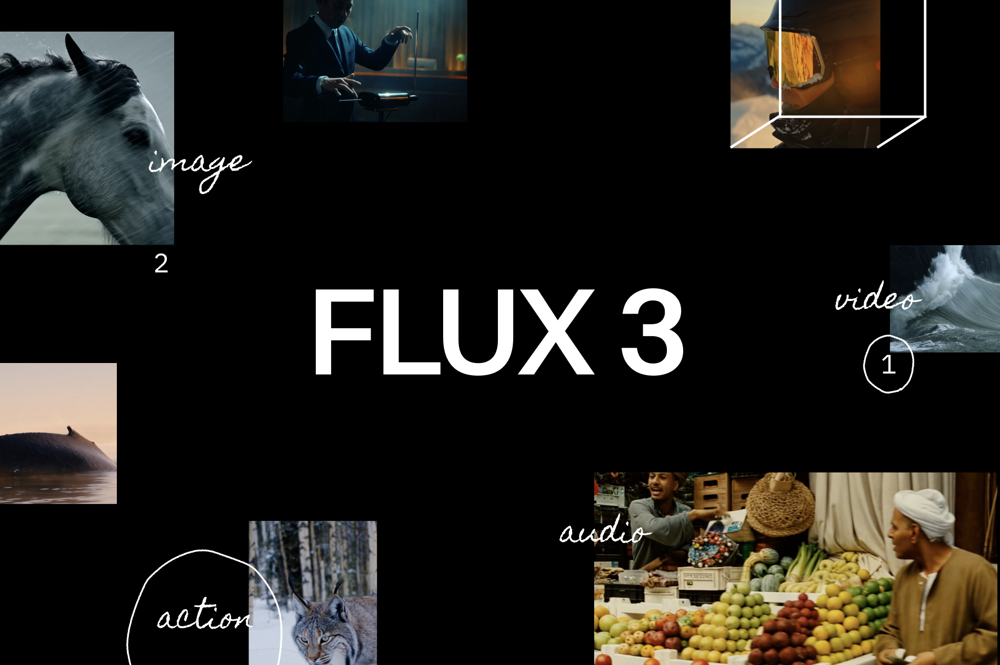
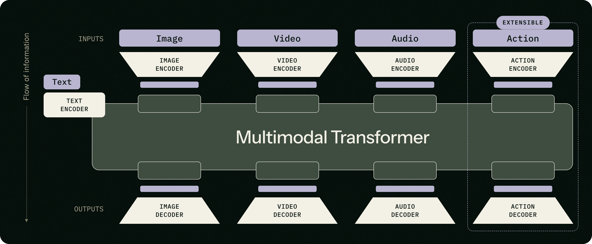
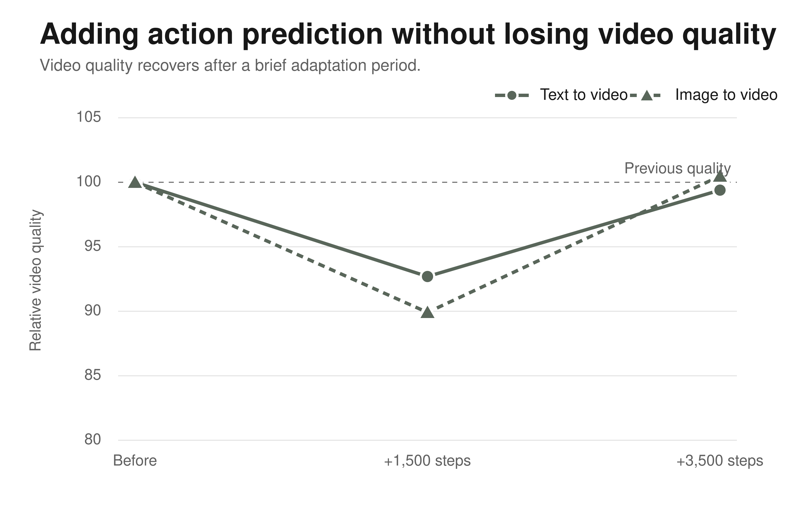
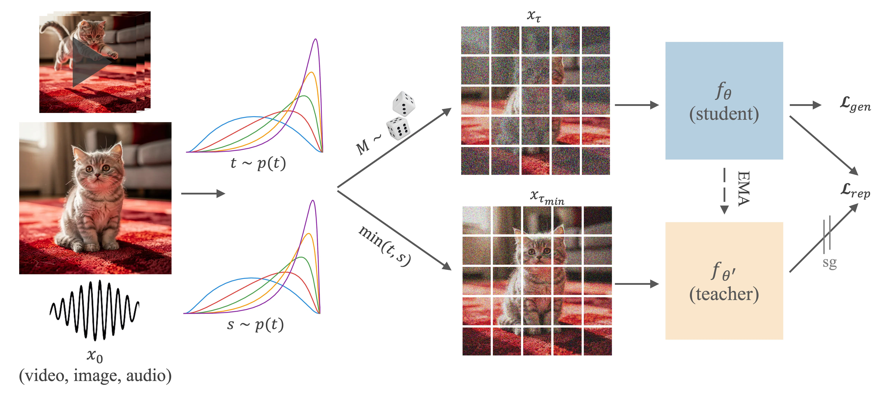
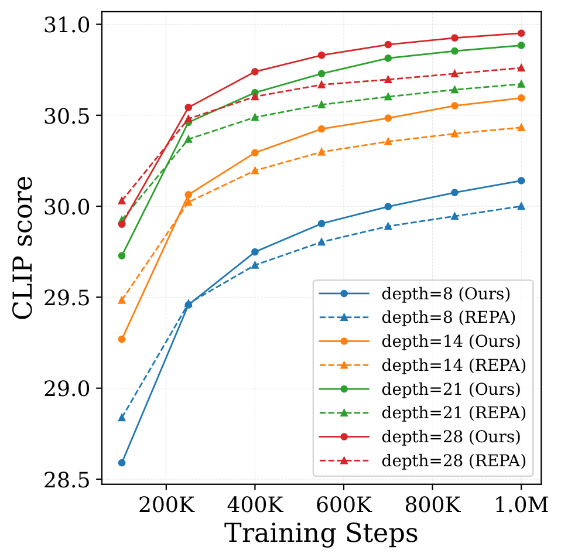
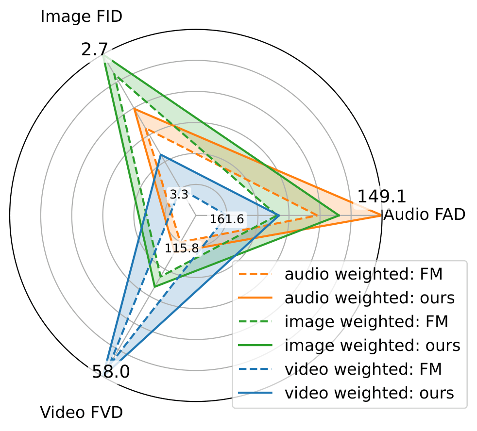
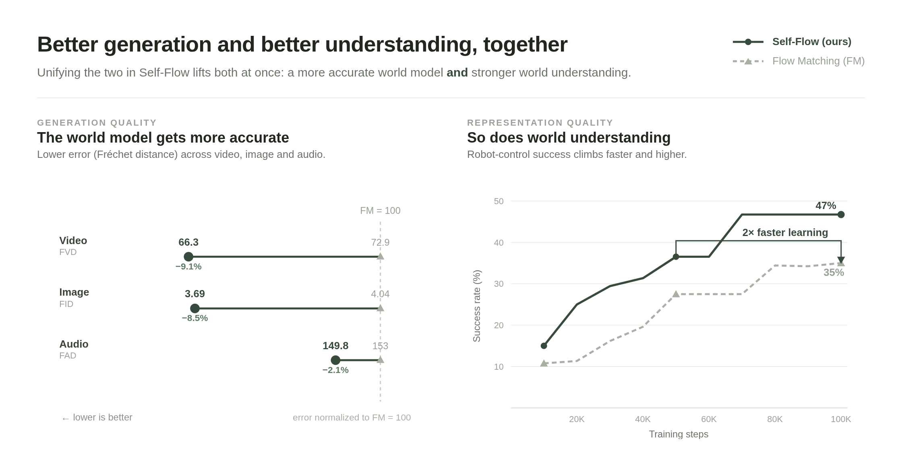
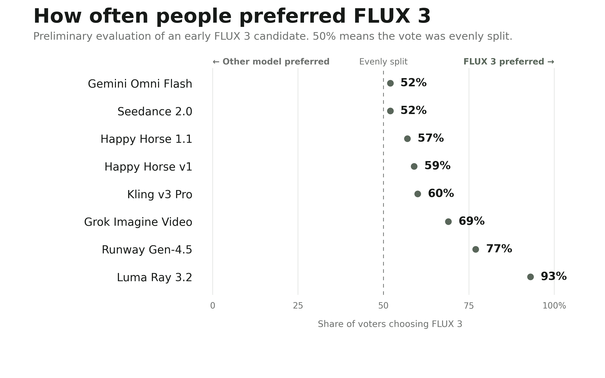
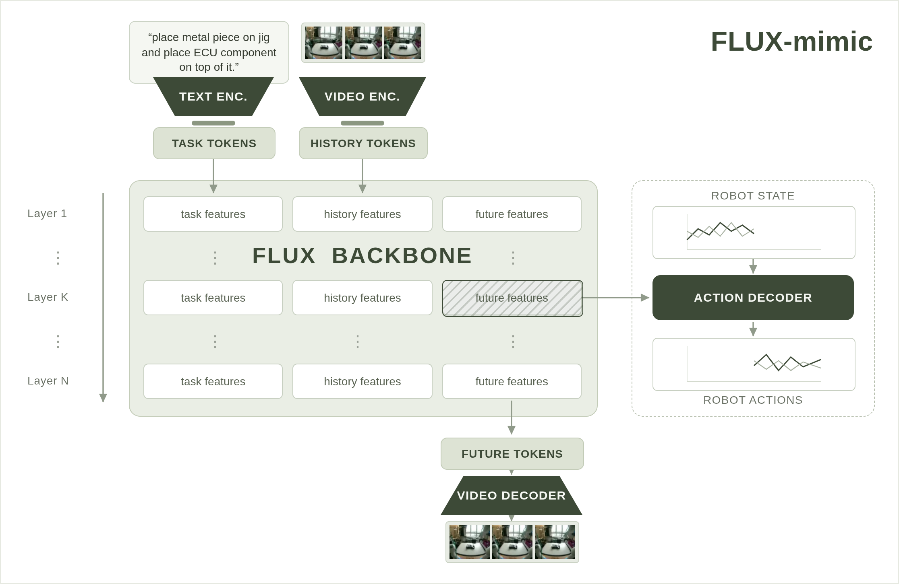
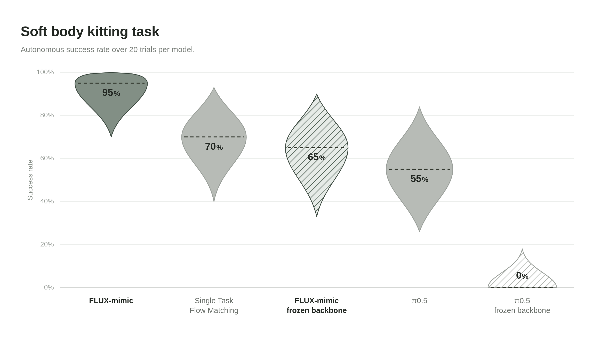

# FLUX 3：架构与创新点详解

> 本文内容整理自 Black Forest Labs 官方博客 [*FLUX 3 — Real World Models: Towards Multimodal Flow Models as the Backbone of Visual Intelligence*](https://bfl.ai/blog/flux-3)（2026-07-23）、官方研究页 [*Self-Supervised Flow Matching for Scalable Multi-Modal Synthesis*](https://bfl.ai/research/self-flow) 与官方博客 [*FLUX 3 × mimic: The Next Generation of Video-Action Models*](https://bfl.ai/blog/flux-3-mimic)。重点聚焦模型架构与创新点，内容仅围绕 FLUX 3 本身。截至撰写时官方未发布技术论文与参数量，细节以官方博客披露为准。

---

## 目录

1. [模型概览](#1-模型概览)
2. [背景与定位：从图像生成器到"真实世界模型"](#2-背景与定位从图像生成器到真实世界模型)
3. [核心架构：统一多模态流匹配](#3-核心架构统一多模态流匹配)
4. [Self-Flow：自监督流匹配（核心创新）](#4-self-flow自监督流匹配核心创新)
5. [多模态能力与评测](#5-多模态能力与评测)
6. [动作预测与 Physical AI：FLUX-mimic](#6-动作预测与-physical-aiflux-mimic)
7. [发布计划与开放情况](#7-发布计划与开放情况)
8. [已知局限](#8-已知局限)
9. [参考资料](#9-参考资料)

---

## 1. 模型概览

| 项目 | 内容 |
|---|---|
| 模型名称 | FLUX 3 |
| 发布方 | [Black Forest Labs](https://bfl.ai/)（BFL，FLUX 系列与 Stable Diffusion 原班缔造者） |
| 发布时间 | 2026 年 7 月 23 日（Early Access） |
| 模型类型 | **多模态流匹配基础模型**（Multimodal Flow Matching Foundation Model，Diffusion Transformer） |
| 联合训练模态 | **图像 + 视频 + 音频**（同一统一架构），扩展至**动作预测** |
| 核心训练框架 | **Self-Flow**（自监督流匹配，BFL + MIT，Chefer & Esser 共同一作） |
| 训练数据 | 数千万小时通用视频 + 数十万小时人/机器人操作视频 + 图像与音频（**视频占 >95% 训练算力**） |
| 视频能力 | 单次生成最长 **20 秒**、**原生同步音频**；官方评测用 10 秒 720p |
| 参数量 | 未披露（Self-Flow 验证实验用 4B FLUX.2 backbone） |
| 产品线 | FLUX 3 Video（EA 已开）→ FLUX 3 Image（数周内）→ FLUX-mimic（机器人，已部署 Audi）→ FLUX 3 Dev（开源权重，后续） |
| 许可证 | 未公布（前代 FLUX.2 Klein 为 Apache 2.0，FLUX.2 dev 为非商用许可） |

官方定位（原文引用）：

> "FLUX 3 is our new multimodal foundation model. It jointly learns from images, videos, and audio within a unified architecture, because what it needs to learn is not any one of these elements in isolation. Instead, **a model must learn a representation of the world**: how objects hold together, how things move, and how events sound."

> "FLUX 3 is our first model built entirely on that principle, and a checkpoint on our mission to develop **real-world visual intelligence**: models that perceive, predict, and act across physical and digital environments."

---

## 2. 背景与定位：从图像生成器到"真实世界模型"

FLUX 1 / FLUX 2 生成图像；FLUX 3 的跨越在于**多模态统一**。官方的哲学论证是整篇博客的地基：

> "No single modality provides a complete description. Each is a **projection of the same underlying reality**, captured by different sensors, each of which loses some information in the process. Images capture spatial structures and relationships at a specific point in time. Videos restore the dimension of time and reveal temporal dynamics and physical laws. Audio reveals causal relationships between mechanical phenomena and acoustics that vision alone cannot detect. Language links these perceptions to goals, abstractions, and instructions."

核心推论——**模态间的互约束本身就是物理教学信号**：

> "Learn from one and you get a good model of that projection. Learn from all of them at once and their mutual constraints tell you more: **the sound has to match the impact, the motion has to obey the mass, the future has to follow from the past**. The modalities stop being separate and start being evidence about one underlying reality."

*FLUX 3 官方博客主视觉（来源：[bfl.ai/blog/flux-3](https://bfl.ai/blog/flux-3)）*

---

## 3. 核心架构：统一多模态流匹配

### 3.1 一个模型、多种能力

FLUX 3 是**单一底层多模态流匹配模型**（one underlying multimodal flow matching model），所有产品线能力都从它派生：

*"One model, multiple capabilities"：同一多模态骨干派生视频、图像、动作等全部能力。（来源：[官方博客](https://bfl.ai/blog/flux-3)）*

### 3.2 架构要点

- **Diffusion Transformer（DiT）**：延续 FLUX 系列的 DiT 路线，以**流匹配（flow matching）**为生成目标；
- **联合多模态训练**：图像、视频、音频在同一架构中**从第一天起同时训练**（"jointly trained across images, video and audio from the beginning"），而非分阶段拼接；
- **视频是主要训练信号**：

> "The most demanding part of that training — accounting for **over 95% of the total compute costs** — is video prediction. To generate realistic videos, a model has no choice but to learn contact, motion, weight, cause and effect; get any of them wrong and it looks wrong. **Learning to render the world accurately means learning how the world behaves.**"

- **音频是"简单模态"**：低维、细节远少于视频——**在一条带音频的 720p 视频中音频 token 占比不足 0.5%**。模型先啃下视频的硬骨头，再学"视觉事件 → 声学对应物"的因果关系（唇形同步语音、音效与物理事件同步）就是显著更简单的学习问题；
- **动作同理**：动作是"机器人状态的低维表示，与视觉观测紧耦合"——在模型已学会视频/音频背后的物理过程之后，动作预测不是新方向，而是"它已建模的那个现实的又一个视图"。

### 3.3 骨干的无损扩展性（动作加入实验）

官方做过一个直接验证"单一骨干足够"的大规模实验：在训练课程中加入动作预测，观察对视频生成质量的影响——

> "Human ratings on text-to-video and image-to-video initially fell by **up to 10%** as the model started to incorporate the new action modality. **After 3500 steps, the model had regained its full previous quality on video generation tasks** while now also predicting actions."

*动作模态加入课程后：文生视频/图生视频人评先短暂下跌（≤10%），约 3500 步后完全恢复，同时具备动作预测能力。每条曲线以加入动作前的自身质量归一化。（来源：[FLUX-mimic 博客](https://bfl.ai/blog/flux-3-mimic)）*

结论："Video generation and action prediction don't need separate foundations. **The same backbone carries both.**"——内容创作与 Physical AI 是同一基础模型的两种应用。

---

## 4. Self-Flow：自监督流匹配（核心创新）

Self-Flow 是 FLUX 3 的技术基石——"FLUX 3 is the scaled-up version of Self-Flow"。论文作者：Hila Chefer\*、Patrick Esser\*（共同一作），Dominik Lorenz、Dustin Podell、Vikash Raja、Vinh Tong、Antonio Torralba（BFL + MIT）、Robin Rombach（BFL）。

### 4.1 问题：去噪目标学不出好的表征

> "Strong semantic representations improve the convergence and generation quality of diffusion and flow models. Existing approaches largely **rely on external models** (如 REPA-DINOv2 / REPA-SigLIP2), which require separate training, operate on **misaligned objectives**, and exhibit unexpected scaling behavior. We argue that this dependence arises from the model's training objective, which poses a **denoising task with little incentive to learn semantic representations**."

流匹配/扩散模型能"隐式"学到世界模型——但要生成一段球下落的完美视频，并不意味着模型内部暴露出"重力"这样**可分离、可提取**的语义特征。表征质量成为生成模型用于下游世界理解任务的瓶颈。

### 4.2 方法：生成 + 自监督表征联合学习，零外部模型

Self-Flow 把表征学习**集成进生成框架本身**，不依赖任何外部表征模型（"without using any external models or supervision"），联合优化：

- **生成质量**：跨模态的标准流匹配目标；
- **表征质量**：自监督特征重建目标（self-supervised feature reconstruction）。

**核心机制——Dual-Timestep Scheduling（双时间步调度）**：

> "Our key mechanism, Dual-Timestep Scheduling, applies **heterogeneous noise levels across tokens**, creating an **information asymmetry** that forces the model to infer missing information from corrupted inputs."

具体流程（官方方法图）：

1. 给定干净输入 $x_0$，抽取**两个时间步** $t$、$s$ 和随机掩码 $M$；
2. 每个 token 按其被指派的时间步加噪（同一样本内**异质噪声水平**）；
3. **教师输入**按 $\tau_{\min} = \min\{t, s\}$ 加噪——比学生看到的**信息更多**（噪声更低），形成信息不对称；
4. **学生**被训练去**同时**做两件事：对自己的混合噪声输入去噪（生成目标），以及**从自己的低信息视角重建教师的特征**（表征目标）。

*Self-Flow 方法：给定干净输入 x₀，抽取两个时间步 t、s 与随机掩码 M，逐 token 加噪；教师输入以 τ_min=min{t,s} 加噪，与学生形成信息不对称；学生同时学习去噪与重建教师特征。（来源：[Self-Flow 研究页](https://bfl.ai/research/self-flow)）*

### 4.3 实验结果

**（1）跨模态生成质量全面超越 REPA（FID / FVD / FAD）**——图像、视频、音频三模态一致优于以 DINOv2 / SigLIP2 为外部教师的最强对齐方法 REPA，且无需外部模型。

**（2）缩放行为健康（REPA 收益递减）**：

> "As model size increases (290M → 420M → 625M → 1B parameters), **the performance gap between our method and REPA widens**. Our method effectively leverages increased compute, while REPA shows diminishing returns."

*缩放行为（文生图）：模型从 290M 到 1B，Self-Flow 与 REPA 的差距持续拉大；REPA 收益递减。（来源：[Self-Flow 研究页](https://bfl.ai/research/self-flow)）*

**（3）多模态联合训练 + 视频-动作联合训练验证**：

*左：单模型三模态训练，不同模态权重配比下 Self-Flow 全面占优（轴反转，面积越大越好）；右：视频-动作联合预测成功率，30k 步时 Self-Flow 在全部任务组胜出且在 Open/Place 任务上流匹配完全失败，100k 步时单物体任务收敛而复杂多物体/序列任务仍保持显著优势。（来源：[Self-Flow 研究页](https://bfl.ai/research/self-flow)）*

**（4）规模化验证实验**：单个 **4B 参数 FLUX.2 backbone** 联合生成图像/视频/音频——仅 **6M 视频 + 200M 图像 + 2M 音视频对**、100k 步高分辨率微调，就在结构连贯性（人脸/手部）、运动质量、文字渲染上显著超越 vanilla flow matching：

*Self-Flow vs. Flow Matching：左——各模态生成误差（Fréchet distance，归一化 FM=100，越低越好）；右——微调后机器人操作任务成功率（四任务组平均，越高越好：42% → 71%）。（来源：[官方博客](https://bfl.ai/blog/flux-3)）*

**（5）闭环互促机制**：更好的表征 → 更好的生成 → 更多的训练信号 → 更好的表征。操作任务成功率从 **42% 提升到 71%（+29 个百分点）**；达到同等成功率所需训练步数减半（**约 2 倍样本效率**）。

---

## 5. 多模态能力与评测

### 5.1 视频（FLUX 3 Video，已 Early Access）

单次生成最长 **20 秒**、**全部自带原生音频**：

- 文生视频（T2V）；
- 图生视频：从起始帧延续（animation）或以图像作视觉参考；
- 视频生视频（V2V）：从参考片段延续核心元素（如同角色）迁移到新场景；
- 生成式视频-音频续写（输入视频+音频的预测性延展）；
- 关键帧生视频（keyframe-to-video，受控转场）；
- 多语言对白生成；
- 宽泛视觉风格（从手持 camcorder 到动画、电影感）与多种宽高比；
- **Agentic chaining**：把单片段智能体式串联为更长的多镜头序列——配合视觉参考保证角色跨场景一致，可组合出数分钟的序列；
- 强文字排版与动画设计。

### 5.2 图像（FLUX 3 Image，即将开放）

同一统一模型支持图像合成与编辑：复杂提示词（细粒度空间关系、属性绑定）、**多语言高精度文字渲染**、多样风格与分辨率。中期训练预评显示较 FLUX.2 显著提升。

### 5.3 视频人评基准（初步，10 秒 720p 带音频）

| 对比对象 | FLUX 3 获偏好率 |
|---|---|
| Luma Ray 3.2 | **93%** |
| Runway Gen-4.5 | **77%** |
| Grok Imagine Video | **69%** |
| Kling v3 Pro | **60%** |
| Happy Horse v1 | **59%** |
| Happy Horse 1.1 | **57%** |
| Seedance 2.0 | **52%** |
| Gemini Omni Flash | **52%** |

> "Across early evaluations, FLUX 3 was preferred over Grok Imagine Video in up to 69% of comparisons... FLUX 3 was preferred over Runway Gen-4.5 in 77% of comparisons and over Luma Ray 3.2 in 93% of comparisons."

官方强调的强项：**人脸表情与微妙情绪**、**音画同步（声音与物理事件匹配）**、多语言能力、视觉参考下的跨镜头角色一致性。官方同时声明"evaluations are early and we expect further improvements"——全部为研发期初步结果。

*视频生成人评：FLUX 3 对比八个竞争模型的选择率（10 秒 720p 带音频 T2V）。（来源：[官方博客](https://bfl.ai/blog/flux-3)）*

---

## 6. 动作预测与 Physical AI：FLUX-mimic

### 6.1 两条动作预测路线

1. **原生动作预测**：直接扩缩 Self-Flow 方法，把动作作为模态纳入 FLUX 3 本体（"FLUX 3 Action"）；
2. **轻量动作解码器**：把预训练视频骨干当作"动力学感知基础"，在其**视频预测路径的中间特征**上训练轻量动作解码器——由 mimic 的 mimic-video 工作首创，**无需重训骨干**。

### 6.2 FLUX-mimic：解码"学到的世界模型"

FLUX-mimic 是 BFL 与 [mimic robotics](https://www.mimicrobotics.com/) 联合开发的**视频-动作模型**，已在奥迪（Audi）产线测试与部署。技术前提是论文式的论证链：

> "Our thesis is that FLUX 3 has to learn an internal representation of the world to be able to generate videos. FLUX-mimic follows through on this thesis and **decodes actions from the learned world representation of the FLUX backbone**."

其成败取决于两件事：**世界模型的质量**（生成质量——不理解世界就无法模拟它）与**表征质量**（若特征空间把模态间因果关系非线性纠缠，动作解码器从特征中读出因果关系的难度不亚于从原始输入读出）。Self-Flow 正是同时改进两者的钥匙：生成质量（视频/图像/音频的 Fréchet 距离）与表征质量（仿真机器人控制成功率）**同步提升**。

*FLUX-mimic 架构：在 FLUX 3 骨干的视频预测路径中间特征上，训练轻量动作解码器输出机器人动作；骨干可冻结亦可联合微调。（来源：[FLUX-mimic 博客](https://bfl.ai/blog/flux-3-mimic)）*

### 6.3 关键结果

- **冻结骨干即超越 VLA**：动作解码器在**完全冻结** FLUX 骨干的设置下已超越以往视觉-语言-动作（VLA）模型——"a setting where previous vision-language-action models fail to succeed"；联合微调骨干后达到 SOTA 成功率；

*操作任务成功率（每模型 20 次自主试验的中位数，虚线标注，越高越好）：FLUX-mimic 冻结骨干已超越以往 VLA 模型，联合微调后 SOTA。（来源：[FLUX-mimic 博客](https://bfl.ai/blog/flux-3-mimic)）*

- **样本效率叠加**：Self-Flow 带来约 2 倍效率（同等成功率训练步数减半），mimic-video 论文报告视频-动作模型对 VLA 有**最高 10 倍**样本效率，FLUX-mimic 兼得两者；
- **自恢复行为（self-recovery）**：抓取失败的机器人会自我纠正、重新抓取并完成任务——**训练数据中从未演示过**这种行为，只能来自骨干已学会的世界物理；
- **部署 Audi 产线**：软体操作是传统自动化的禁区——密封圈、线缆等柔性物料（soft-body manipulation）的套件分装（kitting）、电控单元插入、组件装配；
- **实时性**：更好的表征 = 单参数能力更高 = 可用更小更快的骨干。FLUX-mimic 骨干在**单张 RTX 5090 上从输入到世界表示 <80ms**（与人类视觉反应时间同量级）；mimic 优化全栈（动作解码器、传感器-模型-执行器进程间延迟、实时 chunking 让预测与执行重叠）后**整机反应时间 101ms**。

### 6.4 战略含义

> "We didn't build a separate foundation model. We focused on the hard thing: building a model that understands the world. **Acting in it is what that understanding makes possible.**"

> "Content creation is what our multimodal FLUX 3 backbone does with image, video and audio. **Physical AI is what it does with actions.** One foundation model, with visual intelligence at its core, enabling two families of applications."

---

## 7. 发布计划与开放情况

所有能力都构建自**同一个底层多模态流匹配模型**，分阶段开放：

| 能力 | 接入方式 | 状态 |
|---|---|---|
| FLUX 3 Video（视频+音频生成与编辑） | API + 私有权重 | **Early Access 已开放** |
| FLUX 3 Image（图像合成与编辑） | API + 私有权重 | 数周内开放 |
| FLUX-mimic / FLUX 3 Action（动作预测） | 选定研究与商业合作伙伴 | 进行中（始于 mimic robotics） |
| FLUX 3 Dev（开源多模态骨干） | 开源权重 | 后续发布（时间未定） |

- 官方承诺"will also release more technical details on the underlying approach"；
- 下一代目标（官方"What's next"）："Our goal is to **unify perceptual, action and language prediction** in the same unified model."——在感知与动作之外把语言也并入同一模型；
- Early Access 申请：[bfl.ai/models/flux-3](https://bfl.ai/models/flux-3)。

---

## 8. 已知局限

- **全部评测为初步结果**：来自中期训练（midtraining）评估，官方明示早期访问阶段还会继续改进；无第三方独立复现；
- **无公开权重**：FLUX 3 Dev 无发布日期；开放前社区只能通过 API 使用，无法独立评估与微调；
- **视频时长天花板**：单次 20 秒（已大幅超越以往开源模型，但低于部分闭源系统的分钟级生成）；
- **许可证未公布**：FLUX.2 Klein 为 Apache 2.0、FLUX.2 dev 为非商用许可，FLUX 3 Dev 的商用/微调/再分发条款待定；
- **训练数据不透明**：仅披露量级（数千万小时视频），未公开数据构成、过滤方法与来源；
- **参数量与推理配置未披露**：硬件要求、吞吐、每秒成本等 MLOps 信息缺失；
- **动作预测落地范围有限**：FLUX-mimic 目前仅奥迪一个工业合作伙伴、特定操作任务，泛化性待验证。

---

## 9. 参考资料

- 官方发布公告：[*FLUX 3 — Real World Models: Towards Multimodal Flow Models as the Backbone of Visual Intelligence*](https://bfl.ai/blog/flux-3)（2026-07-23）
- 官方研究页：[*Self-Supervised Flow Matching for Scalable Multi-Modal Synthesis*](https://bfl.ai/research/self-flow)（Chefer\*、Esser\* 等，BFL + MIT）
- 官方机器人合作博客：[*FLUX 3 × mimic: The Next Generation of Video-Action Models*](https://bfl.ai/blog/flux-3-mimic)
- mimic 侧博客：[*Introducing FLUX-mimic*](https://www.mimicrobotics.com/blog/introducing-flux-mimic)（mimic robotics）
- 模型页面与 Early Access：[bfl.ai/models/flux-3](https://bfl.ai/models/flux-3)
- 社区技术综述：[FLUX 3 Model Overview（Hugging Face Community Article）](https://huggingface.co/blog/ResterChed/flux-3)、[Coursiv: What FLUX 3 Is](https://coursiv.io/blog/flux-3)
- 相关前作：FLUX.2 Klein 4B（Apache 2.0）、[Demystifying Flux Architecture（arXiv:2507.09595）](https://arxiv.org/abs/2507.09595)

---

*本文档图片（`assets/` 下各文件）均直接取自 Black Forest Labs 官方博客与研究页，版权归 Black Forest Labs 所有。*
