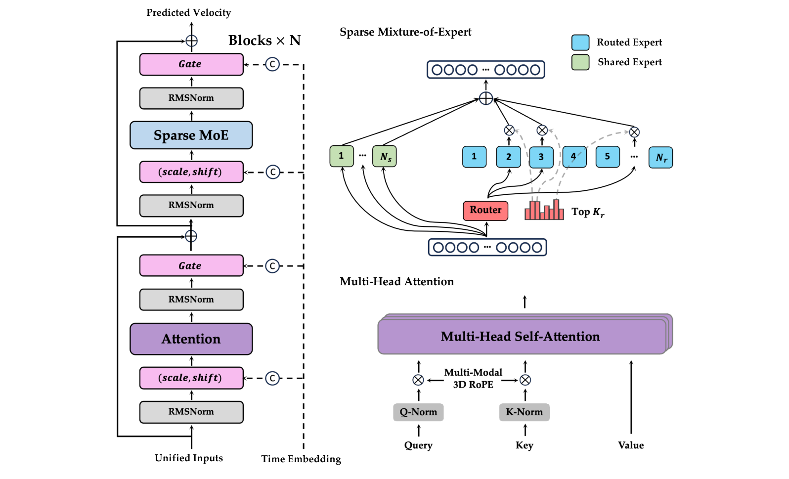
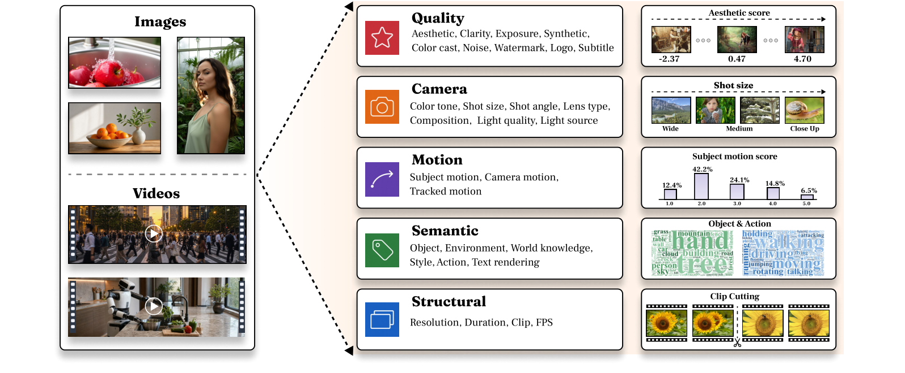
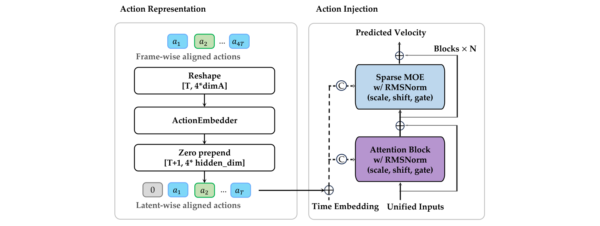
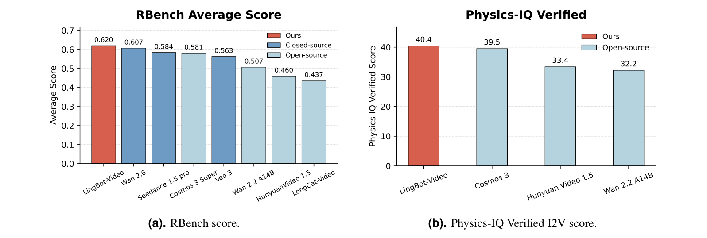

# LingBot-Video：架构与创新点详解

> 本文内容整理自 Robbyant 团队官方技术论文 [*Scaling Mixture-of-Experts Video Pretraining for Embodied Intelligence*](https://arxiv.org/abs/2607.07675)（arXiv:2607.07675，2026-07-08，27 位作者）。重点聚焦模型架构与创新点，内容仅围绕 LingBot-Video 本身。

---

## 目录

1. [模型概览](#1-模型概览)
2. [背景与定位：为具身智能而生的视频基础模型](#2-背景与定位为具身智能而生的视频基础模型)
3. [任务统一单流扩散 Transformer（核心创新）](#3-任务统一单流扩散-transformer核心创新)
4. [稀疏 MoE 缩放（核心创新）](#4-稀疏-moe-缩放核心创新)
5. [MoE 配方探索与缩放实验](#5-moe-配方探索与缩放实验)
6. [级联 Refiner](#6-级联-refiner)
7. [数据体系](#7-数据体系)
8. [基础设施](#8-基础设施)
9. [训练方法](#9-训练方法)
10. [评测结果](#10-评测结果)
11. [定位与展望](#11-定位与展望)
12. [参考资料](#12-参考资料)

---

## 1. 模型概览

| 项目 | 内容 |
|---|---|
| 模型名称 | LingBot-Video（含后训练变体 LingBot-Video-A2V） |
| 发布方 | Robbyant 团队（项目主导：Ka Leong Cheng；赞助：Yujun Shen） |
| 技术论文 | [*Scaling Mixture-of-Experts Video Pretraining for Embodied Intelligence*](https://arxiv.org/abs/2607.07675)（2026-07-08，27 位作者） |
| 模型类型 | **MoE 视频扩散基础模型**，面向具身智能（机器人/物理 AI） |
| 规模 | 基础模型 **13B 总参数 / 1.4B 激活**（MoE 13B-A1.4B，128 专家、每 token 路由 8 个）；缩放实验推至 **120B 总 / 11B 激活** |
| 架构 | 任务统一**单流 Diffusion Transformer**（T2I / T2V / TI2V 一网打尽）+ **稀疏 MoE** + **级联 Refiner**（480p → 1080p） |
| 任务定位 | 视频基础模型 + 动作条件世界模型（A2V 后训练） |
| 开源 | 代码 + 权重开放（[GitHub](https://github.com/robbyant/lingbot-video) / [Hugging Face](https://huggingface.co/robbyant/lingbot-video)） |

论文摘要（原文引用）：

> "In this work, we present LingBot-Video, a DiT-based video pretraining paradigm specifically tailored for embodied intelligence... From the architecture perspective, we adopt the Mixture-of-Experts (MoE), instead of dense, framework to achieve a better trade-off between modeling capacity and inference efficiency, and manage to scale it up from scratch. From the data perspective, we construct a data profiling engine that augments standard internet videos with extensive robot-oriented footage... From the training perspective, we develop a multi-dimensional reward system to enforce the alignment regarding physical rationality and task completion, going beyond standard criteria such as aesthetics, prompt-following, and motion consistency."

---

## 2. 背景与定位：为具身智能而生的视频基础模型

论文的出发点：**主流视频生成模型存在"领域错配"**——

> "Despite the recent promise in robot control, video generative models suffer from a domain mismatch due to their primary focus on content creation. For example, their design inherently prioritizes visual fidelity and creativity over **computational efficiency and physical realism**."

LingBot-Video 的定位是"数字创意与物理执行之间的桥梁"，为机器人社区扮演三种角色（论文结论）：

- **数据引擎（Data Engine）**：规模化合成高保真、低成本的训练数据，缓解机器人数据稀缺；
- **策略评估器（Policy Evaluator）**：作为视觉模拟器，无真实风险地安全评估机器人策略；
- **动作规划器（Action Planner）**：预测"接下来会发生什么"，辅助机器人的实时决策与规划。

---

## 3. 任务统一单流扩散 Transformer（核心创新）

### 3.1 统一输入形式（Unified Input Formulation）

每个训练样本表示为**单一 token 序列** = 视觉 latent patch + 条件 token（拼接进同一序列维度）。一套框架统一处理 **T2I、T2V、TI2V** 三个任务——**图像就是 T=1 的单帧视频**。条件与视觉 token 的结构差异用 **3D MM-RoPE** 解决：条件 token 放在不重叠的时间坐标范围，无需任务专属架构或编码器。

### 3.2 单流（Single-Stream）Diffusion Transformer

区别于双流架构（如两条独立通路分别处理条件与生成 token），LingBot-Video 采用**单流**设计，所有视觉与条件 token 共享同一组 Transformer 块：

> "This single-stream architecture maximizes parameter reuse and facilitates dense cross-modal interactions at every layer... groups multi-modal features into larger, unified GEMM computations, aiming to improve Model FLOPs Utilization (MFU) and reduce kernel launch overhead."

单流在分布式场景下还简化了通信模式：双流需要在每个 block 的注意力前后频繁拼接/拆分条件与 latent token（内存带宽受限的张量重组与布局转换），单流连续处理统一序列，**避免了序列并行布局下的额外负载不均衡与同步开销**。

### 3.3 三大工程细节

- **多模态 3D RoPE（MM-RoPE）**：给定 L 个条件 token 与 F×H×W 的视觉 latent 网格——条件 token 用纯时间坐标 (i,0,0)；视觉 patch 用 (L+1+f, h, w)。Q/K 的 head 维度按时间/垂直/水平轴拆分，各自施加旋转频率——保持空间局部性与时间顺序，同时注意力完全单流；
- **QK-Norm**：注意力前对 Q/K 做逐 head RMSNorm，控制深层 backbone 中的注意力 logit 增长与特征尺度（高分辨率混合精度训练下尤其重要）；每个 block 在注意力与 FFN 残差分支外加 RMSNorm；
- **AdaLN-Single 调制**：只在 Transformer 栈前算一次共享的时间步调制，每个 block 加一层**可训练的逐层调制表**（shift/scale/gate），共享投影零初始化（DiT 风格），逐层调制表小随机初始化——**省掉每个 block 的时间步 MLP**。

*图 2（论文 Fig. 2）：任务统一单流扩散 Transformer 总览。统一输入由堆叠的 Transformer 块处理，时间步调制控制注意力与稀疏 MoE 分支；注意力分支应用 QK-Norm 与多模态 3D RoPE，MoE 分支由常开的共享专家与 top-Kr 路由专家组合，最终预测速度场。（来源：[论文 §2](https://arxiv.org/abs/2607.07675)）*

---

## 4. 稀疏 MoE 缩放（核心创新）

### 4.1 动机：容量-算力解耦

稠密模型让所有 token 共享同一 FFN 参数通路，统一视频预训练中存在**严重的子任务干扰**（一组参数同时建模空间纹理 vs 时序运动、T2I vs T2V vs TI2V 异构任务格式、低噪声细节重建 vs 高噪声全局布局）。稀疏 MoE 能**解耦总容量与单 token 激活 FLOPs**：

> "This allows us to scale the total parameter capacity—creating a vast repository for diverse physical priors—while strictly controlling per-token active FLOPs. This decoupling is especially critical for high-resolution video generation, which easily scales to million-token (1M+) spatio-temporal sequences."

扩散视频生成器要在多个去噪步中反复处理完整视觉 latent 序列，每 token 计算是长视频缩放的支配性压力；稀疏路由降低每一步的激活 FFN 计算，同时保留总参数容量。

### 4.2 稀疏 MoE 架构（DeepSeekMoE 风格）

每个 Transformer 块保留单流 FFN 残差分支结构，只把稠密 FFN 替换为 **token-choice 稀疏 MoE 层**，并吸收 DeepSeekMoE 的两个关键原则——**细粒度专家切分**与**共享专家隔离**：

$$m(u_t) = \sum_{i=1}^{N_s} E^{(s)}_i(u_t) + \sum_{j \in R_b(u_t)} g_{t,j} E^{(r)}_j(u_t)$$

- 每个专家是 SwiGLU MLP；共享专家（常开）提供通用物理原理与空间一致性通路，路由专家（按 token 选择）捕获专门特征；
- **细粒度切分**：共享与路由专家的中间维度都小于标准稠密 FFN，最大化专家专精、降低知识混杂；
- **Sigmoid 路由器**：$\alpha_{t,j} = \text{Sigmoid}(u_t^\top r_j)$（r_j 为可学习路由嵌入）；
- **分组限制路由（DeepSeek 风格）**：N_r 个路由专家分为 N_g 组，加在线修正偏置后先选 top-K_g 组（每组按组内 top-2 亲和度之和评分），组内再选 top-K_r 专家——控制分布式训练的通信成本。

### 4.3 负载均衡三件套

1. **在线偏置修正（auxiliary-loss-free）**：为每个专家维护动态修正偏置 b_j（按全局负载偏差符号更新：$b_j \leftarrow b_j - \eta \,\text{sign}(n_j - \bar{n})$），仅用于选专家、不参与门控值；可选偏置中心化保持路由输入相关且稳定；
2. **序列级辅助损失（sequence-wise auxiliary loss）**：视频是长时空 token 序列，批级统计会隐藏单条视频内部的路由失衡——沿用 DeepSeek-V3 的序列级平衡损失，鼓励**每条打包视频序列内**专家使用均衡（$L_{\text{seq}} = \frac{1}{S}\sum_s \sum_j f^{(s)}_j P^{(s)}_j$）；
3. **路由缩放因子 γ**：归一化选中的原始亲和度。

### 4.4 后训练基础设施配套

MoE 路由天然契合机器人在线 RL 的需求：token 选择专家形成异构数据流，需要专门的 **diffusion-native RL 系统**支持（详见 §8-9）。

---

## 5. MoE 配方探索与缩放实验

### 5.1 专家池规模（容量-算力解耦验证）

固定激活 1.4B/token，比较路由专家数 E ∈ {64, 128, 256}（对应总参 7B / 13B / 25B）：

- 扩大专家池在训练与验证损失上持续改善，验证容量-算力解耦有效；
- 但 **E=128→256 的提升边际**远小于 64→128；权衡性能/延迟/显存后**默认 E=128**。

### 5.2 细粒度 vs 粗粒度路由

固定 13B 总参数预算：细粒度 `MoE 13B-A1.4B-E128`（每 token 路由 K_r=8/128）vs 粗粒度 `MoE 13B-A1.5B-E64`（K_r=4/64）：

> "Despite the coarse routing model having a higher active parameter count (and thus a larger FLOP footprint per token), it performs consistently worse than the fine-grained counterpart... By dividing the FFN parameters into more, smaller experts, the model gains access to a dramatically larger combinatorial routing space (C(128,8) vs C(64,4))."

细粒度路由为异构模态与噪声水平的视觉 token 提供更定制化的执行通路；粗粒度则引入参数级梯度冲突与知识混杂。

### 5.3 激活参数对等缩放

- `MoE 13B-A1.4B` vs `Dense 1.3B`：同等激活算力下，稀疏模型训练/验证损失全面占优——**10 倍总容量为物理先验提供更大的"仓库"**；
- 进一步对比 `MoE 30B-A3B` vs `Dense 14B`：MoE 30B-A3B 逼近 Dense 14B 表现；
- **缩放轨迹**：MoE 13B-A1.4B → 30B-A3B → 60B-A6B → **120B-A11B**（总参数最高推到 120B）。

### 5.4 推理效率（MoE-对-稠密 速度比）

以 MoE 30B-A3B 在 1M token 序列上的延迟为基准：

| 对比基线 | 速度比（Dense/MoE） |
|---|---|
| Dense 3B（激活参数等价） | 0.97×（近持平，路由开销可忽略） |
| Dense 6B | 1.50× |
| Dense 14B | 2.59× |
| Dense 30B | 3.18× |

> "These results demonstrate that our sparse framework successfully scales model capacity while preserving the inference efficiency of a 3B-scale model."

---

## 6. 级联 Refiner

直接生成高分辨率视频的时空 token 数量庞大，采用**级联设计**：高容量基础生成器先在低分辨率（480p）建模整体运动与场景布局，专门的第二阶段 refiner 超分到 **1080p**。

- **训练**：用目标视频下采样 + 合成退化（Gaussian blur、压缩）构造低分辨率输入，模拟基础生成器输出；退化视频在像素空间上采样后经 VAE 编码为条件 latent x_lr——**在 latent 空间直接处理上采样条件**，避免中间像素解码，兼顾开销与质量；
- **阈值化条件整流流**：refiner 不从纯高斯噪声去噪，而是学习从退化条件 x_lr 到干净 target x_0 的条件整流流——噪声阈值 τ ~ Uniform(0.85, 0.95) 限定轨迹最大噪声水平，训练时间步 t ∈ [0, τ]：
$$x_t = \left(1-\frac{t}{\tau}\right)x_0 + \frac{t}{\tau}x_\tau, \qquad v^*_{\text{ref}} = \frac{x_\tau - x_0}{\tau}$$
- **效果**：refiner 保留基础模型的全局语义与运动，容量专注于恢复高频细节、锐化纹理、修正局部伪影（显著改善人脸、生成清晰的 OCR 文字）。

---

## 7. 数据体系

### 7.1 数据画像引擎（Data Profiling Engine）

把原始多模态样本投影到**固定 schema 的结构化记录**上，五个互补维度（Fig. 9）：

- **结构（Structural）**：分辨率、时长、片段、FPS（TransNetV2 检测镜头边界，保证每个训练片段是单一连贯镜头）；
- **语义（Semantic）**：物体、环境、世界知识、风格、动作、文字渲染等结构化标签（VLM 生成，带置信度）；
- **运动（Motion）**：相机运动、主体运动、跟踪运动三信号；VLM 解耦相机/主体运动强度，几何接地（LocoTrack 点跟踪）信号筛除近静态/退化片段；
- **相机（Camera）**：色调、景别、机位角度、镜头类型、构图、光照质量/光源等七种电影属性；
- **质量（Quality）**：美学、清晰度、曝光、合成、偏色、噪声、水印、Logo、字幕。

### 7.2 世界知识拓扑图（World-Knowledge Topological Graph）

把视觉概念组织成**层次化语义结构**（语义树），实现分布感知采样与长尾覆盖——为每个样本分配类别级置信度分数，驱动后续过滤、均衡采样与描述。

### 7.3 稠密结构化描述（Dense Structured Captioning）+ 描述重写器（Caption Rewriter）

- 稠密结构化描述提供层次化文本描述，为训练提供细粒度语义监督；
- **Caption Rewriter** 在推理时把用户简短提示词映射到同一结构化格式，**弥合训练与部署之间的提示词分布差距**；
- 配套**阶段式数据课程（Data Curriculum）**：按渐进预训练各阶段控制数据量与构成。

*图 9（论文 Fig. 9）：数据画像引擎总览。每个图像/视频样本在结构、语义、运动、相机、质量五个维度上被标注为结构化画像记录，驱动下游过滤、均衡采样与描述生成。（来源：[论文 §3.1](https://arxiv.org/abs/2607.07675)）*

---

## 8. 基础设施

### 8.1 预训练基础设施（六项协同设计）

1. **异构数据管线 + Token 预算打包（Token-Budgeted Packing）**：不按固定样本数批处理，而是**按目标 token 预算**构造每个 mini-batch——采样器按剩余容量动态决定是否追加样本（视觉与条件 token 数量可相差数量级）；打包成**一维序列** [x₁,y₁,x₂,y₂,...] 由变长注意力内核（FlashAttention）单次前向处理，防止跨样本注意力泄漏；smart-fill 采样器用 rank 本地候选池填补剩余 token 预算，消除 padding 浪费；
2. **可组合并行训练**：四个可组合并行维度——**DP（吞吐扩展）、FSDP/HSDP（模型状态分片）、SP（Ulysses 序列并行，长上下文）、EP（专家并行）**，通过命名多维 device mesh 统一表达，可组合选择而无需改动训练主循环；
3. **激活检查点（Activation Checkpointing）**；
4. **Compile-First 图捕获**：先编译再分片，保证数值敏感参数（归一化、路由缩放）以 FP32 复制、周围张量低精度编译；
5. **显式通信预取**；
6. **异步监控 + 分布式检查点 I/O**。

### 8.2 后训练基础设施：Diffusion-Native RL 系统

MoE 路由产生异构数据流（不同 token 走不同专家），RL 滚动与梯度更新需要专门系统设计；论文实现了面向扩散的 RL 系统（性能数据见 §9.2）。

### 8.3 服务基础设施

- **Diffusers 兼容模型包**：一键接入生态；
- **SGLang-Native 服务后端**；
- **分布式视频服务**。

---

## 9. 训练方法

### 9.1 渐进式五阶段预训练（Progressive Pre-Training）

大规模 MoE 扩散模型从头训练时，路由器需要逐步建立专家通路；一上来就暴露全部复杂度会引发优化不稳定、路由坍缩。课程设计（每阶段只加一种复杂度）：

| 阶段 | 内容 |
|---|---|
| Stage 1 图像先验 | 图像即 T=1 视频，建立文本-视觉语义对齐与单帧先验，为稀疏路由器提供稳定初始化环境 |
| Stage 2 低分辨率时序 | 引入 T2V 视频数据，专注时序动力学、相机运动、帧间一致 |
| Stage 3 多任务条件 | 视频端从纯 T2V 扩展为 T2V + TI2V 联合，学习保留首帧约束 |
| Stage 4 加权分布调和 | 切换加权采样器（alias tables），稳定在更干净均衡的混合语料上 |
| Stage 5 高分辨率精修 | 专用高分辨率 refiner 训练（映射上采样低分辨率输出 → 干净高分辨率目标），保持时序锐度、减少纹理闪烁 |

### 9.2 后训练（Post-Training）

**（1）多维奖励 RL（Multi-Aspect Rewards）**——论文的核心创新之一。现有 RL 方法用单一标量奖励模型，无法惩罚视频的复杂失败模式（静态模式坍缩、时序幻觉、物理不合理）。LingBot-Video 解耦出**六个专门奖励模型**：

- **视觉质量（Vision Quality）**：以 HPSv3 为基础，用全帧统计设计互补信号，分别捕捉整体视觉保真与标题对齐，惩罚模糊、伪影、低分辨率；
- **文本-视频对齐（Text-Video Alignment）**：细粒度、动作中心的文本对齐奖励；
- **动态程度（Dynamic Degree）**、**运动连贯性（Motion Coherence）**、**人体运动一致性（Human Motion Consistency）**、**物理合理性（Physical Plausibility）**。

**（2）On-Policy GRPO 训练（Flash-GRPO 风格）**：

- **组共享单步探索**：每组 G 个 rollout 只有**一个去噪步随机**（步索引 k 从推理调度前半均匀抽取、组内共享），其余步为确定性 ODE——精确信用分配，解决 Flow-GRPO/DanceGRPO 全步随机导致的严重信用分配问题；
- **系数保持采样（CPS）**：随机步用 DDIM 风格转换而非 SDE 转换——SDE 转换注入超出调度规定的噪声（高噪声时扩散系数爆炸、需额外 clipping patch），CPS 从构造上避免；η=0.7 控制探索强度，样本始终停留在确定性采样器的边际路径上，奖励始终在干净视频上评估；
- **时间步均衡梯度重加权**：策略梯度强度随转换增益 κ_k 变化，用逆增益归一化 λ_k 均衡各时间步更新幅度（解析计算归一化子）；
- **多奖励优势归一化**：每个奖励独立做组内标准化后再加权融合；
- 严格 on-policy、无 KL 正则、无参考模型、全参数微调。

**（3）负样本感知微调（Negative-Aware Finetuning，真实视频直接监督）**：

> "Most existing RL post-training methods for diffusion models rely on reward models to provide optimization signals, which introduces the risk of reward hacking in the video domain. To mitigate this, we leverage **real-world videos as direct preference signals**: a real video clip serves as the positive (chosen) sample, while the model-generated video under the same prompt serves as the negative (rejected) sample."

采用 DiffusionNFT 的**前向过程优化框架**（无需反传去噪轨迹）：真实视频编码为 chosen latent x_w⁰，策略生成视频作 rejected 池 {x_l⁰}；共享随机时间步与噪声对二者加噪后，由 EMA 旧策略稳定优化，构造隐式正/负策略——计算轻量、单步即可。

### 9.3 动作到视频后训练（Action-to-Video Post-Training）→ LingBot-Video-A2V

把视频模拟器改造成**动作条件世界模型**：仅以初始世界状态（首帧 + 文本状态描述）与机器人动作参数为条件，生成动作条件化的未来视觉 rollout。三大设计：

1. **数据重描述（Recaptioning）**：把训练描述改写为**只描述初始状态**（推动视频演化只能靠机器人动作），并做严格的**未来信息泄漏检查**；
2. **动作表示与注入**：原始动作转**相对动作**（每步编码相对前序状态的增量）；动作 chunk 展平为单序列，经 **ActionEmbedder** 投影；首观测前置零动作，动作 latent 与视觉 latent **时间对齐**；动作以**残差信号**与时间嵌入一起调制每个 Transformer 块——ActionEmbedder 最后一层**零初始化**，让新动作分支逐步融入预训练主干；
3. **训练设置**：使用 **Fourier GR-1 后训练数据集**（[26]），联合优化 ActionEmbedder 与完整 Transformer 骨干（而非孤立训练动作分支），8k 步、全局 batch 64、lr 1e-5。

*图 14（论文 Fig. 14）：LingBot-Video-A2V 架构。给定未来 4T 帧的逐帧动作，先通过 ActionEmbedder 投影为潜在对齐动作，作为残差信号连同时间嵌入一起调制每个 Transformer 块。（来源：[论文 §5.3](https://arxiv.org/abs/2607.07675)）*

### 9.4 蒸馏（DMD2）

按改进版分布匹配蒸馏（DMD2）把模型蒸馏为少步生成器，提升推理效率。

---

## 10. 评测结果

### 10.1 内部基准（Internal Benchmark）

两个维度 × 两个设置（T2V / TI2V）：

- **通用质量（General Quality）**：运动质量（自然度/连续性/物理合理性，惩罚闪烁、结构形变、身份漂移）、提示跟随（多实体、复杂计数、动作顺序、相机运动）、视觉一致性（身份/场景随时间保持，TI2V 含首帧保持）、美学质量；
- **具身领域（Embodied Domain）**：人体交互（精细手部/手指运动、面部表情）、物理模拟（经典力学、光学、热力学、流体、材料、磁力）、机器人（人形/机械臂/四足）、以自我为中心视角、导航。

对比五个开源模型（Cosmos 3 Super-Image2Video、Wan 2.2 A14B、LongCat-Video、Hunyuan Video 1.5、LTX-2.3）：

> "LingBot-Video achieves **state-of-the-art performance among all open-source competitors on the TI2V task**, securing the top spot in both general quality and embodied domain scores... For the T2V task, while our model ranks second in general quality, we still consistently outperform competitive baselines such as Cosmos on the embodied domain score."

### 10.2 公开基准

- **RBench**：LingBot-Video **0.620 平均分排名第一**，超过闭源 Wan 2.6（0.607）、Seedance 1.5 pro（0.584）、Cosmos 3 Super（0.581）、Veo 3（0.563）、Wan 2.2 A14B（0.507）、HunyuanVideo 1.5（0.460）、LongCat-Video（0.437）；
- **Physics-IQ Verified（I2V）**：LingBot-Video **40.4** > Cosmos 3（39.5）> Hunyuan Video 1.5（33.4）> Wan 2.2 A14B（32.2）；
- **用户研究**：T2V 与 TI2V 的 Good-Same-Bad 人类评估（Fig. 17）。

*图 16（论文 Fig. 16）：公开基准分数对比。左：RBench 平均分（LingBot-Video 0.620 居首，含闭源模型）；右：Physics-IQ Verified I2V 分数（40.4，领先 Cosmos 3 等开源模型）。（来源：[论文 §6.2](https://arxiv.org/abs/2607.07675)）*

### 10.3 A2V 评估

在 **EgoDex Eval 与 DreamDojo-HV Eval** 上验证（两者均含 GR-1 训练数据之外的新物体/新动作）：LingBot-Video-A2V 更好地遵循物理规律（如保留黄色苹果）与动作跟随（如手相对三明治的位姿）——证明泛化到分布外动作跟随而非记忆训练轨迹。

---

## 11. 定位与展望

- 论文自我定位为**首个大规模开源 MoE 视频基础模型**（"the inaugural large-scale, open-source MoE video foundation model"），旨在架起数字创意与物理执行之间的桥梁；
- 明确的三重角色：机器人数据引擎、策略评估器、动作规划器——"为下一代机器人脑铺路"；
- 开源以激励社区共建"具身物理引擎"。

---

## 12. 参考资料

- 论文：[*Scaling Mixture-of-Experts Video Pretraining for Embodied Intelligence*](https://arxiv.org/abs/2607.07675)（arXiv:2607.07675）
- 代码仓库：https://github.com/robbyant/lingbot-video
- Hugging Face 权重：https://huggingface.co/robbyant/lingbot-video
- 姊妹项目：LingBot-World（[arXiv:2601.20540](https://arxiv.org/abs/2601.20540)，交互式世界模拟器）
- 社区讨论：[Reddit: LingBot-Video 发布讨论](https://www.reddit.com/r/MachineLearning/comments/1ur0bxq/lingbotvideo_sparsemoe_video_diffusion/)

---

*本文档图片（`assets/lv-fig2-arch.png`、`assets/lv-fig9-profiling.png`、`assets/lv-fig14-a2v.png`、`assets/lv-fig16-benchmark.png`）均直接摘录自论文 [arXiv:2607.07675](https://arxiv.org/abs/2607.07675)，版权归 Robbyant 团队所有。*
