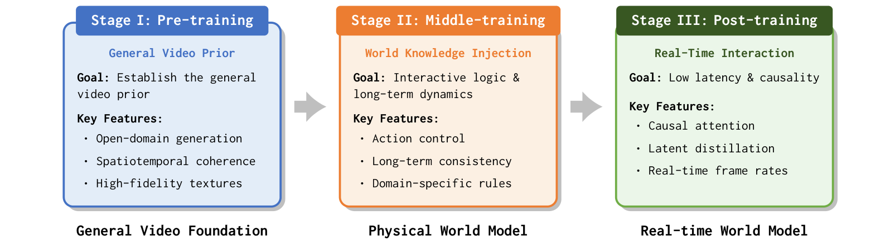
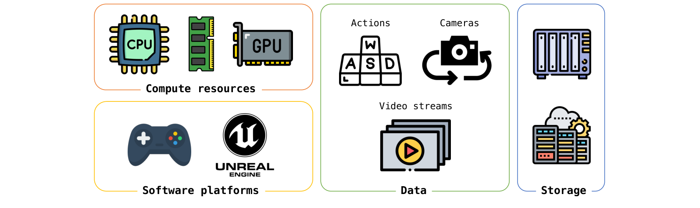
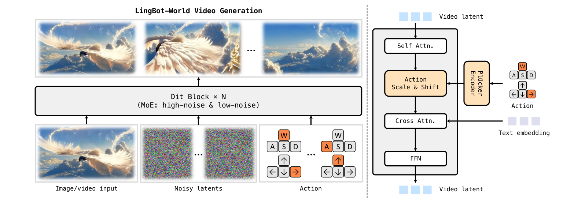
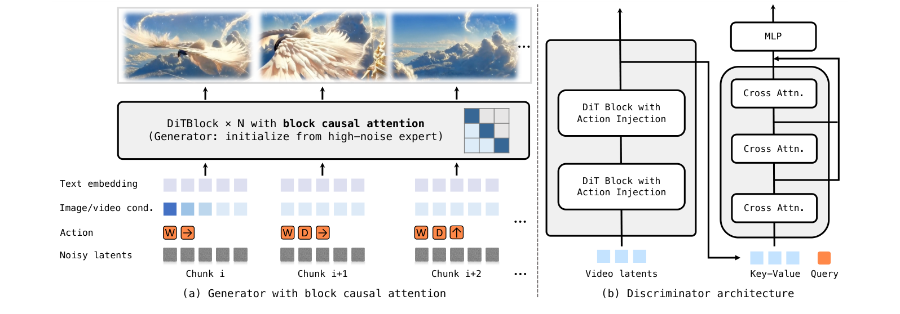

# LingBot-World：架构与创新点详解

> 本文内容整理自 Robbyant 团队官方技术报告 [*Advancing Open-source World Models*](https://arxiv.org/abs/2601.20540)（arXiv:2601.20540，2026-01-28）与进阶版本 [*Infinite Worlds with Versatile Interactions*](https://arxiv.org/abs/2607.07534)（LingBot-World 2.0 / Infinity，arXiv:2607.07534，2026-07-08），以及官方 [GitHub 仓库](https://github.com/robbyant/lingbot-world)。重点聚焦模型架构与创新点，内容仅围绕 LingBot-World 本身。

---

## 目录

1. [模型概览](#1-模型概览)
2. [核心目标：从视频生成到交互式世界模拟](#2-核心目标从视频生成到交互式世界模拟)
3. [数据引擎（Data Engine）](#3-数据引擎data-engine)
4. [三阶段演化训练（核心创新）](#4-三阶段演化训练核心创新)
5. [中期训练：注入世界知识（核心创新）](#5-中期训练注入世界知识核心创新)
6. [后期训练：因果架构适配 + 少步蒸馏（核心创新）](#6-后期训练因果架构适配--少步蒸馏核心创新)
7. [评测结果](#7-评测结果)
8. [应用](#8-应用)
9. [LingBot-World 2.0（Infinity）](#9-lingbot-world-20infinity)
10. [局限与官方定位](#10-局限与官方定位)
11. [参考资料](#11-参考资料)

---

## 1. 模型概览

| 项目 | 内容 |
|---|---|
| 模型名称 | LingBot-World（v1）→ LingBot-World 2.0 / Infinity（v2） |
| 发布方 | Robbyant 团队（[GitHub](https://github.com/robbyant/lingbot-world)） |
| v1 技术报告 | [*Advancing Open-source World Models*](https://arxiv.org/abs/2601.20540)（2026-01-28，24 位作者） |
| v2 技术报告 | [*Infinite Worlds with Versatile Interactions*](https://arxiv.org/abs/2607.07534)（2026-07-08） |
| 模型类型 | **动作条件世界模拟器（Action-Conditioned World Simulator）**，源自视频生成（built on Wan2.2） |
| 模型规模 | v1：**28B 总参数**（2×14B 双专家 MoE，每步仅激活一个专家）；v2：14B 因果模型 + 1.3B 轻量版 |
| 核心能力 | 高保真多样环境模拟、**分钟级长程一致（long-term memory）**、**实时交互**（<1s 延迟、16fps） |
| 开源 | v1 代码+权重开放；v2 许可证为 **CC BY-NC-SA 4.0** |
| 模型产物 | LingBot-World-Base（Cam / Act）、LingBot-World-Fast（v1）；lingbot-world-v2-14b-causal-fast（v2） |
| 项目主页 | https://technology.robbyant.com/lingbot-world（v2: technology.robbyant.com/lingbot-world-v2） |

论文摘要（原文引用）：

> "We present LingBot-World, an open-sourced world simulator stemming from video generation. Positioned as a top-tier world model, LingBot-World offers the following features. (1) It maintains high fidelity and robust dynamics in a broad spectrum of environments, including realism, scientific contexts, cartoon styles, and beyond. (2) It enables a minute-level horizon while preserving contextual consistency over time, which is also known as 'long-term memory'. (3) It supports real-time interactivity, achieving a latency of under 1 second when producing 16 frames per second."

---

## 2. 核心目标：从视频生成到交互式世界模拟

LingBot-World 把世界模型形式化为**条件生成过程**：用参数化模型 θ 逼近环境的转移动力学，最大化"给定历史帧与当前控制信号下的未来状态似然"：

$$\max_{\theta} \; \mathbb{E}\left[\log p_\theta(x_{t:t+L} \mid x_{<t}, a_{t:t+L})\right]$$

其中 $L \geq 1$ 是预测视界。作者强调其目标不是单步预测，而是**从通用视频生成器平滑演化出"高效、可交互的世界模拟器"**，为此设计了**三阶段渐进演化策略（multi-stage evolution）**：

| 阶段 | 目标 | 关键特征 |
|---|---|---|
| **Stage I 预训练** | 建立通用视频先验（General Video Prior） | 开放域生成、时空连贯、高保真纹理 |
| **Stage II 中期训练** | 注入世界知识与长程动力学 | 动作控制、长程一致、领域规则 |
| **Stage III 后期训练** | 实时交互 | 因果注意力、latent 蒸馏、实时帧率 |

> "We propose a multi-stage evolution strategy, decomposing the learning process into three progressive stages: foundation, knowledge injection, and interaction readiness."

*图 4（论文 Fig. 4）：LingBot-World 训练管线总览。三阶段演化把基础视频生成器转化为交互式世界模拟器：预训练建立通用视频先验；中期训练注入世界知识与动作可控性；后期训练通过因果注意力与少步蒸馏实现低延迟与严格因果性。（来源：[论文 §3.1](https://arxiv.org/abs/2601.20540)）*

---

## 3. 数据引擎（Data Engine）

构建能处理新视角、复杂动力学与长程规划的世界模型需要严谨的数据策略。LingBot-World 的数据引擎由三个协同组件构成：**数据采集（Acquisition）、数据画像（Profiling）、数据描述（Captioning）**。

### 3.1 数据采集（混合策略）

- **通用视频策展（General Video Curator）**：从自有机房与开源仓库筛选高价值样本，优先"多样化世界探索"类内容——涵盖步行、骑行、交通等运动类型，以及人类/动物第一视角与第三人称视角；
- **游戏数据采集（Game Data Acquisition）**：自研采集平台，高精度同步**视觉帧、用户控制输入（W/A/S/D）与相机参数**；屏蔽 UI 覆盖、精确时间戳；四类标准化采集策略——导航（自由导航/环游/转场导航）、观光（细粒度观察、地标环绕多视角一致性）、长尾场景等；
- **合成渲染管线（Synthetic Rendering Pipeline）**：基于 **Unreal Engine（UE）**，整合授权资产与自建环境，自动化生成无碰撞、随机化但物理合理的相机轨迹，输出与**真实相机内参/外参对齐**的 RGB 流。

*图 2（论文 Fig. 2）：游戏与合成数据采集。系统利用算力与软件平台，采集与动作信号、相机状态时间对齐的视觉观测。（来源：[论文 §2.1](https://arxiv.org/abs/2601.20540)）*

### 3.2 数据画像（标准化层）

- 对缺少相机信息的通用视频，用 SOTA 位姿估计模型生成**相机内参/外参伪标签**；
- 按分辨率、时长做基础过滤，用现成算法切分为训练友好片段；
- 用 VLM 做语义分析（视觉质量、运动幅度、场景视角），进一步策展。

### 3.3 数据描述（层次化标注）

用 VLM 实现**三层级描述**，保证多粒度语义理解：

1. **叙事性描述（narrative caption）**：把环境与相机运动编织成全局故事；
2. **场景静态描述（scene-static caption）**：只关注环境本身；
3. **稠密时序描述（dense temporal captions）**：细粒度、时间对齐的特定事件描述。

---

## 4. 三阶段演化训练（核心创新）

### 4.1 Stage I 预训练：建立通用视频先验

> "We leverage a base video generator pretrained on large-scale open-domain video data, which endows LingBot-World with strong spatiotemporal coherence and open-domain semantic understanding... serving as a general visual 'canvas' for subsequent interactive dynamics rather than encoding task-specific physical rules."

即以大规模开放域预训练的视频生成器为起点，先建立强时空连贯与高保真纹理的"通用画布"。

### 4.2 Stage II 中期训练：注入世界知识与长程动力学

在通用公式下令 t=0 即对应**双向（bidirectional）范式**——模型先建立全局时间依赖，再引入两大关键能力：

- **长程一致性**：用扩展视频序列训练，观察长程上下文帧，缓解视频生成中的"遗忘"问题，保证**分钟级游戏画面**而非秒级片段依然连贯；
- **动作可控性**：通过**自适应归一化（AdaLN）**注入用户自定义动作信号，生成不再由随机噪声驱动，而是遵循用户指令。

> "At this stage, the model operates as a holistic world simulator, capable of generating high-fidelity future trajectories conditioned on actions, though it relies on bidirectional attention, which is computationally heavy for real-time rollout."

### 4.3 Stage III 后期训练：因果架构适配 + 少步蒸馏

把双向世界模型转化为**能实时交互的自回归系统**（公式推广到 t≥0、以过去上下文 x<t 为条件）。两大手段：**块因果注意力**（chunk 内双向、chunk 间因果，支持 KV cache 流式生成）与**少步蒸馏**（DMD + 对抗优化）。

---

## 5. 中期训练：注入世界知识（核心创新）

中期训练把预训练的视频扩散模型改造成**双向世界模型**，包含三个组件。

### 5.1 基础世界模型（Fundamental World Model）

输入 = 图像或视频（初始状态）+ 噪声 latent + 用户动作，输出 = 可控视觉世界。三大训练策略：

**（1）MoE 双专家架构（按噪声阶段分工）：**

> "LingBot-World adopts a two-expert design tailored to the diffusion process: a **high-noise expert**, activated at early timesteps, focuses on modeling global structure and coarse layout, while a **low-noise expert**, activated at later timesteps, polishes fine-grained spatial and temporal details. Each expert contains approximately 14B parameters, resulting in a **total model size of 28B parameters, while only one expert is activated at each denoising timestep**. This design preserves inference-time computation and GPU memory consumption comparable to a dense 14B model."

不同于"按 token 路由"的通用 MoE，这是**按去噪时间步路由**的双专家设计——早期步激活高噪声专家（全局结构/粗布局），后期步激活低噪声专家（细节精修），28B 总参但推理开销 ≈ 稠密 14B。

**（2）渐进式课程训练（5 秒 → 60 秒）：**

> "In the first round, we employ 5-second video sequences... Then, we progressively extend the training duration from 5 seconds to 60 seconds, allowing the fundamental world model to learn long-term temporal consistency and facilitate the **emergence of spatial memory**."

并**随视频时长逐步放大 flow shift**——长视频生成需要更多高噪声时间步（负责全局场景结构），从而稳定场景级结构、减少漂移。

**（3）多任务训练：** 同时优化**图生视频（I2V）与视频生视频（V2V，视频续写）**目标，学习统一的"世界转移函数"，支持从任意初始状态预测未来。

### 5.2 动作条件世界模型（Action-Conditioned World Model）

在基础世界模型之上微调出交互控制能力：

- **混合动作表示**：连续相机旋转用 **Plücker embedding**（适合连续 3D 变换的几何表示），离散键盘交互（W/A/S/D）编码为 **multi-hot 向量**，沿通道维拼接融合——同时支持平滑视角变化与离散逻辑状态切换；
- **动作注入机制**：融合后的动作嵌入经投影后通过 **AdaLN** 注入 DiT 块，动态调制归一化特征、引导去噪过程；
- **参数高效微调**：**冻结主干 DiT 块，只微调新增的动作适配层**（动作嵌入投影 + AdaLN 参数）——既解耦"视频生成能力"与"动作控制能力"，又避免高质量动作标注数据稀少时全量微调导致的灾难性遗忘。

*图 5（论文 Fig. 5）：LingBot-World 生成管线。左侧为视频生成流程（条件输入 + 噪声 latent + 动作经 AdaLN 注入 DiT 块）；右侧为对应的训练/推理组件（图片来自论文）。（来源：[论文 §3.3](https://arxiv.org/abs/2601.20540)）*

### 5.3 并行基础设施（Parallelism Infrastructure）

训练 28B 模型 + 一分钟视频序列（长 token、梯度、优化器状态、激活检查点）对显存要求极高，论文实现了专门的并行基础设施，把显存控制在实用范围内（具体并行策略见 §3.3.3，覆盖模型并行/序列并行等组合方案）。

---

## 6. 后期训练：因果架构适配 + 少步蒸馏（核心创新）

后期训练把双向教师模型改造成**因果（自回归）流式世界模型**，过程中优先保住两项关键能力：精确的动作条件动力学建模、以及无累积漂移的长时间视觉保真。

### 6.1 因果架构适配（Causal Architecture Adaptation）

- **模型初始化**：用**高噪声专家**初始化学生模型（实验验证其在动作条件动力学上优于低噪声专家）；得益于渐进课程训练，模型已能处理变长 token 序列，因果适配更稳定、对任意长度 rollout 可泛化；
- **架构改造**：把全双向时序注意力替换为**块因果注意力（block causal attention）**——每个时间块内双向（捕获短程依赖、保持局部一致），块间严格因果（当前块只能注意同块或前块，消除未来帧依赖）；推理时**复用前序块的 KV cache**，只计算新生成 token 的注意力，大幅降低每步开销；
- **训练协议**：N 个噪声帧分为 L 块，每块按 **diffusion forcing 范式**分配独立噪声时间步；只在少数精选目标时间步 {t₁,…,tₘ} 上训练（作为后续蒸馏目标）；由于初始化为高噪声专家，额外加入 **timestep 0 采样**监督，弥合教师高/低噪声专家的专精差距。

### 6.2 少步蒸馏 + 长视界训练（Few-Step Distillation with Long-Horizon Training）

学生模型在训练视界之外会因"训练/推理分布不匹配"产生累积漂移，论文用综合蒸馏框架解决：

- **自滚动扩展视界训练（self-rollout）**：基于 self-forcing 范式，学生模型在其**自生成序列**上训练（通过滚动 KV cache 条件化），学习从自身生成伪影中恢复；用**随机梯度截断**——只反传最近 K 步梯度、保留全上下文前向——平衡效率与长程依赖学习；
- **分布匹配蒸馏（DMD）+ 对抗优化**：用中期训练的 MoE 教师作真实 score 函数、教师初始化 fake score 模型做全步 score 匹配；采用**两时间尺度更新规则**（每步学生更新对应多次 fake score 更新，使其紧贴学生输出分布）。DMD 梯度公式：
$$\nabla_\theta \mathbb{E}_t\left[D_{KL}(p_{\theta,t}\|p_{\text{data},t})\right] = -\mathbb{E}_{t,\hat{x}_t\sim q_{t|0}(\hat{x}_t|\tilde{x}),\,\tilde{x}\sim p_\theta(\tilde{x}|a)}\left[(s_{\text{real}}(\hat{x}_t,t,a) - s_{\text{fake}}(\hat{x}_t,t,a))\frac{\partial \hat{x}}{\partial \theta}\right]$$
- **对抗损失补齐**：论文指出纯 DMD 下学生与教师都不受真实数据直接监督，会继承教师偏差——因此附加 GAN 判别头 D(·)（挂在 fake score 网络上，结构沿用 APT），用**真实视频**监督，突破教师上限：
$$L_G = \mathbb{E}_{p(\tilde{x})}\left[f(1-D(\mu_{\text{fake}}(\tilde{x}_t, t, a)))\right], \qquad L_D = \mathbb{E}_{p(x)}[f(D(\mu_{\text{fake}}(x_t, t, a)))] - \mathbb{E}_{p(\tilde{x})}[\cdots]$$

*图 6（论文 Fig. 6）：(a) 因果生成器适配——用块因果注意力改造高噪声专家，chunk 内双向、chunk 间因果，实现高效的 action-conditioned 自回归 rollout；(b) 判别器架构——把 GAN 分类头挂到 fake score 网络特征上，用交叉注意力区分真实与合成序列，缓解分布匹配蒸馏中的累积漂移。（来源：[论文 §3.4](https://arxiv.org/abs/2601.20540)）*

---

## 7. 评测结果

### 7.1 定性能力

- **多样化环境**：LingBot-World-Base 有效处理不同物体属性与复杂空间构型，帧间过渡平滑、逻辑一致；
- **涌现记忆能力（Emergent Memory）**——论文重点展示的招牌能力：

> "A key property of LingBot-World is the **emergent ability to maintain global consistency without relying on explicit 3D representations** such as Gaussian Splatting."

  - 地标（雕像、巨石阵）**离开视野长达 60 秒后仍保持结构完整**；
  - 模型能推理**未观测状态**的演化：相机前移再回正时远处的桥"变近了"（正确反映前向运动）；车辆驶出画面后**继续沿路行驶、以物理合理位置重现**，而非消失或冻结；
  - 不同于受限于静态场景重建的显式 3D 方法，能自然建模流水、行人等**非刚性动力学**；
- **超长生成**：稳定维持高保真环境**长达 10 分钟**无显著质量退化。

### 7.2 定量结果（VBench）

| 模型 | Imaging Quality | Aesthetic Quality | Dynamic Degree | Motion Smooth | Temporal Flickering | Overall Consistency |
|---|---|---|---|---|---|---|
| Yume-1.5 | 0.5838 | 0.5185 | 0.7612 | 0.9709 | 0.9545 | 0.1994 |
| HY-World 1.5 | 0.6512 | 0.5487 | 0.7217 | 0.9897 | 0.9773 | 0.2016 |
| **Ours** | **0.6683** | **0.5660** | **0.8857** | 0.9895 | 0.9648 | **0.2178** |

论文结论：模型在**动态程度（Dynamic Degree）上显著领先**，同时视觉质量与时间平滑度与头部竞品持平。

### 7.3 实时性

> "LingBot-World-Fast, our real-time variant, which achieves **16 fps throughput when processing 480p videos on a system with one GPU node**."

LingBot-World-Fast 在一台 GPU 节点上以 16fps 生成 480p 视频，感知质量退化可忽略。

---

## 8. 应用

- **可提示世界事件（Promptable World Events）**：给定单一初始上下文（左），模型可生成受提示词引导的多样化未来轨迹——**全局事件**（如天气变化）与**局部事件**（如物体交互）分别操控；
- **动作智能体（Action Agent）**：给定初始图像，智能体预测一串动作来模拟后续世界演化；
- **3D 重建**：LingBot-World 生成的视频可直接用于 3D 重建（室内、科幻、户外场景点云重建结果良好）。

---

## 9. LingBot-World 2.0（Infinity）

2026 年 7 月发布，技术报告 [*Infinite Worlds with Versatile Interactions*](https://arxiv.org/abs/2607.07534)，四项升级：

1. **无界交互视界（Unbounded Interaction Horizon）**：通过精心设计的**因果预训练范式**，实现无界交互时长且输出质量一致；
2. **快速响应**：从基础模型蒸馏出实时变体，**足以驱动 720p @ 60fps 视频流**；
3. **高度多样化的交互元素**：相比 v1 引入更广的动作谱系（攻击、射箭、施法、射击等）与更丰富的文本驱动事件；
4. **Agentic Harness（首创）**：在世界建模领域首次集成智能体框架——**pilot agent** 负责规划与执行角色行为，**director agent** 负责随场景推进合成新颖环境元素。

模型规格与发布：

- 主模型 **14B**（`robbyant/lingbot-world-v2-14b-causal-fast`）+ 轻量 **1.3B** 版本（单 GPU 即可部署）；
- 许可证 **CC BY-NC-SA 4.0**；
- 多人在线接口，支持多位玩家同时沉浸在同一世界模拟器中；
- 体验渠道：Reactor（国际 Web）与 LingGuang（国内移动端）；WAIC 2026 提供官方全能力演示。

---

## 10. 局限与官方定位

- **数据驱动**：高质量动作标注数据稀有或依赖合成/游戏采集，是动作控制能力的瓶颈（论文因此采用参数高效微调）；
- **双专家按步路由**：推理等价于稠密 14B，但高/低噪声专家的知识割裂需要通过后期训练弥合（timestep 0 监督、DMD 蒸馏）；
- v2 采用 **CC BY-NC-SA 4.0**（非商业），与 v1 的完全开放不同；
- 论文坦言世界模型的评测协议仍处于萌芽阶段（"evaluation protocols for world models are still in a nascent stage"），其 VBench 对比以动态质量为主。

---

## 11. 参考资料

- v1 技术报告：[*Advancing Open-source World Models*](https://arxiv.org/abs/2601.20540)（arXiv:2601.20540）
- v2 技术报告：[*Infinite Worlds with Versatile Interactions*](https://arxiv.org/abs/2607.07534)（arXiv:2607.07534）
- GitHub（v1，已停止维护，指向 v2）：https://github.com/robbyant/lingbot-world
- GitHub（v2）：https://github.com/Robbyant/lingbot-world-v2
- Hugging Face 权重：https://huggingface.co/robbyant/lingbot-world · https://huggingface.co/robbyant/lingbot-world-v2-14b-causal-fast
- 项目主页：https://technology.robbyant.com/lingbot-world（v2: https://technology.robbyant.com/lingbot-world-v2）
- 相关报道：[AFP: Robbyant Unveils LingBot-World 2.0](https://www.afp.com/en/infos/robbyant-unveils-lingbot-world-20-pioneering-hour-long-real-time-generation-world-models) · [itbrief.asia](https://itbrief.asia/story/robbyant-open-sources-lingbot-world-2-0-for-live-video)

---

*本文档图片（`assets/lw-fig2-data-acquisition.png`、`assets/lw-fig4-training-pipeline.png`、`assets/lw-fig5-pipeline.png`、`assets/lw-fig6-causal-adapt.png`）均直接摘录自论文 [arXiv:2601.20540](https://arxiv.org/abs/2601.20540)，版权归 Robbyant 团队所有。*
