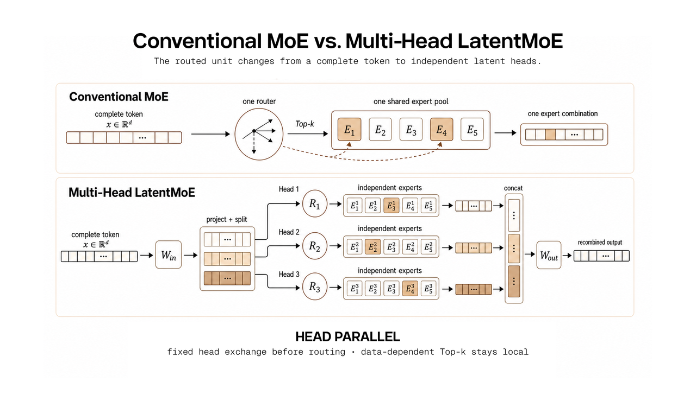
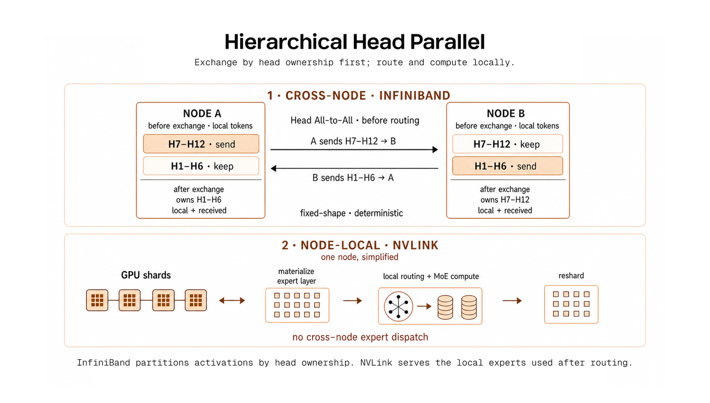

# MAGI-2 Preview：架构与创新点详解

> 本文内容整理自 Sand.ai 官方技术博客 [*MAGI-2 Preview: Scaling Video Generation Models Efficiently*](https://sand.ai/blog/magi-2-preview)（2026-08-05 发布）、官方 [GitHub 仓库](https://github.com/SandAI-org/MAGI-2-preview) 与 [Hugging Face 权重页](https://huggingface.co/sand-ai/MAGI-2-preview)。重点聚焦模型架构与创新点，未涉及与外部模型的横向对比。

---

## 目录

1. [模型概览](#1-模型概览)
2. [背景：从"怎么生成"到"怎么 Scaling"](#2-背景从怎么生成到怎么-scaling)
3. [架构核心：单流 Transformer 起点](#3-架构核心单流-transformer-起点)
4. [MagiMoE：超细粒度 MoE 架构（核心创新）](#4-magimoe超细粒度-moe-架构核心创新)
5. [114B 规模下的系统协同设计](#5-114b-规模下的系统协同设计)
6. [数据方法论：从"过滤"到"生产 + 精准标注"](#6-数据方法论从过滤到生产--精准标注)
7. [推理管线与部署](#7-推理管线与部署)
8. [官方定位与已知局限](#8-官方定位与已知局限)
9. [参考资料](#9-参考资料)

---

## 1. 模型概览

| 项目 | 内容 |
|---|---|
| 模型名称 | MAGI-2 Preview |
| 发布方 | [Sand.ai](https://sand.ai) |
| 发布时间 | 2026 年 8 月 5 日 |
| 模型类型 | **统一音视频生成模型**（文生视频 T2V / 图生视频 I2V，视频与音频同时生成） |
| 总参数量 | **约 114B** |
| 激活参数量 | **约 6B / token** |
| 生成规格 | 仅支持 **10 秒**片段；最终输出 1088×1920（≈1080p，竖屏） |
| 开源协议 | **Apache 2.0**（权重 + 推理代码全开放） |
| 权重体积 | 约 307 GB（Hugging Face: `sand-ai/MAGI-2-preview`） |
| 推理硬件 | 8 张 NVIDIA Hopper GPU（80 GB 显存） |
| 技术路线 | 单流 Transformer + 超细粒度多头 MoE（Ultra-Fine-Grained MoE，代号 MagiMoE） |
| 官方口号 | "Scaling Video Generation Models Efficiently"（高效地扩展视频生成模型） |

官方对模型的定性（原文引用）：

> "Magi-2 Preview is a 114B-parameter unified audio-video generation model that activates just 6B parameters per token. Built on MagiMoE and co-designed across architecture, systems, and data, it explores an efficient path to scaling video generation."
> —— [GitHub README](https://github.com/SandAI-org/MAGI-2-preview)

---

## 2. 背景：从"怎么生成"到"怎么 Scaling"

MAGI-2 的定位建立在其前作 MAGI-1 之上，二者回答的问题不同：

> "In *Magi-1: Autoregressive Video Generation at Scale*, we studied **how video should be generated**. Magi-1 divides a video into temporal chunks and models their causal relationships through autoregressive denoising, enabling streaming generation and video continuation."
>
> "Magi-2 turns to another foundational question: **how should a video generation model scale?**"

官方指出，视频生成社区在过去两年虽不断扩模型、扩数据、扩算力，但"从模型规模到更好生成效果"的路径并不清晰（对比语言模型的明确正反馈循环）。MAGI-2 因此从**三个相互依赖的维度**同时推进：

1. **可扩展的模型架构（Scalable Model Architecture）**：达到 100B 规模的同时保持很小的激活参数量；
2. **可扩展的训练系统（Scalable Training System）**：面向通信、内核、路由稳定性、优化与显存效率的"架构-基础设施"协同设计；
3. **可扩展的数据（Scalable Data）**：从"以过滤为中心"转向"高吞吐数据生产 + 精准多模态标注"。

> "Magi-2 Preview is an intermediate research release. It validates that the architecture, training system, and data methodology can scale together at the 100B level, while revealing several scaling signals that merit further study."

即：MAGI-2 Preview 是**中间研究版本**，用于验证"架构 × 系统 × 数据"三者能在千亿规模上同步放大。

---

## 3. 架构核心：单流 Transformer 起点

MAGI-2 没有沿用 MAGI-1 的自回归分块（autoregressive chunking）建模，而是采用**单流（single-stream）架构**作为统一音视频建模的起点，其来源是团队此前的 *Speed by Simplicity*（MagiHuman）工作：

> "We build on the single-stream design validated in *Speed by Simplicity: A Single-Stream Architecture for Fast Audio-Video Generative Foundation Model*. MagiHuman uses a single Transformer to process text, video, and audio as **one unified token sequence using self-attention only**, avoiding the additional complexity introduced by multiple modality towers and cross-attention interfaces."

设计动机——模态间的强耦合：

> "Text, video, and audio describe the same event. Language, lip movements, body motion, environmental sound, music, and camera rhythm are continuously interdependent. Placing these modalities in a single sequence allows them to exchange information throughout the same backbone, rather than interacting only at a small number of predefined interfaces."

**要点**：文本、视频、音频共享同一 backbone 与同一 token 序列，模态间全序列自由交互；这为后续 MoE 架构、训练系统和数据方法提供了统一的规模化基础（"all three modalities enter a unified token sequence and are processed by the same Transformer backbone"）。

---

## 4. MagiMoE：超细粒度 MoE 架构（核心创新）

### 4.1 为什么视频模型需要 MoE

MAGI-2 论证了稠密模型在视频生成上的两个瓶颈：

- **训练基础设施**：扩宽 FFN 或加层会同步放大参数、梯度、优化器状态与每 token 的计算量；在 100B 规模、长序列视频训练下，"稠密扩展在成为架构问题之前首先成为系统问题"（"dense scaling can become a systems problem before anything else"）。
- **推理成本**：视频生成处理大量时空 token，且去噪网络需重复执行，本就比文本生成昂贵；若 100B 稠密模型每一步都激活全部参数，延迟与服务成本会使其难以实用。因此**推理效率必须在架构设计阶段考虑**，而非训练完成后再补救。

MoE 的核心价值——解耦"总容量"与"单 token 计算量"：

$$F_{\text{dense}} \propto N \cdot P_{\text{FFN}}, \qquad F_{\text{MoE}} \propto N \cdot P_{\text{active}}, \qquad P_{\text{active}} \ll P_{\text{total}}$$

其中 $N$ 为序列长度，$P_{\text{total}}$ 为总参数量，$P_{\text{active}}$ 为每 token 激活的参数量。

### 4.2 标准 MoE 在视频场景的失效

直接把 LLM 常用的 token-choice MoE 移植到视频并不高效。标准 expert-parallel MoE 每层通信量约为 $C_{\text{standard MoE}} \propto N k H$（$k$ 为激活专家数，$H$ 为通信载荷维度），并伴随三类系统开销：

- **Stragglers / bubbles**：all-to-all 流量与专家计算在 rank 间不均衡，整体吞吐受最慢 rank 限制；
- **峰值显存不均衡**：接收缓冲、permute 后的激活、反向保存张量随局部专家负载变化，易导致局部 OOM；
- **Host 侧控制开销**：动态 token 数、路由元数据、偏移量带来 GPU-CPU 同步，打断异步执行。

而视频 latent 的序列远长于文本、模态/噪声水平/空间区域/运动状态高度异构，使这些问题更容易放大为一级成本。

### 4.3 Multi-Head LatentMoE 与 Head Parallel（结构基础）

MAGI-2 采用微软亚研院 [Multi-Head LatentMoE 与 Head Parallel](https://arxiv.org/abs/2506.06929) 的技术路径：**每个 latent head 拥有独立的路由器和独立的专家集合**，子 token 先沿 head 维分发（Head Parallel），随后各 head 所有者在本地完成路由与专家计算。

将完整表示切分为 $M$ 个 latent head（每个维度 $H_{\text{head}}$，$H = M \cdot H_{\text{head}}$）后，Head Parallel 的通信量变为：

$$C_{\text{Head Parallel}} \propto N M H_{\text{head}} = N H$$

关键收益（原文）：

> "Cross-device communication does not grow with Top-$k$ for each head. More importantly, cross-device send and receive shapes can be determined **statically** by the head partition, allowing buffers to be allocated in advance. Routing remains data-dependent, but its irregularity is moved inside each head owner rather than directly determining cross-device communication shapes."
>
> "Head Parallel thus establishes a **regular, preallocatable communication boundary**."

下图即博客中 Multi-Head LatentMoE / Head Parallel 的结构示意图：



*图 1：Multi-Head LatentMoE 结构示意图。完整 token 表示被划分为多个低维 latent head 子空间，每个 head 拥有独立路由器与独立专家集合；子 token 沿 head 维分发，跨设备通信形状由 head 划分静态决定。（来源：[官方博客 §2.1](https://sand.ai/blog/magi-2-preview)）*

### 4.4 Ultra-Fine-Grained MoE：超细粒度专家配置

在 Multi-Head LatentMoE 基础上，MAGI-2 把专家计算放进**独立的低维 head 子空间**，在每个 head 内配置**大量窄专家**——官方称之为 **Ultra-Fine-Grained MoE（超细粒度 MoE）**。

**模型配置（官方原文表格）：**

| Component | Magi-2 Preview configuration |
|---|---|
| Backbone | 40 Transformer layers |
| Sparse core | The middle 36 layers use Multi-Head MoE; the four boundary layers remain dense |
| Model width | 3,072 |
| Routed representation | 12 heads × 256 dimensions |
| Expert pool | 256 experts per head |
| Active experts | Top-6 per head |
| Expert FFN | 256 → 1,280 → 256, fused SwiGLU7 |

**路由计算（原文公式）：**

每个 token 先经 split projection 把 3072 维隐状态映射为路由表示，再切分为 12 个 256 维子空间：

$$\tilde{x} = W_{\text{in}} x, \qquad \tilde{x} \rightarrow [x^{(1)}, \ldots, x^{(12)}], \qquad x^{(h)} \in \mathbb{R}^{256}$$

每个 head 有独立路由器，从自己的 256 个专家中选 Top-6：

$$I^{(h)} = \operatorname{TopK}_6\left(\sigma\left(G^{(h)} x^{(h)} + b^{(h)}\right)\right), \qquad y^{(h)} = \sum_{e \in I^{(h)}} p_e^{(h)} E_e^{(h)}\left(x^{(h)}\right)$$

12 个 head 输出拼接后经 merge projection 映射回 Transformer 隐状态：

$$y = W_{\text{out}} \operatorname{Concat}\left(y^{(1)}, \ldots, y^{(12)}\right)$$

**规模换算**：每个稀疏层含 $12 \times 256 = 3{,}072$ 个 head-local 专家单元，每 token 激活 $12 \times 6 = 72$ 个。

**核心创新点（原文强调）：**

> "These are not 3,072 full-width experts. Each expert unit operates on only one 256-dimensional subspace. Compared with routing the complete hidden state once, different representation subspaces of the same token can form different expert combinations. Magi-2 does not add a collection of wide FFNs that must be invoked as indivisible units, but rather a collection of **low-dimensional transformations that can be selected and recombined independently**."

一句话概括：MAGI-2 没有堆叠"不可分割的宽 FFN 专家"，而是提供**可独立选择、自由重组的大量低维变换**——这是其区别于传统 MoE 视频模型的本质。

---

## 5. 114B 规模下的系统协同设计

架构定了之后，把 3072 个细粒度专家单元扩展到 114B 需要解决三个系统问题：

1. 把 Head Parallel 映射到**层次化集群**（节点内 NVLink + 节点间 InfiniBand 两种带宽层级）；
2. 高效执行**数千个小专家内核**；
3. 分布式地完成**优化器计算**。

MAGI-2 给出三件套：**Hierarchical Head Parallel + MagiMoE（执行内核）+ MagiMuon（优化器）**。

### 5.1 Hierarchical Head Parallel（分层 Head Parallel）

单张 GPU 无法在训练全程驻留某个 head 的完整专家库，而集群天然分两层网络。MAGI-2 将两类通信**分别映射到两个带宽层级**：

- **跨节点（InfiniBand）**：只交换**固定形状**的 head 激活切片——按固定 head 归属在路由前分发，收发计数可由 head 划分静态推导，buffer 可预先分配；
- **节点内（NVLink）**：以 ZeRO/FSDP 风格对专家权重、梯度、优化器状态做**全量分片**，按需物化、算完再 reshare。

官方伪代码：

```python
x_heads = x.view(N, M, head_dim)
x_heads = head_dispatch_over_ib(x_heads)   # fixed head ownership
routes  = route_per_local_head(x_heads)    # data-dependent, local
y_heads = grouped_expert_ffn(x_heads, routes)
y = head_combine_over_ib(y_heads).view(N, M * head_dim)
```

> "The inter-node network handles only regular head slices, not the dynamic token copies produced by Top-$k$. ... InfiniBand therefore handles fixed-shape head-activation exchange, while NVLink handles high-bandwidth gathering and resharding of expert states. A GPU responsible for a given head does not need to keep that head's entire expert bank resident."



*图 2（博客 Figure 2）：分层 Head Parallel 示意。跨节点按固定 head 归属交换激活切片（InfiniBand）；节点内由高带宽互连负责专家参数、梯度与优化器状态的存储、物化与重分片（NVLink）。（来源：[官方博客 §3.1](https://sand.ai/blog/magi-2-preview)）*

### 5.2 MagiMoE：细粒度专家的高效执行内核

Head Parallel 规整了跨节点通信，但每个 head 所有者仍需处理路由、token 重排与专家计算。对传统 MoE 有效的 Grouped GEMM 路径（先按路由结果重排 token，再执行不同大小的专家矩阵）在 MAGI-2 这里失效——每层 3072 个窄专家单元使**每个单元收到的 token 更少、GEMM 形状更小更不规则**，排序、内核启动与中间张量读写会反噬稀疏计算的红利。

MagiMoE 因此不是替换单个 Grouped GEMM 内核，而是**联合优化从路由到专家输出合并的完整路径**：

```text
fused routing and Top-K
  → compact expert-wise token layout
  → fused grouped expert FFN
  → routing-weighted output merge
```

配套工程细节（原文要点）：

- **精度策略**：路由打分用 FP32 保证数值稳定，专家权重与主计算用 BF16；
- **融合**：SwiGLU 的 up/gate 投影融合，减少中间结果物化与显存流量；
- **显存**：为长视频序列提供 memory-efficient 的正反向路径，控制激活显存；
- **负载均衡**：采用**无辅助损失的 expert-bias**（Auxiliary-Loss-Free Load Balancing，[论文 7]），不向主训练目标引入额外负载均衡损失；对每个路由 head 独立施加，并在**独立 CUDA stream 上异步聚合专家负载统计**，减少对主计算路径的干扰。

### 5.3 MagiMuon：理解 Head × Expert 结构的优化器

多头 MoE 不仅改变前向计算，也改变了优化器面对的矩阵形态：专家权重天然构成一批由 **head × expert** 索引的小矩阵。

- **结构化批处理**：路由门控按 head 分组视为矩阵批；专家 up/gate/down 投影把 head 与 expert 展平进 batch 维，**对每个矩阵独立做 Muon 正交化**，并将矩阵批分布到各 rank 以均衡优化器计算，而非拼成一个人为的大矩阵。
- **混合更新规则**：adapter、mHC、attention sinks 与门控相关参数用 Adam 式更新；主矩阵参数用 MagiMuon——"让优化器匹配每类参数的几何结构"。
- **与 Kimi K3 的呼应（原文）**：Kimi K3 的 *Per-Head Muon* 沿注意力 head 维拆分 Q/K/V 动量矩阵并独立正交化；MagiMuon 则针对多头 MoE 的 head-local 专家矩阵。二者针对不同结构，但反映同一设计原则："**当模型具有显式 head 结构时，优化器也可以利用该结构**"。

---

## 6. 数据方法论：从"过滤"到"生产 + 精准标注"

### 6.1 数据过滤陷阱（The Data Filtering Trap）

> "If data is continually trimmed to match the capability boundary of a small model, a larger model still sees a simplified world and has little new structure from which to learn. We call this the **data filtering trap**: When training data is continually simplified to fit the current model, the data itself becomes the capability ceiling of a stronger model."

早期小模型（~7B 及以下）为产出稳定演示，社区形成了"过滤优先"策略：只保留主体清晰、运动简单、镜头稳定的样本。这在当时有效，但**限制了后续 Scaling**——被反复修剪过的数据无法为更大模型提供新的可学习结构。

### 6.2 从"过滤为中心"转向"高吞吐生产 + 精准标注"

MAGI-2 把数据管线的重心从过滤转向**高吞吐数据生产与精准标注**：

- 必要的治理（安全、合规、隐私、严重损坏样本处理、去重）仍然保留，但"**当前模型是否容易生成**"不再是样本准入的首要标准；
- 尽可能保留**复杂运动、多人交互、镜头切换、长尾主体、字幕、屏幕文字、复杂音画关系**；
- 新管线把"主体与场景、动作与交互、镜头与时间结构、对话与歌曲、环境声与音乐、屏幕文字与字幕"纳入**可规模化的多模态标注**。

> "This also gives data quality a new meaning: **preserve useful complexity, then describe that complexity accurately**. Under this definition, annotation is no longer an additional step after filtering, but core infrastructure for data scaling."

### 6.3 涌现能力（Emerging Capabilities）

过滤往往不止删掉孤立片段，还会**切断样本内部与模态间的关联**（例如删掉多镜头视频 = 丢失"同一人物跨镜头的一致性"）。当这些关系被保留并与更大容量结合时，官方观察到**未经专门模块引入**的涌现能力：

> "With more multi-shot data, identities are more likely to remain consistent across different shots. When subtitled data is retained, we also observe samples in which character dialogue or songs appear together with corresponding subtitle effects."
>
> "They suggest that some forms of visual intelligence may arise from **jointly learning the relationships present in real data**, without requiring a dedicated module for every capability."

官方也承认这些仍是定性观察，需要更系统的受控实验。

---

## 7. 推理管线与部署

### 7.1 两阶段生成

MAGI-2 Preview 的推理分两阶段（来自 [GitHub README](https://github.com/SandAI-org/MAGI-2-preview)）：

| 阶段 | 作用 | 分辨率 |
|---|---|---|
| `magi2_preview` | 主去噪阶段，生成 10 秒片段（低分辨率） | 512×896 |
| `magi2_refiner` | 将结果超分到 1080p 交付档 | 1088×1920 |

音频与视频同时生成，并 mux 进输出文件（需要 ffmpeg）。

### 7.2 采样步数与蒸馏状态

| Release | Denoising steps | Weights |
|---|---|---|
| MAGI-2 Preview, base | 100 preview + 5 refiner | `sand-ai/MAGI-2-preview` |
| MAGI-2 Preview, distilled | far fewer | Coming soon（官方预告蒸馏版） |

> "Neither transformer has been step-distilled, so the denoising step count is where most of the wall-clock time goes."

### 7.3 权重构成（约 307 GB）

| 目录 | 大小 | 内容 |
|---|---|---|
| `preview` | 228 GB | Preview 阶段 Transformer（随 MAGI-2 发布） |
| `text_encoder` | 56 GB | 文本编码器 [Qwen/Qwen3.5-27B](https://huggingface.co/Qwen/Qwen3.5-27B) |
| `refiner` | 14 GB | Refiner 阶段 Transformer |
| `stable-audio-open-1.0` | 5 GB | 音频 VAE（解码生成的音频 latent） |
| `vae` | 3 GB | 视频 VAE（来自 [Wan-AI/Wan2.2-TI2V-5B](https://huggingface.co/Wan-AI/Wan2.2-TI2V-5B)） |
| `turbo_vae` | 2 GB | 蒸馏 VAE 解码器（默认用于解码，时间滑动窗口，每个视频单 rank 执行） |

### 7.4 部署要点

- **硬件**：8 张 NVIDIA Hopper GPU（80 GB），Python 3.12 + CUDA，提供官方 [Docker 镜像](https://hub.docker.com/r/sandai/magi-2-preview)；
- **大组件换入换出**：`MAGI2_TEXT_ENC_OFFLOAD_MODE` / `MAGI2_PREVIEW_OFFLOAD_MODE` / `MAGI2_REFINER_OFFLOAD_MODE` / `MAGI2_VAE_OFFLOAD_MODE` 四个环境变量控制各组件在 `cpu` / `gpu` / `roundtrip` 间的调度（preview 与 refiner 默认 `roundtrip`，因 1080p 下任一阶段都无法与另一阶段激活共存于单张 80 GB 卡）；
- **Prompt 增强（可选）**：模型训练数据为长结构化描述，官方提供可选的 PE 步骤——经 OpenAI 兼容接口调用指令跟随 LLM，把短提示词改写为 10 秒片段的结构化 JSON 描述，再渲染成 Markdown 送入下游（T2V / I2V 各有一套模板）；
- **确定性**：`--deterministic` 使 MoE scatter 与 attention 内核位级确定（以速度为代价）；
- **生态**：社区（[orcarouter](https://www.orcarouter.ai/blog/magi-2-preview-sglang-serving-leak)）正在为 MAGI-2-preview 开发 SGLang 一等公民 serving 支持。

---

## 8. 官方定位与已知局限

官方明确这是一次**中间验证（intermediate validation）**，并主动划清边界：

> "Magi-2 Preview does not suggest that more parameters automatically produce a better model. Rather, **model capacity, data complexity, and systems efficiency must scale together**: the model architecture determines how capacity is organized, data determines what that capacity can learn, and the system determines whether that capacity can be trained and deployed reliably."
>
> "Magi-2 Preview remains a research preview on this path. **Future scaling curves, controlled ablations, and capability-boundary analyses will continue to test how far this approach can go.**"

已知局限（综合博客与 README）：

1. **时长固定 10 秒**，是当前唯一支持的生成时长；
2. **未蒸馏**，base 版需 100+5 步去噪，墙钟时间较长（蒸馏版"Coming soon"）；
3. **无完整 Scaling 曲线与对照消融**，数据带来的"涌现能力"仍是定性观察；
4. 官方强调"更多参数 ≠ 更好模型"，三要素必须同步 Scaling。

---

## 9. 参考资料

- 官方技术博客（本文主要来源）：[*MAGI-2 Preview: Scaling Video Generation Models Efficiently*](https://sand.ai/blog/magi-2-preview)
- 官方 GitHub 仓库（推理代码 / README）：https://github.com/SandAI-org/MAGI-2-preview
- Hugging Face 权重：https://huggingface.co/sand-ai/MAGI-2-preview
- 相关论文与工作（博客引用）：
  - [1] MAGI-1: Autoregressive Video Generation at Scale
  - [2] Speed by Simplicity: A Single-Stream Architecture for Fast Audio-Video Generative Foundation Model（MagiHuman）
  - [5] Multi-Head Mixture-of-Experts（微软亚研院）
  - [6] Multi-Head LatentMoE and Head Parallel（https://arxiv.org/abs/2506.06929）
  - [7] Auxiliary-Loss-Free Load Balancing Strategy for Mixture-of-Experts
  - [8] Kimi K3: Open Frontier Intelligence（Per-Head Muon）
- 部署生态：[MAGI-2-preview on SGLang: first-class serving in the works](https://www.orcarouter.ai/blog/magi-2-preview-sglang-serving-leak)

---

*本文档图片（`assets/fig-multihead-latentmoe.png`、`assets/fig-head-parallel.png`）均直接摘录自官方技术博客，版权归 Sand.ai 所有。*
