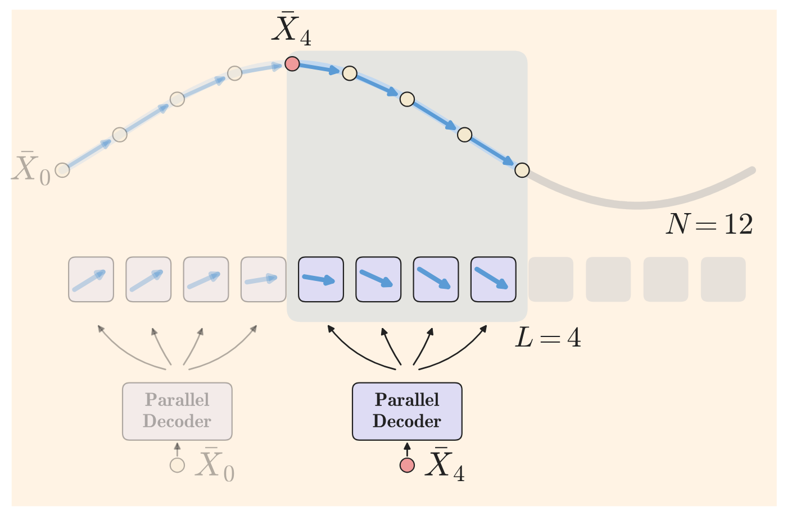
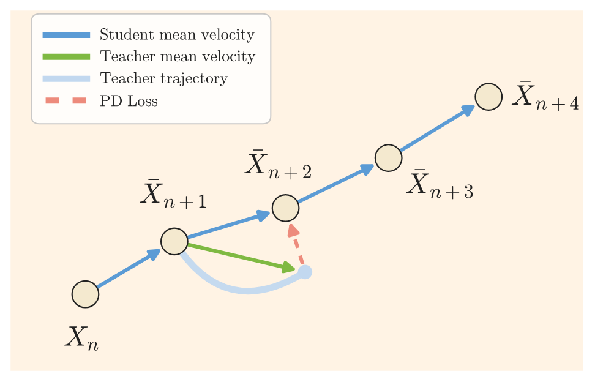
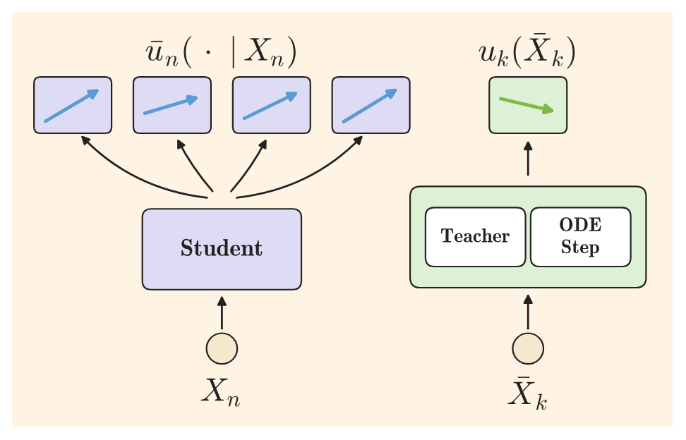
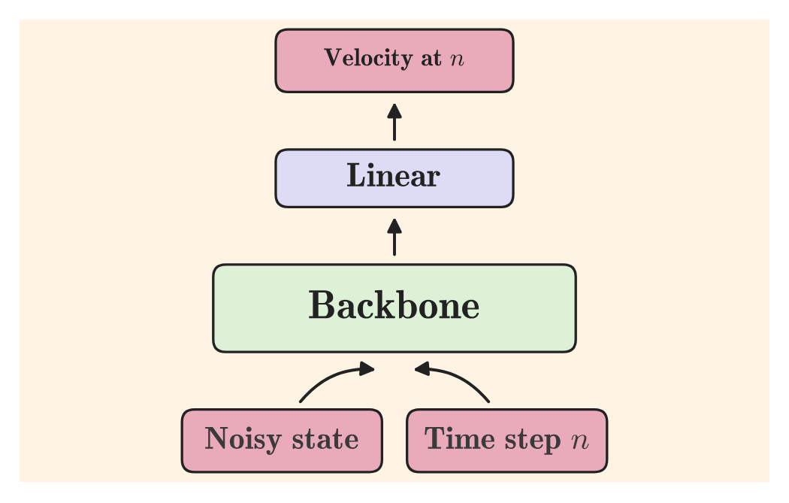
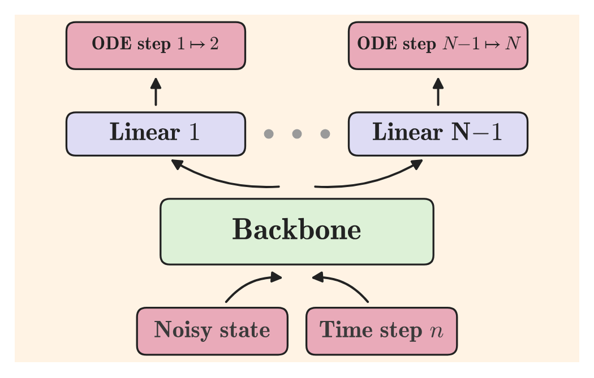
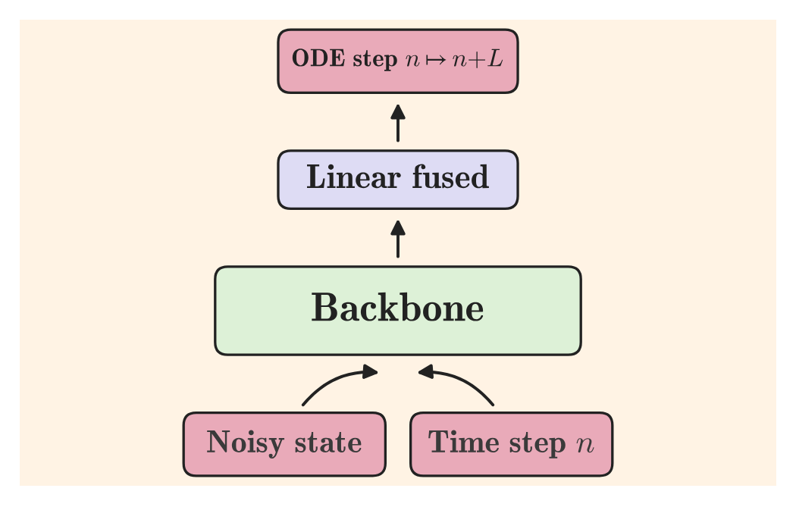

# PDD：架构与创新点详解

> 本文内容整理自 NVIDIA GenAI Research 论文 [*Parallel Decoding Distillation for Fast Image and Video Generation*](https://arxiv.org/abs/2607.26004)（arXiv:2607.26004，2026-07-28，Shaul, Liu, Vahdat, Berner）与[官方项目主页](https://research.nvidia.com/labs/genair/pdd/)。重点聚焦方法原理与创新点，内容仅围绕 PDD 本身。代码开源在 [github.com/NVlabs/fastgen](https://github.com/NVlabs/fastgen)。本目录另附[可交互演示网页](web/index.html)（clone 后浏览器打开即可离线运行）。

---

## 目录

1. [方法概览](#1-方法概览)
2. [背景：采样慢与蒸馏的两大家族](#2-背景采样慢与蒸馏的两大家族)
3. [核心思想：并行预测多步，而非合并大步](#3-核心思想并行预测多步而非合并大步)
4. [数学形式化：平均速度与块步规则](#4-数学形式化平均速度与块步规则)
5. [训练目标：PD Loss](#5-训练目标pd-loss)
6. [架构与层融合](#6-架构与层融合)
7. [可变 NFE 与 data-free 训练](#7-可变-nfe-与-data-free-训练)
8. [实验结果](#8-实验结果)
9. [与相关工作的对比](#9-与相关工作的对比)
10. [局限与未来方向](#10-局限与未来方向)
11. [交互演示与效果视频](#11-交互演示与效果视频)
12. [参考资料](#12-参考资料)

---

## 1. 方法概览

| 项目 | 内容 |
|---|---|
| 方法名称 | **PDD**（Parallel Decoding Distillation，并行解码蒸馏） |
| 发布方 | NVIDIA GenAI Research × Weizmann Institute of Science |
| 发布时间 | 2026 年 7 月 28 日（arXiv:2607.26004） |
| 方法类型 | **轨迹式（trajectory-based）蒸馏**：把教师模型的多步采样轨迹蒸馏为少步生成器 |
| 核心机制 | 学生模型**一次网络评估并行预测一个块内 L 个子区间的平均速度**，每次评估推进 L 个区间 |
| 训练目标 | **纯回归（MSE）**：无 VSD、无 GAN、无 JVP、无有限差分、单阶段训练 |
| 支持模型 | 任意预训练流匹配 / 扩散模型（backbone 原样复用，仅替换最后一层线性层） |
| NFE 灵活性 | **一个模型支持多档 NFE**（训练时随机块大小，推理时按需选择 2/4/8 等） |
| 数据需求 | 支持 **data-free 训练**（Qwen-Image / Wan2.1 / LTX-2.3 均无数据训练） |
| 验证规模 | ImageNet-256（SiT-XL+REPA）、Qwen-Image 20B、Wan2.1 1.3B/14B、LTX-2.3 22B（T2V+音频） |
| 主要成绩 | 4–8 NFE 下 OneIG / DPG / GenEval / VBench **SOTA**；多样性显著优于 DMD2 等分布式方法 |

论文摘要（原文引用）：

> "In this paper, we introduce Parallel Decoding Distillation (PDD), a simplified and scalable trajectory-based distillation method for fast inference of diffusion and flow matching models. ... Conceptually, it learns a representation of the mean velocity without regressing its derivative using JVPs or finite-difference approximations."

---

## 2. 背景：采样慢与蒸馏的两大家族

扩散 / 流匹配模型生成 = 数值求解一个 ODE。经典求解器每步只推进一个小区间，动辄上百次网络推理（如 Wan2.1 教师用 UniPC 50×2 NFE）。现有蒸馏方法分两大流派：

| | 轨迹式 Trajectory-based | 分布式 Distribution-based |
|---|---|---|
| 思路 | 学生复刻教师的**采样轨迹**（逐步对齐） | 只对齐学生 / 教师的**边际分布**，不苛求轨迹 |
| 代表 | Progressive Distillation、Consistency Models、Flow Maps、Pi-Flow、**PDD** | ADD/LADD（GAN）、DMD/DMD2（VSD）、rCM、AnyFlow |
| 优点 | 忠实轨迹、天然保留多样性 | 视频大模型上质量高 |
| 痛点 | 搬到视频上质量崩 / 训练贵（依赖 JVP、有限差分） | loss 难调、易**模式坍缩** → 多样性差、运动少甚至静止 |

关键矛盾：视频蒸馏的 SOTA（DMD2、AnyFlow、rCM）几乎全是分布式的，靠 VSD / 对抗损失，代价是模式坍缩；而轨迹式方法在视频上长期做不出好效果。PDD 的立场是——**纯回归的轨迹式方法也能在视频上做到 SOTA**，前提是把「难学的整块大步」拆成「好学的多个子区间小步」。

---

## 3. 核心思想：并行预测多步，而非合并大步

传统轨迹式蒸馏（Progressive Distillation、Consistency、Flow Maps）的思路是：把教师在多个小区间上的更新**合并成一个大的方向**，让学生一次跳过去——等价于假设区间内轨迹是直的。

PDD 反其道而行：

1. **离散化**：把采样时间 $[0,1]$ 切成 $N$ 个小区间，再分组为大小为 $L$ 的块（block）；
2. **并行预测**：对每个块，学生**一次前向推理**同时输出块内 $L$ 个子区间各自的平均速度，而不是一个大方向；
3. **块步推进**：按各自的步长迈小步，一次评估跨过 $L$ 个区间；重复 $N/L$ 次得到最终样本，即 $\mathrm{NFE} = N/L$。

「并行」与「合并」的本质区别：合并式蒸馏强迫学生输出一个直线大步；PDD 保留每个子区间各自的方向——**曲率信息被保留下来**，而且中间时刻的回归目标更温和、更好学（等价于给同一个块提供 $L$ 个监督点而不是 1 个）。

---

## 4. 数学形式化：平均速度与块步规则

**流模型与离散化。** 速度场 $v_t$ 定义 ODE $\frac{d}{dt}X_t = v_t(X_t)$，$X_0 \sim p_0$（噪声），$X_1 \sim p_1$（数据）。把时间离散为 $0=t_0 < t_1 < \cdots < t_N = 1$，每个区间上的精确解为：

$$X_{n+1} = X_{n} + (t_{n+1}-t_{n})\,u_{n}(X_{n}), \qquad u_{n}(X_{n}) = \frac{1}{t_{n+1}-t_n}\int_{t_n}^{t_{n+1}} v_t(X_t)\,dt$$

其中 $u_n$ 是区间 $[t_n, t_{n+1}]$ 上的**平均速度**（mean velocity）。训练教师目标时用 Euler（1 次教师推理）或 Midpoint（2 次）数值近似。

**并行解码器。** 给定块起点状态 $X_n$，学生一次推理输出 $L$ 个速度：

$$\bar u^{\theta}_{n}(k \mid X_{n}) \;\approx\; u_{k}(X_{k}), \qquad k = n,\dots,n+L-1$$

这个目标是良定义的：块内状态序列 $X_{n+1},\dots,X_{n+L}$ 被精确解与起点 $X_n$ 完全确定。

**并行化过程与块步规则。** 训练时沿学生自己的 rollout 走完整个块（一次学生推理）：

$$\bar X_{k+1} = \bar X_{k} + (t_{k+1}-t_k)\,\bar u^{\theta}_{n}(k \mid X_{n})$$

推理时用**块步规则**直接跨过 $L$ 个区间，重复 $N/L$ 次：

$$\bar X_{n+L} = X_n + \sum_{k=n}^{n+L-1}(t_{k+1}-t_k)\,\bar u^{\theta}_{n}(k\mid X_{n})$$

一个重要的几何直觉：如果学生完美预测了每个子区间的平均速度，那么块步方向恰好是**连接块两端点的弦方向**——一步精确落在教师轨迹的真实终点 $X_{n+L}$ 上。而朴素大步 Euler 用的是起点瞬时速度（切线方向），曲率一大就冲离曲线（见[交互演示](#11-交互演示与效果视频)）。

---

## 5. 训练目标：PD Loss

$$\mathcal{L}_{\mathrm{PD}}(\theta) \;=\; \mathbb{E}\Big[\big\|\bar u^{\theta}_{n}(k\mid X_{n}) \;-\; u_{k}\big(\mathrm{sg}(\bar X_{k})\big)\big\|^{2}\Big]$$

要点：

- 块起点 $n$ 与块内下标 $k$ 均匀采样；$X_n \sim p_{t_n}$ 用插值过程采样；
- **on-policy**：教师目标在**学生自己 rollout 到的状态** $\bar X_k$ 上求值，防止训练 / 推理分布偏移；
- $\mathrm{sg}$ = stop-gradient：梯度不穿过 rollout，省显存省算力——这是训练便宜的关键；
- 教师平均速度用 Euler（1 次教师推理）或 Midpoint（2 次）近似；**每次迭代只监督一个随机子区间 $k$**，期望上覆盖所有头；
- 单次迭代代价 = **1 次学生推理 + 1~2 次教师推理**，无 JVP、无有限差分、无对抗。

论文给出命题（附录有归纳证明）：在可实现假设下，PD loss 的全局极小值点满足并行解码条件，即**学生轨迹 = 教师轨迹**。

**Data-free 训练。** 高质量视频数据稀缺，PDD 提供在线 on-policy 无数据训练：从纯噪声 $X_0 \sim p_0$ 出发，交替执行「优化步」与「推进步」——用学生当前输出（stop-grad）把状态推进一个块，下一迭代继续。教师侧把 CFG、cross-modal / spatiotemporal skip 引导全部折进教师目标，学生推理时不需要额外评估。

---

## 6. 架构与层融合

学生**原样复用教师 backbone**，只把最后一层线性层重复 $N$ 次（每个时间格点一个头）。设教师为 $v_t(x) = W\,H_t(x)$，则学生为：

$$\bar u^{\theta}_n(k|x_n) = W^{\theta}_k\,H^{\theta}_{t_n}(x_n)$$

| 教师 | 学生（训练） | 学生（推理，融合后） |
|:---:|:---:|:---:|
|  |  |  |

**层融合**是点睛之笔：块方向是 $L$ 个子方向按步长加权的平均，而「线性层的加权和仍是线性层」，所以权重可以直接折进一个线性层：

$$\bar X_{n+L} = \bar X_n + (t_{n+L}-t_n)\,W^{\theta}_{n:n+L}\,H^{\theta}_{t_n}(\bar X_n), \qquad W^{\theta}_{n:n+L} = \sum_{k=n}^{n+L-1}\Delta_k W^{\theta}_k,\;\; \Delta_k = \frac{t_{k+1}-t_k}{t_{n+L}-t_n}$$

两全其美：

- **训练时**保留 $N$ 个头——逐子区间的监督与 rollout 需要每个子区间各自的方向；
- **推理时**融合成 1 个头——只需要块的加权平均方向，**推理算力、显存与教师完全相同**。

共享 backbone 学的是「块区间上的平均速度」表示，$N$ 个线性头把它分解成并行子区间预测——这就是「不回归均速的导数（无 JVP / 有限差分），直接分解」的含义。

---

## 7. 可变 NFE 与 data-free 训练

为什么用 $N$ 个（格子级）头而不是 $L$ 个（块级）头？因为 **$N$ 个头的模型天然支持任意块大小**：推理时按目标 NFE 选块大小 $L = N / \mathrm{NFE}$。训练时块大小在 $[L_{\min}, L_{\max}]$ 内随机变化，一次训练覆盖所有目标档位——不需要像 flow maps 那样引入第二个时间坐标重新训练。

| 推理档位 NFE | 块大小 $L$（以 $N=64$ 为例） | 每次评估推进 | 总评估次数 |
|:---:|:---:|:---:|:---:|
| 2 | 32 | 32 个区间 | 2 |
| 4 | 16 | 16 个区间 | 4 |
| 8 | 8 | 8 个区间 | 8 |

实际配置：ImageNet 用 $N=128$（Euler）/ $64$（Midpoint）；T2I / T2V 用 $N=256$（Euler）/ $128$（Midpoint），配 shift 时间重参数化，支持 2 / 4 / 8 NFE（LTX-2.3 为 4 / 8）。

---

## 8. 实验结果

### ImageNet-256（SiT-XL+REPA 教师，1 NFE，FID ↓）

| 方法 | FID |
|---|:---:|
| Pi-Flow | 2.85 |
| **PDD – Euler** | 2.73 |
| **PDD – Midpoint** | **2.69** |
| FreeFlow | **1.45** |

目标更简单（无高斯混合、无额外网络），还支持多档 NFE。

### Qwen-Image 20B（OneIG-EN ↑ / OneIG diversity ↑）

| 方法 | NFE | OneIG ↑ | 多样性 ↑ |
|---|:---:|:---:|:---:|
| DMD2 (Lightning-v2) | 4 | 0.524 | 0.095 |
| Pi-Flow | 4 | 0.533 | 0.182 |
| **PDD – Euler** | 4 | 0.535 | **0.192** |
| **PDD – Midpoint** | 4 | **0.538** | 0.174 |

DMD2 质量高但多样性只有 0.095——模式坍缩的典型表现；PDD 几乎翻倍，同时 OneIG / DPG-Bench / GenEval 三榜总体分最高。

### Wan2.1 14B T2V（VBench，4 NFE）

| 方法 | Overall ↑ | Quality ↑ | 多样性 (V-JEPA2) ↑ |
|---|:---:|:---:|:---:|
| AnyFlow | **84.95** | 85.70 | 0.0786 |
| rCM | 84.92 | 85.43 | — |
| DMD2 (FastGen) | 84.40 | 85.16 | 0.0568 |
| **PDD (short)** | 84.92 | **85.71** | 0.0791 |
| **PDD (long)** | 84.69 | 85.69 | **0.0846** |

质量分最高；多样性（V-JEPA2 / VideoMAE V2 两两特征距离）全面领先所有基线；训练仅 200–3000 迭代。生成视频的运动量也明显更多。

### LTX-2.3 22B T2V + 音频（8 NFE）

- 无数据训练仅 **250 迭代**，8 NFE 达到与官方蒸馏模型相当或更好的质量（教师需 4×30 NFE）；
- Gemini 3.1 Pro 盲评（300 组配对对比）：PDD **赢 142 / 平 35 / 输 123**，四轴均分 2.62 vs 2.59。

---

## 9. 与相关工作的对比

| | Flow Maps（Eulerian / Lagrangian） | Pi-Flow | **PDD** |
|---|:---:|:---:|:---:|
| 蒸馏对象 | 任意两时刻的平均速度 | 连续时间瞬时速度 $v$ | 离散区间的平均速度 $u$ |
| NFE 可变性 | 可变 | 固定 | **可变**（训练时随机块大小） |
| JVP / 有限差分 | 需要 | 免 | **免** |
| 推理时的头 | 线性 | 高斯混合 | **融合线性**（与教师同代价） |
| 额外网络 / 多阶段 | — | 策略头 | **无，单阶段** |

与 Pi-Flow 最接近，但把「连续时间 + 高斯混合策略头 + 固定 NFE」简化成「离散时间 + 可融合线性头 + 可变 NFE」；与 Lagrangian flow maps 的联系在于：对 flow map 损失关于 $s$ 积分即得 PDD-like 目标——但 PDD 不需要回归位移的导数（无需 JVP）。

---

## 10. 局限与未来方向

**已知局限：**

- **8-NFE 反直觉退化**：ImageNet 上 NFE=8 的 FID 反而变差——作者归因于 guidance scale 与档位错配（每档 NFE 各有最优引导强度）；
- **训练期显存**：训练时最后一层是 $N$ 倍宽的（虽然相对 backbone 占比小），大模型上是工程取舍；
- **关键超参**：时间重参数化（shift）与 batch size 最重要；Midpoint 一致优于 Euler（代价是 2 次教师推理）；
- **数据依赖设置**：大规模实验走 data-free 路线；带数据蒸馏仅在 ImageNet 验证。

**未来方向（论文提出）：**

- **自适应块大小**：块大小可以在评估之后再选——用 verifier / 置信度判据决定每步跳多远；
- **推广到离散自回归模型**：把「并行解码」原则扩展到非扩散类生成模型。

---

## 11. 交互演示与效果视频

本目录附带一个**完全离线的交互演示网页**：[web/index.html](web/index.html)（clone 后双击打开，或 `open pdd/web/index.html`）。

- **螺旋流场可视化**：绿色折线是 PDD（每次「评估」并行给出块内 $L$ 个子区间方向，一个块步精确落在真实曲线上）；红色虚线是朴素大步 Euler（用起点瞬时速度跳，因曲率飞偏）；白色点线是教师精确轨迹；
- **可调参数**：NFE（2/4/8/16）、播放 / 单步 / 重置、换一条随机轨迹、显示开关（教师轨迹 / 朴素 Euler / 子区间方向）；
- **效果视频**：网页内嵌 8 段官方演示视频（LTX-2.3 8-NFE 含音频 ×3、Wan2.1 14B 4-NFE ×3、PDD vs FM 动画、训练收敛模拟）。

核心直觉一句话：**块平均速度 = 连接块两端点的弦方向，所以完美的 PDD 块步一步直达教师轨迹的真实终点；切线方向做不到。**

---

## 12. 参考资料

- 论文：Shaul, Liu, Vahdat, Berner. *Parallel Decoding Distillation for Fast Image and Video Generation*. arXiv:2607.26004, 2026. <https://arxiv.org/abs/2607.26004>
- 项目主页：NVIDIA GenAI Research. <https://research.nvidia.com/labs/genair/pdd/>
- 代码：NVlabs/fastgen. <https://github.com/NVlabs/fastgen>
- 相关工作：Pi-Flow (arXiv:2506.07986)、MeanFlow (arXiv:2505.13447)、DMD2 (arXiv:2405.14867)、AnyFlow、rCM 等见论文引用
- 本目录的示意图与视频素材来自 NVIDIA 官方项目页，交互演示网页为本仓库自制
