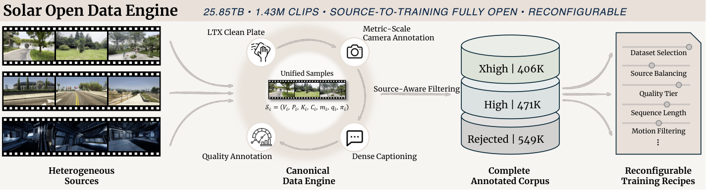
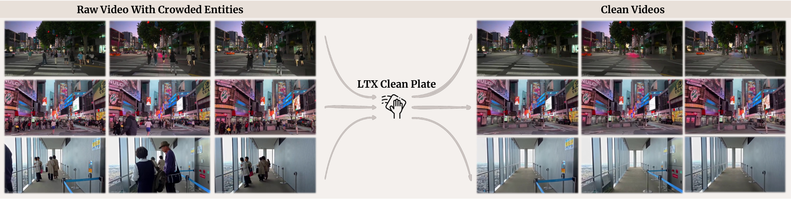
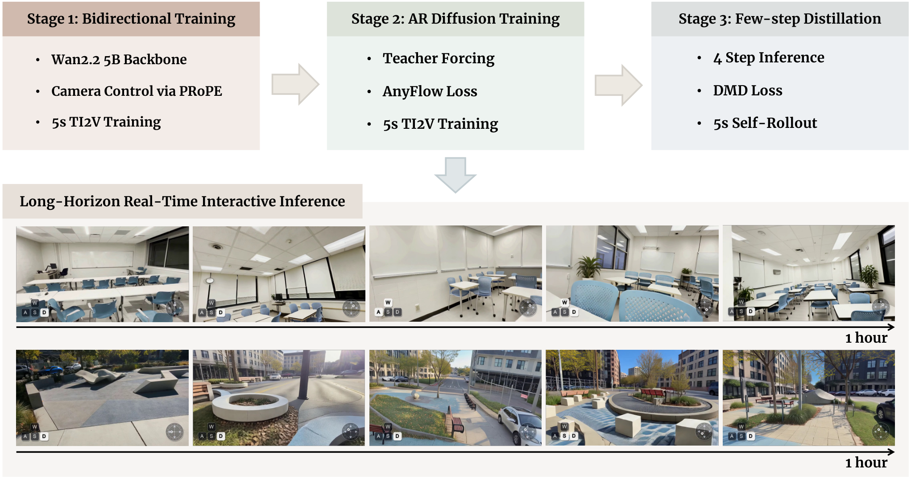
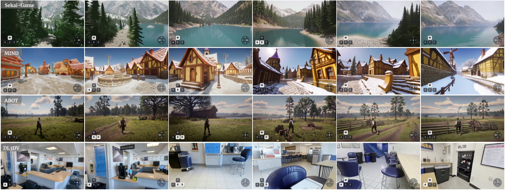
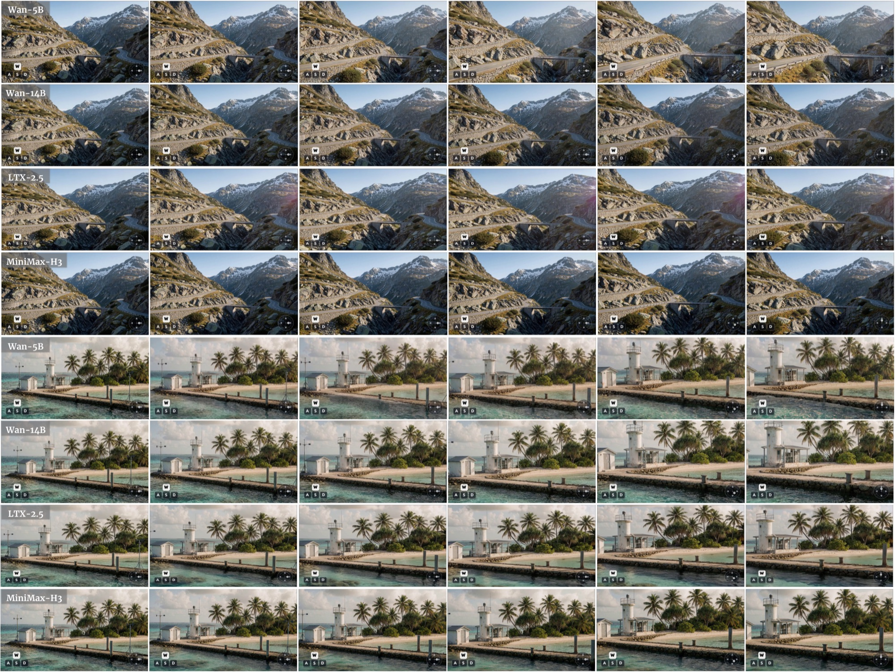
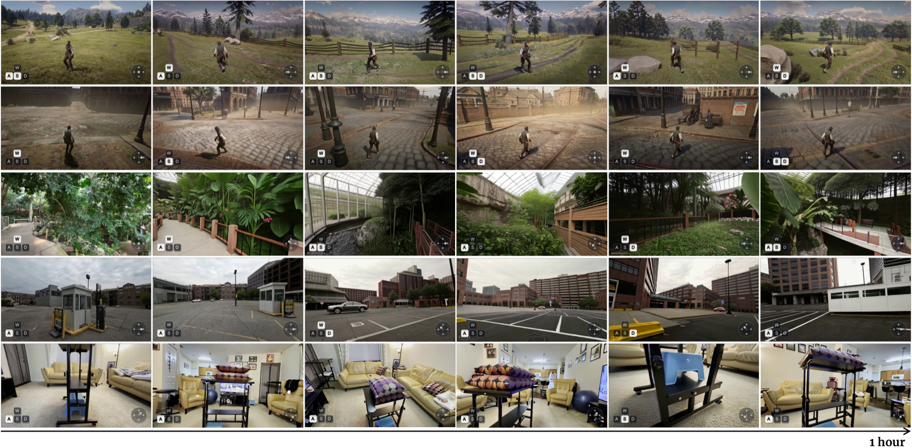
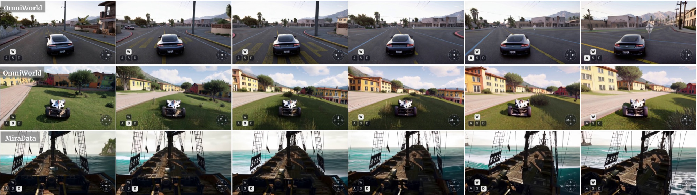

# SolarWM：架构与创新点详解

> 本文内容整理自论文 [*SolarWM: Open Data and Scalable Training for Long-Horizon Video World Models*](https://arxiv.org/abs/2609.02886)（arXiv:2609.02886v1，cs.CV，2026.09）的 HTML 全文，以及官方仓库 [Junchao-cs/SolarWM](https://github.com/Junchao-cs/SolarWM)（HEAD `208141b`，含 data-engine 子模块 `Enderfga/solar-wm-data`）通读。重点聚焦数据引擎、模型家族与三阶段训练配方，数字均取自论文正文与表格。

---

## 目录

1. [模型概览](#1-模型概览)
2. [背景与痛点：两处耦合的异构性](#2-背景与痛点两处耦合的异构性)
3. [开放数据引擎](#3-开放数据引擎)
4. [最终语料与 recipe 构造](#4-最终语料与-recipe-构造)
5. [模型家族：四个 backbone，一套接口](#5-模型家族四个-backbone一套接口)
6. [统一相机条件化：Fused-PRoPE](#6-统一相机条件化fused-prope)
7. [三阶段训练配方（核心）](#7-三阶段训练配方核心)
8. [实验结果](#8-实验结果)
9. [已知局限](#9-已知局限)
10. [参考资料](#10-参考资料)

---

## 1. 模型概览

| 项目 | 内容 |
|---|---|
| 论文 | *SolarWM: Open Data and Scalable Training for Long-Horizon Video World Models*（arXiv:2609.02886v1，2026-09-02） |
| 机构 | CUHK-SZ · SLAI · NUS · CUHK · HKUST · HKUST-GZ · NVIDIA · UCLA · MSRA |
| 通讯 | Junchao Huang（junchaoh.cs@gmail.com，项目负责人） |
| 定位 | **全开放的交互式视频世界模型基础栈**：数据构造 → 模型训练 → 长时程推理 |
| 数据 | **1,425,694** 条 canonical clips（10 个源数据集 / 14 个 dataset owner），约 **25.85 TB**、**29k shards** |
| 模型 | 4 个：SolarWM-wan2.2-5B / -wan2.2-14B / -ltx-2.5-22B / -minimax-h3-33B（5B–33B） |
| 训练 | 三阶段：Bidirectional Adaptation → Teacher-Forced AnyFlow → DMD（Self-Gradient Forcing） |
| 推理 | **16 fps、4 步采样、无 attention sink**；仅用 **5 秒**片段训练，可做分钟级到 **60 分钟**级连续 rollout |
| 开源 | 数据、处理流水线、训练配方、权重、训练与推理框架；代码 Apache-2.0（主仓），数据引擎为 git submodule |

---

## 2. 背景与痛点：两处耦合的异构性

论文把问题定义成**两个紧耦合的异构性**：

1. **数据侧**：各源在 temporal scale、camera geometry/convention、metric scale、视觉质量、motion 分布、captioning 风格上互不相同。朴素拼接会引入**不一致监督**，让"在单源上表现良好"的模型在多源训练下**退化**。
2. **模型侧**：视频生成器的 latent 表示、attention 结构、conditioning 机制差异很大。统一改造会损伤预训练能力，backbone-specific 改造又让跨模型比较与扩展无从谈起。

现有开源系统的缺口：多数只释放 checkpoint 或推理代码；即便有训练代码，"processed data / source-to-training 流程 / 精确选择记录与配方 / checkpoint-matched 配置"仍常缺失，复现需重建大半个系统；多 backbone 的发布一般只覆盖 2–3 个 backbone family。

SolarWM 的解法是把三件事**解耦**：数据契约 ⟂ mixture 构造；backbone 原生表示 ⟂ 统一接口；双向适应 ⟂ 因果化蒸馏。

---

## 3. 开放数据引擎



*Solar Open Data Engine：从源摄取到训练配方构建的完整路径（论文 Figure 2）。*

设计原则：**先把每个源、每条 canonical clip 全部处理并标注完，再施加训练期选择标准**。不满足默认配方的样本进入独立的 `rejected` 分区，且**保留标注、指标值与机器可读的拒绝原因**。

### 3.1 统一样本契约（unified sample schema）

$$\mathcal{S}_i=\bigl(V_i,\ P_i,\ K_i,\ C_i,\ m_i,\ q_i,\ \pi_i\bigr)$$

| 字段 | 含义 |
|---|---|
| $V_i$ | 视频 |
| $P_i\in\mathbb{R}^{N\times4\times4}$ | metric camera-to-world 变换 |
| $K_i\in\mathbb{R}^{N\times4}$ | 逐帧内参 $(f_x,f_y,c_x,c_y)$ |
| $C_i$ | dense caption |
| $m_i$ | source / media 元数据 |
| $q_i$ | 完整 metric 记录 |
| $\pi_i$ | provenance 与 lineage（owner、原始 id、时间区间、各 stage 处理版本与结果） |

三个命名空间分离：**physical corpus**（样本+标注）/ **logical recipe**（split、tier policy、source weights、repeat factor）/ **model view**（backbone-specific 时间窗或预计算 latent）。改 recipe 不复制视频，换 VAE 不影响数据选择。

### 3.2 Metric-scale 相机标注

沿用 SANA-WM 的稳健设计，按源可用几何选择路径：

- **纯视频源**：Pi3X 估计时间一致但 scale-ambiguous 的场景结构；MoGe-2 提供逐帧 metric-depth anchor；两者深度对齐融合后送入**改造版 VIPE SLAM**；VIPE 估 6-DoF 轨迹并做 bundle adjustment，**逐帧内参可独立优化**，初值来自 **GeoCalib**（对 zoom / focal-length drift 必需，单一内参矩阵不够）。
- **有 GT / COLMAP 位姿的源**：保留原轨迹，只用 Pi3X 把预测结构与轨迹的 metric gauge 连起来——用 robust **Umeyama Sim(3)** 对齐相机中心，并**用最低残差的 80% 帧重新估计**。
- 也支持"有 metric depth、无轨迹"的源，直接用深度作 VIPE 的 scale anchor。

所有模式输出 frame-aligned c2w 与 pixel-space intrinsics；translation 保持 metric 单位，**不做 corpus-wide 归一化**；源坐标系转换在 ingestion 时做一次并记账。检查项：finite geometry、正焦距、合理 FOV、focal consistency $|f_x-f_y|/\bigl(\tfrac12(f_x+f_y)+\epsilon\bigr)$、temporal scale stability $\mathrm{std}(s)/\mathrm{mean}(s)$。缺证据时 camera gate **fail closed**。

### 3.3 LTX Clean Plate

动态人／车带来"既非相机解释、也不可控"的运动。SolarWM 用 **LTX-2.3 Clean Plate IC-LoRA** 派生三个额外 owner：8 步去噪、strength 1.0、Clean Plate prompt，输入 $1248\times704$，输出 $1280\times720$ @ 16 fps，去掉人与车、保留静态布局与相机轨迹。



*LTX-2.3 Clean Plate 处理：去除动态人与车辆，同时保留静态场景布局与源相机轨迹（论文 Figure 3）。*

Clean 输出**不继承**源片段质量（可能出现纹理伪影、时间不连续、运动统计变化），因此 caption / 视觉指标 / 语义指标 / 相机诊断**全部重算**；metric scale 由确定性源帧对应关系恢复，歧义则 fail closed。规模：**543k clean clips** = SpatialVID-Clean 298k（73k @81 帧 + 224k @160 帧）+ MiraData-Clean 135k + Sekai-Walking-Clean 109k。

### 3.4 Dense captioning（Kimi-K2.6）

**全部 1.43M clips** 走同一 Kimi-K2.6 production pipeline。输入 1 fps、≤64 帧、最长边 768 px、JPEG qscale 3、无音频；输出严格 JSON、**恰好 6 个顶层字段**：

| 字段 | 取值 |
|---|---|
| `dense_caption` | 英文单段 60–150 words，只描述持久环境与稳定场景内容（**硬性排除**人、动物、动态车辆、动作、相机运动、镜头术语、媒体术语、推测与臆造细节）→ 防止文本条件泄露相机控制信息 |
| `vlm_entity_density` | 整数 {1,2,3}：人/车/动物峰值密度（none/sparse/dense） |
| `vlm_quality` | {1.0…5.0}：视觉可用性 |
| `reject_flags` | 8 个 flag 的子集：`text_heavy`、`watermark`、`ui_overlay`、`blurry`、`near_static`、`low_light`、`nsfw`、`single_color` |
| `scene_type` | `real_world` / `rendered` / `game` / `animation` / `mixed` |
| `scene_transition` | `label`(none/possible/definite) + `count` + `timestamps_sec` + `evidence` |

解码温度 0、seed 0、thinking=false。只有 `dense_caption` 作为文本条件；其余作为结构化标注供 owner 级 policy 使用。

### 3.5 质量 / 运动指标

- **camera integrity**：pose/intrinsic 有限性、水平/垂直 FOV、focal divergence、scale 变异系数；
- **visual quality**：饱和度统计 + **DOVER** technical/aesthetic 均值；
- **motion**：**FFmpeg VMAF Motion** + **UniMatch/GMFlow** 稠密对应幅值；
- **temporal consistency**：**PySceneDetect** cut 数 + Kimi transition 字段；
- **semantic suitability**：Kimi 质量、实体密度、场景类型与显式 flag。

即使未被默认选择使用的指标也全部入档——不同源域的自然分布不同，统一的运动/美学阈值会在一个域里删掉有用轨迹、在另一个域里留下伪影。

### 3.6 Source-aware filtering 与三档 quality tier

**每个 dataset owner 冻结一份带版本 policy**，产出三个互斥物理标签：`xhigh`（kept rule + 更严的 promotion rule）、`high`（仅满足 kept rule）、`rejected`（含失败原因）。规则符号：$N$ 帧数、$Q$ Kimi 质量、$R$ reject 集合、$T$ transition 数、$E$ 实体密度、$D$ mean DOVER、$V$ VMAF Motion、$U$ UniMatch motion、$S$ 饱和度、$J$ PySceneDetect cut 数；$C_{120}$ 要求两方向 FOV ∈ [25,120]°、focal divergence ≤ 0.20、scale CV ≤ 2（$C_{125}$ 只把 FOV 上界改成 125°）；$G$ 为 clean 后的严格几何与 lineage 检查；$A$ 为非空 caption。

代表性阈值：

| Owner | kept rule 摘要 |
|---|---|
| DL3DV-10s / 60s | $C_{120}$; $S\in[0,180]$; $Q\ge4$; $D\ge.20$（xhigh: $Q=5$, $D\ge.30$） |
| MiraData | $A$; $N\ge81$; $C_{120}$; $Q\ge4$; $D\ge.40$; 分辨率 $1280\times720$; $R=\varnothing$; $T=0$; $V\in[.5,50]$; $U\in[3,120]$ |
| OmniWorld | $C_{120}$; $R=\varnothing$; $T=0$; $Q\ge4$; $D\ge.30$; $V\in[.5,100]$; $U\in[3,250]$ |
| Sekai-Game | $U\le350$; $D\ge.20$; $Q\in[3,5]$; `blurry`$\notin R$（**不设**通用相机几何/饱和度 gate，保高运动游戏轨迹） |
| SpatialVID | $A$; $N\ge81$; $C_{120}$; $T=0$; $Q\ge4$; $V\in[.5,50]$; $D\ge.35$; $U\in[3,120]$; $J=0$ |
| \*-Clean 系列 | 额外要求 $G$（post-transform 几何检查）与精确 lineage |

policy **有意非对称**：既避免把每个算出的指标都升级成 gate，也把当前 Kimi 分层与早期内部配方区分开。

---

## 4. 最终语料与 recipe 构造

### 4.1 语料规模（论文 v1）

- **总计 1,425,694 clips**，**10 个源数据集 → 14 个 dataset owner**（DL3DV 拆成 DL3DV-10s / DL3DV-60s 两个 temporal view；另有 3 个 Clean Plate owner）。
- 10 源：ABOT-World、DL3DV、MiraData、RealCam、SpatialVID、Sekai-Game、Sekai-Walking、MIND、MultiCamVideo、OmniWorld。
- 分层：**kept 876k**（High **471,798** + xhigh **404,795**）、**rejected 549,101**。
- 存储：**29k shards、约 25.85 TB**。

| Owner | All | High | xhigh | Rejected |
|---|---|---|---|---|
| SpatialVID | 365,345 | 100,815 | 127,180 | 137,350 |
| SpatialVID-Clean | 298,514 | 133,149 | 73,450 | 91,915 |
| MiraData | 140,877 | 3,683 | 17,806 | 119,388 |
| MiraData-Clean | 135,224 | 12,865 | 5,740 | 116,619 |
| MultiCamVideo | 123,117 | 89,587 | 5,369 | 28,161 |
| DL3DV-10s | 120,924 | 54,528 | 60,396 | 6,000 |
| Sekai-Walking-Clean | 109,248 | 46,831 | 33,660 | 28,757 |
| RealCam | 45,697 | 16,154 | 16,074 | 13,469 |
| ABOT | 30,966 | 127 | 30,715 | 124 |
| Sekai-Walking | 22,990 | 6,054 | 12,976 | 3,960 |
| OmniWorld | 19,632 | 3,773 | 13,552 | 2,307 |
| DL3DV-60s | 10,077 | 3,578 | 6,065 | 434 |
| Sekai-Game | 2,550 | 537 | 1,410 | 603 |
| MIND | 533 | 117 | 402 | 14 |
| **Total** | **1,425,694** | **471,798** | **404,795** | **549,101** |

### 4.2 时长分布与 temporal view

- 主体落在 **153–956 帧**：858k clips，其中 kept 553k；
- **所有 <81 帧的 78k clips 全部归入 rejected**；
- **≥957 帧的长尾含 82k kept clips**。

Temporal view 指从物理 clip 派生出的"模型可用时间窗"（short/long-horizon），与标注语料、mixture policy、backbone latent 分层索引，可各自替换而无需重建底层语料。

### 4.3 Split 与 recipe

- WebDataset 物理发布把每行放入 `kept-high` / `kept-xhigh` / `rejected`，recipe index 提供逻辑 train/eval 成员；split 用稳定 sample id 构造并验证无重叠 id。
- 每个 owner 另发独立 **100-sample test view（共 1,400 行）**。
- **81f short recipe**：覆盖 10 个 owner、**600,320 physical training rows**，对 ABOT / MiraData / Sekai-Game 施加 **repeat factor 6**，得 **870,210 virtual occurrences per epoch**；held-out test view **1,000 rows**。
- 因为选择、平衡、temporalization 都表达为索引，用户可以审计配方，或构造 metric-camera-only、宽松运动过滤、不同源混合、更长时序课程等替代方案。

---

## 5. 模型家族：四个 backbone，一套接口

框架固定：同一份 data recipe、同一套处理与标注契约、同一个相机几何接口、统一训练/推理工作流；**每个 backbone 保留自己的时间表示、attention 布局、conditioning 细节与原生优化目标**。

| 模型 | 保留的组件 | Image conditioning | Audio | VAE DS (T / S) |
|---|---|---|---|---|
| SolarWM-wan2.2-5B | 5B，native TI2V latent path，无独立 $y$ | None：首个 latent 作 clean image anchor 并**排除出 video loss** | None | 4× / 16× |
| SolarWM-wan2.2-14B | 取 Wan 2.2 I2V-A14B 的 **high-noise expert** 初始化，**作为单一 dense model 覆盖全部 timestep**（弃用双 expert 路由与噪声边界） | 官方 $y$：4 通道首帧 mask + 16 通道图像 latent，与 noisy 16 通道 target 拼接；**首个 target latent 仍为 noisy 且被监督** | None | 4× / 8× |
| SolarWM-ltx-2.5-22B | 保留 **14.74B** video path（13.1B video core）+ **1.61B Gemma connector（frozen）**；移除 3.69B audio stream 与 2.58B AV cross-attention | native first-frame latent | 移除 | 8× / 32× |
| SolarWM-minimax-h3-33B | **33B Omni Transformer**，保留 multimodal packing：Qwen caption/image rows + 1 帧 VisualVAE anchor + audio rows + target-video rows | Qwen image/caption rows + VisualVAE first-image anchor | 保留 audio rows（体积小），填官方 AudioVAE 的静音编码并置 **zero audio loss** | $(17n+5)\mapsto(5n+2)$ / 16× |

补充细节：5B 用 **48 通道** Wan2.2 VAE latent；14B 走 16 通道 target；LTX route 保留 native first-frame latent 约定与 **rectified-flow** 目标，相机条件只插入 video self-attention（Qwen conditioner / VisualVAE / AudioVAE 全部 frozen）；MiniMax-H3 的相机注入**保留预训练 head split**——维度 **[0:96)** 维持 native content 表示与 MM-RoPE，仅 **[96:128)** 在 VisualVAE anchor 与 target-video rows 上接受 **camera-relative-pose PRoPE**。

---

## 6. 统一相机条件化：Fused-PRoPE

流程（四个模型共用）：

1. backbone 先施加**原生 video RoPE**，表达 video token 的时空位置；
2. 相机 poses 与 intrinsics 决定 **projective rotations**，**直接作用在 Q、K、V 三个张量上**；
3. 执行**一次** self-attention；
4. 施加**匹配的输出变换**，再走原生 output projection。

因此相机运动由 attention 计算本身引入——**不追加无关 condition token、不建独立 camera branch、不多跑一遍 attention**，只增加 camera conditioning 必需的接口。

---

## 7. 三阶段训练配方（核心）

论文编号为 Stage 1/2/3；为与社区常见说法对齐，下文同时给出 Stage0.5 的别名。



*SolarWM-5B 的三阶段训练流程与小时级推理结果（论文 Figure 1）。*

### 7.1 Stage 1（≈Stage0.5）Bidirectional Adaptation

学的是"把预训练视频生成器适配到 camera-conditioned world data"，全程 bidirectional attention 覆盖完整训练窗口，目标仍是 backbone 原生的 flow / velocity 匹配：

$$\mathcal{L}_{\mathrm{bid}}=\mathbb{E}_{\mathbf{z}_0,t,\boldsymbol{\epsilon}}\Bigl[\bigl\|f_\theta(\mathbf{z}_t,t,\mathbf{c})-\mathbf{u}_t\bigr\|_2^2\Bigr]$$

其中 $\mathbf{c}$ 汇集 text / image / camera 条件，$\mathbf{u}_t$ 为该 backbone 原生 flow 或 velocity target。相机控制经 fused-PRoPE 注入。该 checkpoint **既是因果训练的初始化，又是 DMD 的固定双向参考（frozen teacher）**。

### 7.2 Stage 2（≈Stage1）Teacher-Forced AnyFlow 初始化

latent 序列切成有序 block；预测当前 block 时**只能看当前 noisy state + 干净的 ground-truth history，future block 被 mask**。采样一对噪声水平 $(t,r)$：

$$\mathcal{L}_{\mathrm{TF\text{-}AF}}=\mathbb{E}\Bigl[\sum_k \ell_{\mathrm{AF}}\bigl(f_\phi;\ \mathbf{z}^k_t,\ t,\ r,\ \mathbf{z}^{<k}_0,\ \mathbf{c}\bigr)\Bigr]$$

$\ell_{\mathrm{AF}}$（AnyFlow，Gu et al. 2026）监督**任意噪声水平之间的 flow map**，因此直接得到 few-step 自回归生成器。机制上：teacher forcing 提供稳定的干净历史，AnyFlow 把模型直接暴露给少步采样真正使用的有限噪声跳变。

**关键收益**：由于 AR initializer 一开始就是 few-step，**省掉了 Causal Forcing（Zhu et al. 2026b）的 Causal ODE 初始化、以及 Causal Forcing++（Zhao et al. 2026b）的 Causal CD 初始化这两个独立阶段**。该阶段是"短的 causal adaptation"，而不是重新学 appearance / motion。

### 7.3 Stage 3（≈Stage2）DMD-based Causal Training via Self-Gradient Forcing

teacher-forced 训练看到的仍是干净历史，而推理时条件于模型自己的预测——这就是 exposure gap。做法：

- **causal student** 按**与推理完全相同的时间规则**在自己 rollout 上生成轨迹，并用 **detached rollout-and-replay（Self Gradient Forcing，Zhuang et al. 2026）让梯度穿过 KV Cache**；
- **frozen bidirectional teacher**（即 Stage 1 的 checkpoint）估计 real 分布；
- **trainable fake-distribution model** 跟随 student 不断变化的 rollout 分布（只在生成样本上优化）。

$$\nabla_\psi\mathcal{L}_{\mathrm{DMD}}=\mathbb{E}\Bigl[J_{G_\psi}^{\top}\,w(t)\,\bigl(s_{\mathrm{fake}}(\mathbf{z}_t,t,\mathbf{c})-s_{\mathrm{real}}(\mathbf{z}_t,t,\mathbf{c})\bigr)\Bigr]$$

$J_{G_\psi}$ 把分布匹配信号映回生成器参数，$w(t)$ 控制不同噪声水平上的尺度。teacher 固定、fake 跟随的分离设计，既保住稳定质量参照，又让训练信号跟踪变化中的 student 分布。

> **超参说明**：论文正文（v1）未给出各阶段的 step 数、学习率、batch size 或 GPU 型号/GPU-hours；可公开引用的推理设定是 **16 fps、4 sampling steps、no attention sink**。

---

## 8. 实验结果

**统一评测协议**：因果结果全部 **16 fps、4 步采样、无 attention sink**；每条序列由**一张图**初始化，配文本描述与 frame-aligned 相机轨迹；scene prompt 全程固定，**唯一时变外部控制是相机轨迹**；双向生成产出 **10 秒**片段；使用各 backbone 原生 latent 表示、conditioning 接口与采样目标。

### (a) 双向预训练模型的 OOD 评测（7.2）

四条 backbone route 在同一协议下评测：首帧由 **GPT Image 2 或 Krea** 合成，固定场景 caption + 相机轨迹，覆盖 translation / rotation / mixed 6-DoF，生成 10 秒视频。结论是统一的 data + camera 契约可跨异构生成器一致迁移，并保住各自视觉先验。**论文未给出 FVD / PSNR / SSIM / CLIP 或相机误差数值**。

### (b) In-domain validation（7.3.1）

样本取自 held-out validation pool（同源、同 canonical pipeline，未参与优化）。两组结果：**10 秒 third-person** rollout（检验主体外观与空间关系、相机跟随）；**不中断的 minute-scale** rollout，覆盖 real-world / synthetic / game 与 translation / rotation / mixed 6-DoF。



*域内分钟级定性结果：真实首帧 + 指定相机轨迹，后续帧全部自回归生成（论文 Figure 8）。*

### (c) Out-of-domain 初始化（7.3.2）

首帧全部由 GPT Image 2 或 Krea 合成，prompt 刻意覆盖 stylized illustration、surreal geometry、unusual material、dramatic lighting 等语料稀有条件；每张首帧配多条轨迹（forward、lateral translation、turning、orbit-like、平移+旋转复合），以**分离"外观鲁棒性"与"控制响应性"**。展示 10 秒 OOD；minute-scale OOD 放在 7.3.3。



*双向预训练模型族的 OOD 定性结果：四条 backbone route 各由 OOD 首帧 + 指定相机轨迹生成 10 秒视频（论文 Figure 6）。*

### (d) 长视频生成（7.3.3）



*小时级 rollout：单次不中断的自回归 session，从首帧生成到 60 分钟端点（论文 Figure 11）。*

**不**重启首帧、**不**注入 reference frame、**不**独立生成短片段再拼接、**不**使用 attention sink。Minute-scale：合成首帧 + forward/turning/lateral/pauses 复合轨迹，连续导航 **5 个视觉上不同的场景**且保持主体布局与外观。Hour-scale：真实首帧，单次不中断 AR session 到 **60-minute endpoint**，端点仍可辨识且视觉连贯。训练只用 5 秒序列。

> **实时性**：论文只声明因果模型"enable real-time interaction"，**未给出 FPS / latency / throughput 数字**（除 16 fps 生成规格与 4 步采样）。



*域内第三人称 10 秒 rollout（SolarWM-wan2.2-5B-fast 因果学生），检验主体一致性与外部视角下的相机响应（论文 Figure 7）。*

### (e) 消融

**论文没有正式 ablation 表**；等价结论写在 Introduction 的三条 finding：

1. 无需专门的 ODE 或 CD 初始化即达 SOTA；
2. 大部分优化量应放在 bidirectional 阶段——AR adaptation 收敛很快，DMD 所需 step 更少；
3. 仅 5 秒序列训练即可支持分钟到小时级 open-ended rollout，无需长序列微调、也无需 attention sink。

---

## 9. 已知局限

- **论文正文没有 limitation 章节**，Conclusion 亦未讨论限制，全文无 failure case 或定量误差分析；
- 可被引用为"隐含保守设计"的点：相机证据缺失时 camera gate fail closed；Clean Plate 输出不继承源质量、需全量重算标注；scene transition 预测标记为 unverified；caption 本身不影响 tier 分配；
- 长时程质量以**视觉观察**为主（Figure 10/11 的抽帧），缺少长序列的量化指标与人类评测；
- 评测基本是**定性 + OOD 展示**，没有与同期长时程世界模型（如 WorldPlay、Matrix-Game 3.x、SANA-WM 等）在同协议下的定量对比表。

---

## 10. 参考资料

- 论文：[*SolarWM: Open Data and Scalable Training for Long-Horizon Video World Models*](https://arxiv.org/abs/2609.02886)（arXiv:2609.02886v1）· [HTML 全文](https://arxiv.org/html/2609.02886v1)
- 代码：[github.com/Junchao-cs/SolarWM](https://github.com/Junchao-cs/SolarWM)（HEAD `208141b`，2026-09-14 快照）
- 数据引擎：[github.com/Enderfga/solar-wm-data](https://github.com/Enderfga/solar-wm-data)（git submodule，commit `d1c6e721`；87 文件 / 65 个 py / 13,578 行）
- 项目页：[junchao-cs.github.io/SolarWM-Web](https://junchao-cs.github.io/SolarWM-Web/)；权重与数据：[HF 集合 junchaoh-cs/solarwm](https://huggingface.co/collections/junchaoh-cs/solarwm)；数据集另见 [ModelScope](https://modelscope.cn/datasets/junchao2003/SolarWM-Data)
- 引用格式：
  ```bibtex
  @article{huang2026solarwm,
    title  = {SolarWM: Open Data and Scalable Training for Long-Horizon Video World Models},
    author = {Huang, Junchao and Fang, Guian and Qian, Shengju and Kong, Xianghao and Zhao, Zhuoran and Huang, Wei and Du, Yihua and Zhang, Zixin and Cui, Justin and Gu, Yuchao and Chen, Yukang and Hu, Xinting and He, Tianyu and Shi, Shaoshuai and Tian, Zhuotao and Wang, Xin and Shou, Mike Zheng and Jiang, Li},
    journal= {arXiv preprint arXiv:2609.02886},
    year   = {2026}
  }
  ```

---

*本文档图片（`assets/` 下各文件）取自论文 [arXiv:2609.02886v1](https://arxiv.org/html/2609.02886v1) 的配图（Figure 1/2/3/5/6/7/8/11 等），版权归原作者所有。*
